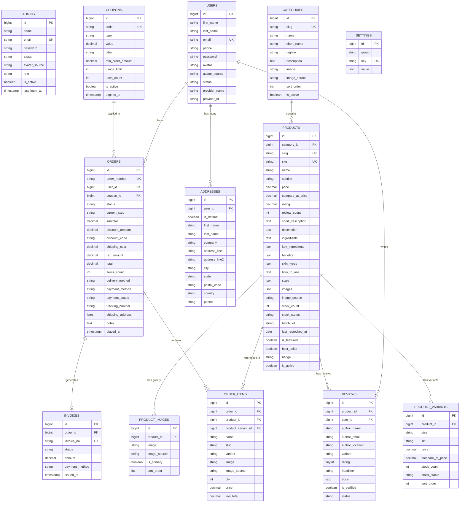

# 06 — Database Schema, Dual-Auth & TNTSearch Architecture

> **AI Agent Context Header**
> - **Project**: The Everbloom (Botanical Skincare E-Commerce — Laravel 12)
> - **Core Architectural Rules**:
>   1. **Separate Tables & Sessions for Admin vs. User**: `admins` table (`App\Models\Admin`, guard `admin`, cookie `everbloom_admin_session`) and `users` table (`App\Models\User`, guard `web`, cookie `everbloom_user_session`).
>   2. **Full-Text Search Engine**: **TNTSearch** via `laravel/scout` and `teamtnt/laravel-scout-tntsearch-driver`.
>   3. **Third-Party Cloud Image Storage + Source Column + WebP Conversion**: Every table that stores an image path also has a companion source column (`image_source` or `avatar_source`, e.g., `'s3'`, `'r2'`, `'spaces'`, `'cloudinary'`, or `'local'` for demo seed assets). All uploaded images are automatically converted to **`.webp`** before being pushed to third-party storage.
>   4. **Zero-Breakage View Compatibility**: Eloquent models implement `ArrayAccess` (native in Laravel Eloquent) and define computed accessors matching the keys in `config/demo/*.php` so existing Storefront and `/admin` Blade views require minimal or zero structural changes.

---

## 1. Entity-Relationship Diagram (ERD)



---

## 2. Dual-Table & Dual-Session Authentication Architecture

### 2.1 Why Separate Tables & Sessions?
- **Table Separation**:
  - `admins` table stores back-office staff (`App\Models\Admin`) with `role` (`super_admin`, `manager`, `fulfillment`), `avatar`, and `is_active`.
  - `users` table stores storefront customers (`App\Models\User`) with `first_name`, `last_name`, `phone`, `status`, and OAuth fields.
- **Session Separation**:
  - By default in Laravel, all `session`-driver guards share the same session cookie (`laravel_session`) and CSRF/session file. If an admin logs out in `/admin/logout` via `$request->session()->invalidate()`, it would also log out their storefront customer session in another tab.
  - To guarantee **100% isolated sessions**, we use a dedicated `IsolateAdminSession` middleware placed **before** `StartSession` in the web middleware stack (or configured via `bootstrap/app.php`) that switches `config(['session.cookie' => ...])` whenever the request path matches `admin` or `admin/*`.

### 2.2 Auth Guards & Providers (`config/auth.php`)
```php
'defaults' => [
    'guard' => env('AUTH_GUARD', 'web'),
    'passwords' => env('AUTH_PASSWORD_BROKER', 'users'),
],

'guards' => [
    'web' => [
        'driver' => 'session',
        'provider' => 'users',
    ],
    'admin' => [
        'driver' => 'session',
        'provider' => 'admins',
    ],
],

'providers' => [
    'users' => [
        'driver' => 'eloquent',
        'model' => App\Models\User::class,
    ],
    'admins' => [
        'driver' => 'eloquent',
        'model' => App\Models\Admin::class,
    ],
],

'passwords' => [
    'users' => [
        'provider' => 'users',
        'table' => env('AUTH_PASSWORD_RESET_TOKEN_TABLE', 'password_reset_tokens'),
        'expire' => 60,
        'throttle' => 60,
    ],
    'admins' => [
        'provider' => 'admins',
        'table' => 'admin_password_reset_tokens',
        'expire' => 60,
        'throttle' => 60,
    ],
],
```

### 2.3 Separate Session Cookie Middleware (`app/Http/Middleware/IsolateAdminSession.php`)
```php
<?php

namespace App\Http\Middleware;

use Closure;
use Illuminate\Http\Request;
use Symfony\Component\HttpFoundation\Response;

class IsolateAdminSession
{
    public function handle(Request $request, Closure $next): Response
    {
        if ($request->is('admin') || $request->is('admin/*')) {
            config([
                'session.cookie' => env('ADMIN_SESSION_COOKIE', 'everbloom_admin_session'),
                'session.path'   => '/admin',
            ]);
        } else {
            config([
                'session.cookie' => env('SESSION_COOKIE', 'everbloom_user_session'),
                'session.path'   => '/',
            ]);
        }

        return $next($request);
    }
}
```
> [!TIP]
> Setting `'session.path' => '/admin'` for the admin cookie ensures the browser **only** sends `everbloom_admin_session` on `/admin*` requests, while `everbloom_user_session` remains completely untouched on storefront routes (`/`). When the database session driver is used (`SESSION_DRIVER=database`), both cookies write their own independent row IDs into the `sessions` table (or separate `admin_sessions` table if desired).

---

## 3. Detailed Table Migration Specifications

### 3.1 `admins` Table (`create_admins_table`)
| Column | Type | Modifiers | Description |
| :--- | :--- | :--- | :--- |
| `id` | `bigIncrements` | PK | Admin ID |
| `name` | `string(120)` | required | Full display name (e.g., `"Clara Vance"`) |
| `email` | `string(191)` | `unique()` | Admin login email (e.g., `admin@the-everbloom.com`) |
| `password` | `string` | required | Bcrypt/Argon2 hashed password |
| `avatar` | `string` | `nullable()` | Stored `.webp` path (e.g., `'avatars/admin-01.webp'`) |
| `avatar_source` | `string(40)` | `default('local')` | Storage provider/disk name (`'local'`, `'s3'`, `'r2'`, `'spaces'`, `'cloudinary'`) |
| `role` | `string(50)` | `default('super_admin')` | `'super_admin'`, `'manager'`, `'support'` |
| `is_active` | `boolean` | `default(true)` | Account enabled status |
| `last_login_at` | `timestamp` | `nullable()` | Audit timestamp |
| `remember_token` | `rememberToken` | `nullable()` | Remember me token |
| `timestamps` | `timestamps` | — | `created_at`, `updated_at` |

### 3.2 `users` Table (`0001_01_01_000000_create_users_table`)
Update the default `users` migration to match customer fields used in `AccountController` and `AdminCustomerController`:
| Column | Type | Modifiers | Description |
| :--- | :--- | :--- | :--- |
| `id` | `bigIncrements` | PK | Customer ID |
| `first_name` | `string(100)` | required | Customer first name |
| `last_name` | `string(100)` | required | Customer last name |
| `email` | `string(191)` | `unique()` | Customer email |
| `phone` | `string(40)` | `nullable()` | Phone number |
| `avatar` | `string` | `nullable()` | Stored `.webp` avatar path |
| `avatar_source` | `string(40)` | `default('local')` | Storage provider/disk name (`'local'`, `'s3'`, `'r2'`, `'spaces'`, `'cloudinary'`) |
| `status` | `string(30)` | `default('Active')` | `'Active'`, `'Inactive'`, `'Blocked'` |
| `provider_name` | `string(40)` | `nullable()` | Socialite provider (`'google'`, `'apple'`) |
| `provider_id` | `string(191)` | `nullable()` | Socialite UID |
| `email_verified_at` | `timestamp` | `nullable()` | Verification timestamp |
| `password` | `string` | required | Hashed password |
| `remember_token` | `rememberToken` | `nullable()` | Remember me token |
| `timestamps` | `timestamps` | — | Used for `member_since` & `join_date` accessors |

### 3.3 `categories` Table (`create_categories_table`)
| Column | Type | Modifiers | Description |
| :--- | :--- | :--- | :--- |
| `id` | `bigIncrements` | PK | Category ID |
| `slug` | `string(120)` | `unique()` | URL slug (e.g., `'face-care'`, `'serums'`) |
| `name` | `string(120)` | required | Display name (e.g., `'Face Care'`) |
| `short_name` | `string(60)` | `nullable()` | Short label (e.g., `'Face'`) |
| `tagline` | `string(255)` | `nullable()` | Card subtitle |
| `description` | `text` | `nullable()` | Full category description |
| `image` | `string` | `nullable()` | Stored `.webp` image path (e.g., `'categories/category-face-care.webp'`) |
| `image_source` | `string(40)` | `default('local')` | Storage provider/disk name (`'local'`, `'s3'`, `'r2'`, `'spaces'`, `'cloudinary'`) |
| `sort_order` | `integer` | `default(0)` | Display order |
| `is_active` | `boolean` | `default(true)` | Visibility toggle |
| `timestamps` | `timestamps` | — | `created_at`, `updated_at` |

### 3.4 `products` & `product_images` Tables (`create_products_table`)
| Column | Type | Modifiers | Description |
| :--- | :--- | :--- | :--- |
| `id` | `bigIncrements` | PK | Product ID |
| `category_id` | `foreignId` | `constrained()->cascadeOnDelete()` | References `categories.id` |
| `slug` | `string(160)` | `unique()` | URL slug (`'botanical-radiance-serum'`) |
| `sku` | `string(60)` | `unique()` | Batch SKU (`'EB-SKU-0001'`) |
| `name` | `string(180)` | required | Product title |
| `subtitle` | `string(255)` | `nullable()` | Optional italic subtitle |
| `price` | `decimal(10,2)` | required | Base retail price |
| `compare_at_price` | `decimal(10,2)` | `nullable()` | Original price before sale |
| `rating` | `decimal(3,2)` | `default(5.00)` | Cached average rating |
| `review_count` | `unsignedInteger` | `default(0)` | Cached count of approved reviews |
| `short_description` | `text` | `nullable()` | Catalogue summary |
| `description` | `text` | `nullable()` | Full editorial description |
| `ingredients` | `text` | `nullable()` | Full INCI ingredient list |
| `key_ingredients` | `json` | `nullable()` | Array of featured botanical actives |
| `benefits` | `json` | `nullable()` | Array of benefit strings |
| `skin_types` | `json` | `nullable()` | Array of skin goals/types (e.g., `["Dry", "Sensitive"]`) |
| `how_to_use` | `text` | `nullable()` | Daily ritual application steps |
| `sizes` | `json` | `nullable()` | Array of size labels (`["30ml / 1.0 fl oz", "50ml / 1.7 fl oz"]`) |
| `images` | `json` | `nullable()` | Array of `.webp` image paths |
| `image_source` | `string(40)` | `default('local')` | Storage provider/disk name (`'local'`, `'s3'`, `'r2'`, `'spaces'`, `'cloudinary'`) |
| `stock_count` | `integer` | `default(25)` | Total stock quantity across batch |
| `min_threshold` | `integer` | `default(10)` | Low-stock warning threshold |
| `stock_status` | `string(30)` | `default('in_stock')` | `'in_stock'`, `'low_stock'`, `'out_of_stock'` |
| `batch_lot` | `string(60)` | `nullable()` | e.g., `'LOT-2026-B1'` |
| `last_restocked_at` | `date` | `nullable()` | Restock date for `/admin/inventory` |
| `is_featured` | `boolean` | `default(false)` | Featured on Homepage |
| `best_seller` | `boolean` | `default(false)` | Featured in "Most Loved Rituals" |
| `badge` | `string(60)` | `nullable()` | `'Bestseller'`, `'Signature'`, `'New'`, etc. |
| `is_active` | `boolean` | `default(true)` | Published on storefront |
| `timestamps` | `timestamps` | — | `created_at`, `updated_at` |

#### `product_images` Table (Normalized Gallery with Per-Image Source)
In addition to the cached `images` + `image_source` columns on `products`, `product_images` tracks individual gallery items so a product can even mix demo (`local`) and newly uploaded third-party (`s3` / `r2`) `.webp` images:
| Column | Type | Modifiers | Description |
| :--- | :--- | :--- | :--- |
| `id` | `bigIncrements` | PK | Gallery image ID |
| `product_id` | `foreignId` | `constrained()->cascadeOnDelete()` | Parent product |
| `image` | `string` | required | `.webp` path in storage (`'products/botanical-radiance-serum-01.webp'`) |
| `image_source` | `string(40)` | `default('s3')` | Storage source name (`'s3'`, `'r2'`, `'spaces'`, `'cloudinary'`, `'local'`) |
| `is_primary` | `boolean` | `default(false)` | Primary thumbnail flag |
| `sort_order` | `integer` | `default(0)` | Gallery display order |
| `timestamps` | `timestamps` | — | `created_at`, `updated_at` |

### 3.5 `product_variants` Table (`create_product_variants_table`)
| Column | Type | Modifiers | Description |
| :--- | :--- | :--- | :--- |
| `id` | `bigIncrements` | PK | Variant ID |
| `product_id` | `foreignId` | `constrained()->cascadeOnDelete()` | Parent product |
| `size` | `string(80)` | required | e.g., `'30ml / 1.0 fl oz'` |
| `sku` | `string(80)` | `nullable()` | Variant-specific SKU |
| `price` | `decimal(10,2)` | required | Variant price |
| `compare_at_price` | `decimal(10,2)` | `nullable()` | Variant compare-at price |
| `stock_count` | `integer` | `default(25)` | Variant stock count |
| `stock_status` | `string(30)` | `default('in_stock')` | `'in_stock'`, `'low_stock'`, `'out_of_stock'` |
| `sort_order` | `integer` | `default(0)` | Ordering |
| `timestamps` | `timestamps` | — | `created_at`, `updated_at` |

### 3.6 `addresses` Table (`create_addresses_table`)
Matches `config/demo/account.php` `addresses` and `frontend/account/addresses.blade.php`:
- `id`, `user_id` (`foreignId` -> `users`), `is_default` (`boolean`), `first_name`, `last_name`, `company` (`nullable`), `address_line1`, `address_line2` (`nullable`), `city`, `state`, `postal_code`, `country`, `phone` (`nullable`), `timestamps`.

### 3.7 `coupons` Table (`create_coupons_table`)
Matches `config/demo/site.php` `demo_discounts` and `AdminCouponController`:
- `id`, `code` (`unique`, uppercase), `type` (`'percentage'`, `'fixed'`, `'shipping'`), `value` (`decimal(10,2)`), `label` (`string`), `min_order_amount` (`decimal(10,2)`, `default(0)`), `usage_limit` (`integer`, `nullable`), `used_count` (`integer`, `default(0)`), `is_active` (`boolean`, `default(true)`), `expires_at` (`timestamp`, `nullable`), `timestamps`.

### 3.8 `orders`, `order_items`, and `invoices` Tables
- **`orders`**:
  - `id`, `order_number` (`unique`, e.g., `'EVB-9204'`), `user_id` (`nullable()->constrained()->nullOnDelete()`), `coupon_id` (`nullable()->constrained()->nullOnDelete()`), `customer_email`, `customer_phone` (`nullable`), `status` (`'Placed'`, `'Processing'`, `'Shipped'`, `'Delivered'`, `'Cancelled'`), `current_step`, `subtotal`, `discount_amount` (`default(0)`), `discount_code` (`nullable`), `shipping_cost` (`default(0)`), `tax_amount` (`default(0)`), `total`, `items_count`, `delivery_method`, `payment_method`, `payment_status` (`default('Paid')`), `tracking_number` (`default('Pending assignment')`), `shipping_address` (`json`), `placed_at` (`timestamp`), `timestamps`.
- **`order_items`**:
  - `id`, `order_id` (`constrained()->cascadeOnDelete()`), `product_id` (`nullable()->constrained()->nullOnDelete()`), `product_variant_id` (`nullable`), `name`, `slug`, `variant` (`nullable`), `image` (`nullable`), `image_source` (`string(40)`, `default('local')`), `qty` (`unsignedInteger`), `price` (`decimal(10,2)`), `line_total` (`decimal(10,2)`), `timestamps`.
- **`invoices`**:
  - `id`, `order_id` (`constrained()->cascadeOnDelete()`), `invoice_no` (`unique`, e.g., `'INV-2026-1001'`), `customer_name`, `customer_email`, `amount` (`decimal(10,2)`), `status` (`default('Paid')`), `payment_method`, `issued_at` (`timestamp`), `timestamps`.

### 3.9 `reviews`, `settings`, `contact_inquiries`, `newsletter_subscribers`
- **`reviews`**: `id`, `product_id` (`constrained()->cascadeOnDelete()`), `user_id` (`nullable()->constrained()->nullOnDelete()`), `author` (`string`), `author_email` (`nullable`), `location` (`nullable`), `variant` (`nullable`), `rating` (`unsignedTinyInteger`), `headline`, `body` (`text`), `verified` (`boolean`, `default(true)`), `is_featured_testimonial` (`boolean`, `default(false)`), `status` (`default('Approved')` — `'Pending'`, `'Approved'`, `'Rejected'`), `timestamps`.
- **`settings`**: `id`, `key` (`unique`, e.g., `'site'`), `value` (`json` storing the full `config('demo.site')` structure so Admin Settings updates persist cleanly), `timestamps`.
- **`contact_inquiries`**: `id`, `name`, `email`, `message` (`text`), `status` (`default('unread')`), `timestamps`.
- **`newsletter_subscribers`**: `id`, `email` (`unique`), `is_active` (`default(true)`), `timestamps`.

---

## 4. TNTSearch Architecture (`laravel/scout` + `teamtnt/laravel-scout-tntsearch-driver`)

### 4.1 Package Installation & Configuration
Install Laravel Scout and the TNTSearch driver:
```bash
composer require laravel/scout teamtnt/laravel-scout-tntsearch-driver
php artisan vendor:publish --provider="Laravel\Scout\ScoutServiceProvider"
```

In `.env`:
```dotenv
SCOUT_DRIVER=tntsearch
SCOUT_QUEUE=false
```

In `config/scout.php`, add the `tntsearch` configuration block:
```php
'tntsearch' => [
    'storage'  => storage_path('search'), // Ensure storage/search directory exists
    'fuzziness' => env('TNTSEARCH_FUZZINESS', true),
    'fuzzy' => [
        'prefix_length' => 2,
        'max_expansions' => 50,
        'distance' => 2,
    ],
    'asYouType' => true,
    'searchBoolean' => env('TNTSEARCH_BOOLEAN', false),
    'maxDocs' => env('TNTSEARCH_MAX_DOCS', 500),
],
```

### 4.2 `App\Models\Product` Searchable Implementation
```php
namespace App\Models;

use Illuminate\Database\Eloquent\Model;
use Laravel\Scout\Searchable;

class Product extends Model
{
    use Searchable;

    public function searchableAs(): string
    {
        return 'products_index';
    }

    public function shouldBeSearchable(): bool
    {
        return (bool) $this->is_active;
    }

    public function toSearchableArray(): array
    {
        $this->loadMissing('categoryRelation');

        return [
            'id'                => $this->id,
            'name'              => $this->name,
            'slug'              => $this->slug,
            'sku'               => $this->sku,
            'category'          => $this->categoryRelation?->name ?? '',
            'short_description' => $this->short_description,
            'description'       => $this->description,
            'ingredients'       => $this->ingredients,
            'skin_types'        => is_array($this->skin_types) ? implode(' ', $this->skin_types) : '',
            'benefits'          => is_array($this->benefits) ? implode(' ', $this->benefits) : '',
            'badge'             => $this->badge,
        ];
    }
}
```

### 4.3 How TNTSearch Powers Both Storefront & Admin
1. **Storefront Instant Search Modal (`components/storefront/search-modal.blade.php`)**:
   - Endpoint: `GET /search?q={query}` (`SearchController@index`).
   - Executes `Product::search($q)->get()` (or filters active products matching the returned IDs with their `categoryRelation` and `variants`), returning JSON formatted identically to `config('demo.products')`.
   - In `resources/js/app.js`, `searchModal` debounces input (`200ms`) and fetches `/search?q=...` so fuzzy, typo-tolerant TNTSearch results appear live as the customer types!
2. **Storefront Shop Catalogue (`GET /shop?search={query}`)**:
   - When `?search=` is present on `/shop`, `ShopController@index` retrieves matching product IDs via `Product::search($request->search)->keys()` and applies Eloquent filters (`category`, `skin_types`, `stock_status`, `sort`) and pagination on top of those IDs.
3. **Admin Product Catalogue (`GET /admin/products?search={query}`)**:
   - `AdminProductController@index` uses `Product::search($request->search)->keys()` to filter the admin product list instantaneously.
4. **Automatic Index Sync**:
   - Because `SCOUT_QUEUE=false`, every time an admin creates, updates, or deletes a product in `AdminProductController`, Laravel Scout automatically updates `storage/search/products_index.index` in real time.

---

## 5. Third-Party Cloud Storage, `image_source` Column & WebP Conversion Architecture

### 5.1 Storage Source Column Rule
Whenever an image is saved in the database, **two columns** are persisted:
1. **Path Column (`image` / `images` / `avatar`)**: Stores the relative `.webp` object key (e.g., `'products/botanical-radiance-serum-01.webp'`, `'categories/face-care.webp'`, `'avatars/user-12.webp'`).
2. **Source Column (`image_source` / `avatar_source`)**: Stores the identifier of the storage disk/provider where the file resides:
   - `'s3'` (Amazon S3 / AWS-compatible object storage)
   - `'r2'` (Cloudflare R2)
   - `'spaces'` (DigitalOcean Spaces)
   - `'cloudinary'` (Cloudinary)
   - `'local'` (Seeded demo files inside `public/images/` or `public/admin/assets/images/`)

### 5.2 Packages Required for Third-Party Storage & WebP Conversion
```bash
composer require league/flysystem-aws-s3-v3 "^3.0" intervention/image-laravel "^1.3"
```
Configure the default third-party media disk in `.env` and `config/filesystems.php`:
```dotenv
FILESYSTEM_CLOUD_DISK=s3
AWS_ACCESS_KEY_ID=your-key
AWS_SECRET_ACCESS_KEY=your-secret
AWS_DEFAULT_REGION=us-east-1
AWS_BUCKET=everbloom-media
AWS_URL=https://cdn.the-everbloom.com
AWS_ENDPOINT=
```

### 5.3 Centralized WebP Upload & URL Resolver Service (`app/Services/ImageStorageService.php`)
All image uploads across Admin and Customer Profile controllers use `ImageStorageService`:

```php
<?php

namespace App\Services;

use Illuminate\Http\UploadedFile;
use Illuminate\Support\Facades\Storage;
use Illuminate\Support\Str;
use Intervention\Image\Laravel\Facades\Image;

class ImageStorageService
{
    /**
     * Convert an uploaded image to WebP and store it on the configured third-party disk.
     *
     * @return array{path: string, source: string, url: string}
     */
    public function uploadAsWebp(
        UploadedFile $file,
        string $directory = 'products',
        ?string $customName = null,
        int $quality = 85,
        ?string $disk = null
    ): array {
        $sourceDisk = $disk ?: config('filesystems.cloud', env('FILESYSTEM_CLOUD_DISK', 's3'));

        $baseName = $customName
            ? Str::slug($customName) . '-' . Str::lower(Str::random(6))
            : Str::uuid()->toString();

        $relativePath = trim($directory, '/') . '/' . $baseName . '.webp';

        // Convert any input format (JPG, PNG, AVIF, GIF, WebP) to WebP binary
        $encodedWebp = Image::read($file->getRealPath())
            ->scaleDown(width: 1600, height: 2000)
            ->toWebp($quality);

        Storage::disk($sourceDisk)->put($relativePath, (string) $encodedWebp, 'public');

        return [
            'path'   => $relativePath,
            'source' => $sourceDisk,
            'url'    => $this->resolveUrl($relativePath, $sourceDisk),
        ];
    }

    /**
     * Resolve the public URL of an image based on its path and image_source column.
     */
    public function resolveUrl(?string $path, ?string $source = 'local'): string
    {
        if (empty($path)) {
            return '';
        }

        if (Str::startsWith($path, ['http://', 'https://'])) {
            return $path;
        }

        $source = $source ?: 'local';

        if ($source === 'local') {
            $clean = ltrim($path, '/');
            if (Str::startsWith($clean, ['images/', 'admin/'])) {
                return asset($clean);
            }
            return asset('images/' . $clean);
        }

        return Storage::disk($source)->url($path);
    }

    /**
     * Delete an image from its recorded third-party source disk (never deletes seeded 'local' demo assets).
     */
    public function delete(?string $path, ?string $source = null): void
    {
        if (empty($path) || empty($source) || $source === 'local') {
            return;
        }

        Storage::disk($source)->delete($path);
    }
}
```

### 5.4 Updating `<x-storefront.image />` & Alpine Views for Third-Party WebP URLs
1. **`resources/views/components/storefront/image.blade.php`**:
   - Add `'source' => null` prop.
   - If `$src` starts with `http://` or `https://` (or `$source` is a third-party disk like `'s3'`), resolve `$imageUrl = app(\App\Services\ImageStorageService::class)->resolveUrl($src, $source)` and set `$fileExists = true` without calling `file_exists(public_path(...))`.
2. **Alpine Dynamic Image Bindings (`cart-drawer.blade.php`, `cart/index.blade.php`, `checkout/index.blade.php`, `search-modal.blade.php`, `wishlist.blade.php`)**:
   - When Eloquent serializes `Product` for `#everbloom-products-data` and `#everbloom-search-data`, resolve each image via `ImageStorageService::resolveUrl($img, $this->image_source)` (or provide a helper `resolveImageUrl(item.image)` in `resources/js/app.js` that returns `item.image` directly if it starts with `http://`, `https://`, or `/`, otherwise prefixes `'/images/' + item.image`).
   - This guarantees both local seeded images (`products/botanical-radiance-serum-01.jpg`) and third-party cloud `.webp` URLs (`https://cdn.the-everbloom.com/products/botanical-radiance-serum-01.webp`) render everywhere without broken URLs.


