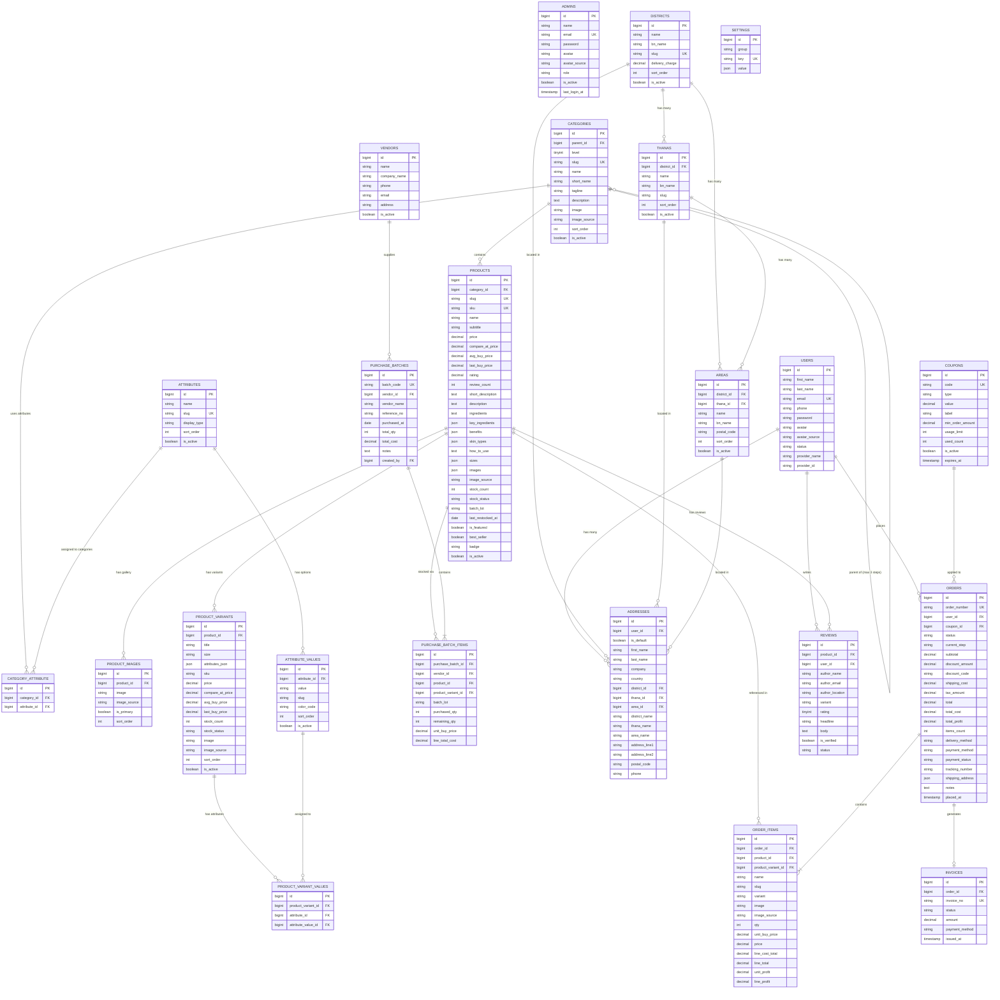

# 06 — Database Schema, Dual-Auth & TNTSearch Architecture

> **AI Agent Context Header**
> - **Project**: The Everbloom (Botanical Skincare E-Commerce — Laravel 12)
> - **Core Architectural Rules**:
>   1. **Separate Tables & Sessions for Admin vs. User**: `admins` table (`App\Models\Admin`, guard `admin`, cookie `everbloom_admin_session`) and `users` table (`App\Models\User`, guard `web`, cookie `everbloom_user_session`).
>   2. **Full-Text Search Engine**: **TNTSearch** via `laravel/scout` and `teamtnt/laravel-scout-tntsearch-driver`.
>   3. **Third-Party Cloud Image Storage + Source Column + WebP Conversion**: Every table that stores an image path also has a companion source column (`image_source` or `avatar_source`, e.g., `'s3'`, `'r2'`, `'spaces'`, `'cloudinary'`, or `'local'` for demo seed assets). All uploaded images are automatically converted to **`.webp`** before being pushed to third-party storage.
>   4. **Bangladesh Location Hierarchy (`Country = Bangladesh` -> `District` -> `Thana` -> `Area`)**: Country is always **Bangladesh**. Districts, Thanas, and Areas are stored in database tables (`districts`, `thanas`, `areas`) populated via `BangladeshLocationSeeder`. Customers select District -> Thana -> Area sequentially on Checkout and Address pages, and Admins can **rename** or **enable/disable (`is_active`)** any District, Thana, or Area in `/admin/locations`.
>   5. **Wholesale Purchase Batches, Available-Stock Weighted Average Price & Order Profit Tracking**: Admin buys products wholesale by **Vendor Name** (`vendors`) and **Batch** (`purchase_batches` & `purchase_batch_items`). When a new batch is added for an existing product, `avg_buy_price` is calculated **strictly from currently available stock (`stock_count`) + new batch quantity** (already-sold units never dilute or skew the current average cost). When an order is received, `order_items` and `orders` snapshot the buy cost and display exact per-item and per-order **Profit** in `/admin`.
>   6. **3-Step Category Hierarchy & Category-Driven Multi-Attribute Product Variants + Optional Variant Image**:
>      - Categories support a **maximum 3-step hierarchy** (`level = 1` Main Category -> `level = 2` Subcategory -> `level = 3` Child Category via `parent_id`).
>      - Attributes (`Brand`, `Size`, `Color`, `SPF`, `Scent`, etc.) are assigned to Categories via `category_attribute` (with inheritance from parent categories). When a Category is selected on `/admin/products/create`, only that Category's attributes are displayed in the Variant Builder, and each variant can optionally attach a `.webp` image (`image` + `image_source`).
>   7. **Separated Operational Dashboard (`/admin`) & Dedicated Financial Menu (`/admin/financial`)**:
>      - `/admin` displays common store operational metrics (`Orders`, `Customers`, `Active SKUs`, `Low Stock`, `Recent Orders`).
>      - `/admin/financial` provides a dedicated Financial Analytics & Profit Ledger view with Date Range, Category, Vendor, and Order Status filters built with Larkon components from `docs/admin-dashboard/`.
>   8. **Dynamic Website Currency (`Taka ৳ / BDT`, `Dollar $ / USD`, `Pound £ / GBP`, `Euro € / EUR`, etc.)**: Currency is never hardcoded to `$` or `USD`. Admin selects or customizes the store currency (`code`, `symbol`, `name`, `position`) in `/admin/settings`, and `AppServiceProvider` shares `$currencySymbol` and `$currencyCode` globally across all Storefront, Alpine.js, JSON-LD, and Admin Panel views.
>   9. **Zero-Breakage View Compatibility**: Eloquent models implement `ArrayAccess` (native in Laravel Eloquent) and define computed accessors matching the keys in `config/demo/*.php` so existing Storefront and `/admin` Blade views require minimal or zero structural changes.

---

## 1. Entity-Relationship Diagram (ERD)



---

## 2. Dual-Table & Dual-Session Authentication Architecture

### 2.1 Why Separate Tables & Sessions?
- **Table Separation**:
  - `admins` table stores back-office staff (`App\Models\Admin`) with `role` (`super_admin`, `manager`, `fulfillment`), `avatar`, and `is_active`.
  - `users` table stores storefront customers (`App\Models\User`) with `first_name`, `last_name`, `phone`, `status`, and OAuth fields.
- **Session Separation**:
  - By default in Laravel, all `session`-driver guards share the same session cookie (`laravel_session`) and CSRF/session file. If an admin logs out in `/admin/logout` via `$request->session()->invalidate()`, it would also log out their storefront customer session in another tab.
  - To guarantee **100% isolated sessions**, we use a dedicated `IsolateAdminSession` middleware placed **before** `StartSession` in the web middleware stack (or configured via `bootstrap/app.php`) that switches `config(['session.cookie' => ...])` whenever the request path matches `admin` or `admin/*`.

### 2.2 Auth Guards & Providers (`config/auth.php`)
```php
'defaults' => [
    'guard' => env('AUTH_GUARD', 'web'),
    'passwords' => env('AUTH_PASSWORD_BROKER', 'users'),
],

'guards' => [
    'web' => [
        'driver' => 'session',
        'provider' => 'users',
    ],
    'admin' => [
        'driver' => 'session',
        'provider' => 'admins',
    ],
],

'providers' => [
    'users' => [
        'driver' => 'eloquent',
        'model' => App\Models\User::class,
    ],
    'admins' => [
        'driver' => 'eloquent',
        'model' => App\Models\Admin::class,
    ],
],

'passwords' => [
    'users' => [
        'provider' => 'users',
        'table' => env('AUTH_PASSWORD_RESET_TOKEN_TABLE', 'password_reset_tokens'),
        'expire' => 60,
        'throttle' => 60,
    ],
    'admins' => [
        'provider' => 'admins',
        'table' => 'admin_password_reset_tokens',
        'expire' => 60,
        'throttle' => 60,
    ],
],
```

### 2.3 Separate Session Cookie Middleware (`app/Http/Middleware/IsolateAdminSession.php`)
```php
<?php

namespace App\Http\Middleware;

use Closure;
use Illuminate\Http\Request;
use Symfony\Component\HttpFoundation\Response;

class IsolateAdminSession
{
    public function handle(Request $request, Closure $next): Response
    {
        if ($request->is('admin') || $request->is('admin/*')) {
            config([
                'session.cookie' => env('ADMIN_SESSION_COOKIE', 'everbloom_admin_session'),
                'session.path'   => '/admin',
            ]);
        } else {
            config([
                'session.cookie' => env('SESSION_COOKIE', 'everbloom_user_session'),
                'session.path'   => '/',
            ]);
        }

        return $next($request);
    }
}
```
> [!TIP]
> Setting `'session.path' => '/admin'` for the admin cookie ensures the browser **only** sends `everbloom_admin_session` on `/admin*` requests, while `everbloom_user_session` remains completely untouched on storefront routes (`/`). When the database session driver is used (`SESSION_DRIVER=database`), both cookies write their own independent row IDs into the `sessions` table (or separate `admin_sessions` table if desired).

---

## 3. Detailed Table Migration Specifications

### 3.1 `admins` Table (`create_admins_table`)
| Column | Type | Modifiers | Description |
| :--- | :--- | :--- | :--- |
| `id` | `bigIncrements` | PK | Admin ID |
| `name` | `string(120)` | required | Full display name (e.g., `"Clara Vance"`) |
| `email` | `string(191)` | `unique()` | Admin login email (e.g., `admin@the-everbloom.com`) |
| `password` | `string` | required | Bcrypt/Argon2 hashed password |
| `avatar` | `string` | `nullable()` | Stored `.webp` path (e.g., `'avatars/admin-01.webp'`) |
| `avatar_source` | `string(40)` | `default('local')` | Storage provider/disk name (`'local'`, `'s3'`, `'r2'`, `'spaces'`, `'cloudinary'`) |
| `role` | `string(50)` | `default('super_admin')` | `'super_admin'`, `'manager'`, `'support'` |
| `is_active` | `boolean` | `default(true)` | Account enabled status |
| `last_login_at` | `timestamp` | `nullable()` | Audit timestamp |
| `remember_token` | `rememberToken` | `nullable()` | Remember me token |
| `timestamps` | `timestamps` | — | `created_at`, `updated_at` |

### 3.2 `users` Table (`0001_01_01_000000_create_users_table`)
Update the default `users` migration to match customer fields used in `AccountController` and `AdminCustomerController`:
| Column | Type | Modifiers | Description |
| :--- | :--- | :--- | :--- |
| `id` | `bigIncrements` | PK | Customer ID |
| `first_name` | `string(100)` | required | Customer first name |
| `last_name` | `string(100)` | required | Customer last name |
| `email` | `string(191)` | `unique()` | Customer email |
| `phone` | `string(40)` | `nullable()` | Phone number |
| `avatar` | `string` | `nullable()` | Stored `.webp` avatar path |
| `avatar_source` | `string(40)` | `default('local')` | Storage provider/disk name (`'local'`, `'s3'`, `'r2'`, `'spaces'`, `'cloudinary'`) |
| `status` | `string(30)` | `default('Active')` | `'Active'`, `'Inactive'`, `'Blocked'` |
| `provider_name` | `string(40)` | `nullable()` | Socialite provider (`'google'`, `'apple'`) |
| `provider_id` | `string(191)` | `nullable()` | Socialite UID |
| `email_verified_at` | `timestamp` | `nullable()` | Verification timestamp |
| `password` | `string` | required | Hashed password |
| `remember_token` | `rememberToken` | `nullable()` | Remember me token |
| `timestamps` | `timestamps` | — | Used for `member_since` & `join_date` accessors |

### 3.3 `categories` & `category_attribute` Tables (3-Step Hierarchy & Category-Scoped Attributes)
| Column | Type | Modifiers | Description |
| :--- | :--- | :--- | :--- |
| `id` | `bigIncrements` | PK | Category ID |
| `parent_id` | `foreignId` | `nullable()->constrained('categories')->nullOnDelete()` | Parent Category ID (`null` for Step 1 Root Category) |
| `level` | `unsignedTinyInteger` | `default(1)` | **Hierarchy Depth (`1`, `2`, or `3` max)**: `1 = Main Category`, `2 = Subcategory`, `3 = Child Category` |
| `slug` | `string(120)` | `unique()` | URL slug (e.g., `'face-care'`, `'serums'`) |
| `name` | `string(120)` | required | Display name (e.g., `'Face Care'`) |
| `short_name` | `string(60)` | `nullable()` | Short label (e.g., `'Face'`) |
| `tagline` | `string(255)` | `nullable()` | Card subtitle |
| `description` | `text` | `nullable()` | Full category description |
| `image` | `string` | `nullable()` | Stored `.webp` image path (e.g., `'categories/category-face-care.webp'`) |
| `image_source` | `string(40)` | `default('local')` | Storage provider/disk name (`'local'`, `'s3'`, `'r2'`, `'spaces'`, `'cloudinary'`) |
| `sort_order` | `integer` | `default(0)` | Display order |
| `is_active` | `boolean` | `default(true)` | Visibility toggle |
| `timestamps` | `timestamps` | — | `created_at`, `updated_at` |

#### `category_attribute` Pivot Table (`create_category_attribute_table`)
Links `Category` records to the `Attribute` records (`Brand`, `Size`, `Color`, `SPF`, `Skin Type`, etc.) that should appear when creating or editing a product in that category:
| Column | Type | Modifiers | Description |
| :--- | :--- | :--- | :--- |
| `id` | `bigIncrements` | PK | Pivot ID |
| `category_id` | `foreignId` | `constrained('categories')->cascadeOnDelete()` | Category (`level` 1, 2, or 3) |
| `attribute_id` | `foreignId` | `constrained('attributes')->cascadeOnDelete()` | Attribute assigned to this Category |
| `timestamps` | `timestamps` | — | `created_at`, `updated_at` |
> [!NOTE]
> **Attribute Inheritance Across 3 Category Steps**: When a user selects a Level 3 Child Category (or Level 2 Subcategory) on the Create Product page, `Category::effectiveAttributes()` returns the union of attributes assigned to the selected category **plus** any attributes assigned to its parent/root category (or attributes with no specific category restriction).

### 3.4 `products` & `product_images` Tables (`create_products_table`)
| Column | Type | Modifiers | Description |
| :--- | :--- | :--- | :--- |
| `id` | `bigIncrements` | PK | Product ID |
| `category_id` | `foreignId` | `constrained()->cascadeOnDelete()` | References `categories.id` |
| `slug` | `string(160)` | `unique()` | URL slug (`'botanical-radiance-serum'`) |
| `sku` | `string(60)` | `unique()` | Batch SKU (`'EB-SKU-0001'`) |
| `name` | `string(180)` | required | Product title |
| `subtitle` | `string(255)` | `nullable()` | Optional italic subtitle |
| `price` | `decimal(10,2)` | required | Base retail selling price |
| `compare_at_price` | `decimal(10,2)` | `nullable()` | Original price before sale |
| `avg_buy_price` | `decimal(10,2)` | `default(0.00)` | **Weighted Average Wholesale Buy Price** of currently available stock (`stock_count`) |
| `last_buy_price` | `decimal(10,2)` | `default(0.00)` | Wholesale unit buy price from the most recent batch |
| `rating` | `decimal(3,2)` | `default(5.00)` | Cached average rating |
| `review_count` | `unsignedInteger` | `default(0)` | Cached count of approved reviews |
| `short_description` | `text` | `nullable()` | Catalogue summary |
| `description` | `text` | `nullable()` | Full editorial description |
| `ingredients` | `text` | `nullable()` | Full INCI ingredient list |
| `key_ingredients` | `json` | `nullable()` | Array of featured botanical actives |
| `benefits` | `json` | `nullable()` | Array of benefit strings |
| `skin_types` | `json` | `nullable()` | Array of skin goals/types (e.g., `["Dry", "Sensitive"]`) |
| `how_to_use` | `text` | `nullable()` | Daily ritual application steps |
| `sizes` | `json` | `nullable()` | Array of size labels (`["30ml / 1.0 fl oz", "50ml / 1.7 fl oz"]`) |
| `images` | `json` | `nullable()` | Array of `.webp` image paths |
| `image_source` | `string(40)` | `default('local')` | Storage provider/disk name (`'local'`, `'s3'`, `'r2'`, `'spaces'`, `'cloudinary'`) |
| `stock_count` | `integer` | `default(25)` | Total stock quantity across batch |
| `min_threshold` | `integer` | `default(10)` | Low-stock warning threshold |
| `stock_status` | `string(30)` | `default('in_stock')` | `'in_stock'`, `'low_stock'`, `'out_of_stock'` |
| `batch_lot` | `string(60)` | `nullable()` | e.g., `'LOT-2026-B1'` |
| `last_restocked_at` | `date` | `nullable()` | Restock date for `/admin/inventory` |
| `is_featured` | `boolean` | `default(false)` | Featured on Homepage |
| `best_seller` | `boolean` | `default(false)` | Featured in "Most Loved Rituals" |
| `badge` | `string(60)` | `nullable()` | `'Bestseller'`, `'Signature'`, `'New'`, etc. |
| `is_active` | `boolean` | `default(true)` | Published on storefront |
| `timestamps` | `timestamps` | — | `created_at`, `updated_at` |

#### `product_images` Table (Normalized Gallery with Per-Image Source)
In addition to the cached `images` + `image_source` columns on `products`, `product_images` tracks individual gallery items so a product can even mix demo (`local`) and newly uploaded third-party (`s3` / `r2`) `.webp` images:
| Column | Type | Modifiers | Description |
| :--- | :--- | :--- | :--- |
| `id` | `bigIncrements` | PK | Gallery image ID |
| `product_id` | `foreignId` | `constrained()->cascadeOnDelete()` | Parent product |
| `image` | `string` | required | `.webp` path in storage (`'products/botanical-radiance-serum-01.webp'`) |
| `image_source` | `string(40)` | `default('s3')` | Storage source name (`'s3'`, `'r2'`, `'spaces'`, `'cloudinary'`, `'local'`) |
| `is_primary` | `boolean` | `default(false)` | Primary thumbnail flag |
| `sort_order` | `integer` | `default(0)` | Gallery display order |
| `timestamps` | `timestamps` | — | `created_at`, `updated_at` |

### 3.5 `attributes`, `attribute_values`, `product_variants` & `product_variant_values` Tables

#### `attributes` Table (`create_attributes_and_variant_values_tables`)
Stores dynamic variant attribute types (`Brand`, `Size`, `Color`, `Scent`, `Finish`, `Pack Size`, etc.):
| Column | Type | Modifiers | Description |
| :--- | :--- | :--- | :--- |
| `id` | `bigIncrements` | PK | Attribute ID |
| `name` | `string(100)` | required | Display name (e.g., `'Brand'`, `'Size'`, `'Color'`) |
| `slug` | `string(100)` | `unique()` | URL/lookup slug (`'brand'`, `'size'`, `'color'`) |
| `display_type` | `string(30)` | `default('button')` | `'button'`, `'color_swatch'`, `'dropdown'` |
| `sort_order` | `integer` | `default(0)` | Ordering in Admin & Storefront |
| `is_active` | `boolean` | `default(true)` | Active toggle |
| `timestamps` | `timestamps` | — | `created_at`, `updated_at` |

#### `attribute_values` Table (`create_attributes_and_variant_values_tables`)
Stores selectable values for each attribute (e.g., `Size` -> `'30ml / 1.0 fl oz'`, `'50ml / 1.7 fl oz'`; `Color` -> `'Amber Glass'`, `'Frosted Ivory'`; `Brand` -> `'The Everbloom'`):
| Column | Type | Modifiers | Description |
| :--- | :--- | :--- | :--- |
| `id` | `bigIncrements` | PK | Attribute Value ID |
| `attribute_id` | `foreignId` | `constrained('attributes')->cascadeOnDelete()` | Parent Attribute |
| `value` | `string(120)` | required | Option label (e.g., `'50ml / 1.7 fl oz'`, `'Amber Glass'`) |
| `slug` | `string(140)` | `index()` | Slug |
| `color_code` | `string(20)` | `nullable()` | Optional hex color (e.g., `'#8B5A2B'`) when `display_type === 'color_swatch'` |
| `sort_order` | `integer` | `default(0)` | Display order |
| `is_active` | `boolean` | `default(true)` | Active toggle |
| `timestamps` | `timestamps` | — | `created_at`, `updated_at` |

#### `product_variants` Table (`create_products_and_variants_tables`)
Stores each product variant with multi-attribute combinations AND an **optional per-variant WebP image**:
| Column | Type | Modifiers | Description |
| :--- | :--- | :--- | :--- |
| `id` | `bigIncrements` | PK | Variant ID |
| `product_id` | `foreignId` | `constrained()->cascadeOnDelete()` | Parent product |
| `title` | `string(180)` | required | Composite variant label (e.g., `'30ml / 1.0 fl oz'` or `'50ml / Amber Glass / The Everbloom'`) |
| `size` | `string(180)` | required | Synced with `title` for backward compatibility with existing storefront views |
| `attributes_json` | `json` | `nullable()` | Key-value map of attributes for this variant, e.g., `{"Brand": "The Everbloom", "Size": "50ml / 1.7 fl oz", "Color": "Amber Glass"}` |
| `sku` | `string(80)` | `nullable()` | Variant-specific SKU |
| `price` | `decimal(10,2)` | required | Variant retail price |
| `compare_at_price` | `decimal(10,2)` | `nullable()` | Variant compare-at price |
| `avg_buy_price` | `decimal(10,2)` | `default(0.00)` | Weighted average wholesale buy cost for this variant's available stock |
| `last_buy_price` | `decimal(10,2)` | `default(0.00)` | Latest wholesale unit buy price |
| `stock_count` | `integer` | `default(25)` | Variant stock count |
| `stock_status` | `string(30)` | `default('in_stock')` | `'in_stock'`, `'low_stock'`, `'out_of_stock'` |
| `image` | `string` | `nullable()` | **Optional variant-specific `.webp` image path** (e.g., `'products/variants/serum-50ml-amber.webp'`) |
| `image_source` | `string(40)` | `default('local')` | Companion storage provider column (`'s3'`, `'r2'`, `'spaces'`, `'cloudinary'`, `'local'`) |
| `sort_order` | `integer` | `default(0)` | Ordering |
| `is_active` | `boolean` | `default(true)` | Active toggle |
| `timestamps` | `timestamps` | — | `created_at`, `updated_at` |

#### `product_variant_values` Pivot Table (`create_attributes_and_variant_values_tables`)
Links each `ProductVariant` to its relational `Attribute` and `AttributeValue` rows for structured filtering:
| Column | Type | Modifiers | Description |
| :--- | :--- | :--- | :--- |
| `id` | `bigIncrements` | PK | Row ID |
| `product_variant_id` | `foreignId` | `constrained('product_variants')->cascadeOnDelete()` | Variant |
| `attribute_id` | `foreignId` | `constrained('attributes')->cascadeOnDelete()` | Attribute (`Brand`, `Size`, `Color`, etc.) |
| `attribute_value_id` | `foreignId` | `constrained('attribute_values')->cascadeOnDelete()` | Selected Value |

### 3.6 `districts`, `thanas`, `areas` & `addresses` Tables (Bangladesh Cascading Location System)

#### `districts` Table (`create_bangladesh_locations_tables`)
| Column | Type | Modifiers | Description |
| :--- | :--- | :--- | :--- |
| `id` | `bigIncrements` | PK | District ID |
| `name` | `string(120)` | required | English name (e.g., `'Dhaka'`, `'Chattogram'`) — **Editable by Admin** |
| `bn_name` | `string(120)` | `nullable()` | Bangla name (e.g., `'ঢাকা'`) — **Editable by Admin** |
| `slug` | `string(120)` | `unique()` | URL/lookup slug (`'dhaka'`) |
| `delivery_charge` | `decimal(10,2)` | `nullable()` | Optional district-level shipping fee override |
| `sort_order` | `integer` | `default(0)` | Custom ordering (e.g., Dhaka first) |
| `is_active` | `boolean` | `default(true)` | **Admin Enable/Disable toggle** (`true` = visible on Checkout/Addresses) |
| `timestamps` | `timestamps` | — | `created_at`, `updated_at` |

#### `thanas` Table (`create_bangladesh_locations_tables`)
| Column | Type | Modifiers | Description |
| :--- | :--- | :--- | :--- |
| `id` | `bigIncrements` | PK | Thana / Upazila ID |
| `district_id` | `foreignId` | `constrained('districts')->cascadeOnDelete()` | Parent District |
| `name` | `string(120)` | required | Thana name (e.g., `'Gulshan'`, `'Dhanmondi'`, `'Uttara'`) — **Editable by Admin** |
| `bn_name` | `string(120)` | `nullable()` | Bangla name |
| `slug` | `string(140)` | `index()` | Slug |
| `sort_order` | `integer` | `default(0)` | Display order |
| `is_active` | `boolean` | `default(true)` | **Admin Enable/Disable toggle** |
| `timestamps` | `timestamps` | — | `created_at`, `updated_at` |

#### `areas` Table (`create_bangladesh_locations_tables`)
| Column | Type | Modifiers | Description |
| :--- | :--- | :--- | :--- |
| `id` | `bigIncrements` | PK | Area / Locality ID |
| `district_id` | `foreignId` | `constrained('districts')->cascadeOnDelete()` | Parent District |
| `thana_id` | `foreignId` | `constrained('thanas')->cascadeOnDelete()` | Parent Thana |
| `name` | `string(150)` | required | Area name (e.g., `'Gulshan 2'`, `'Banani DOHS'`, `'Dhanmondi Road 27'`) — **Editable by Admin** |
| `bn_name` | `string(150)` | `nullable()` | Bangla name |
| `postal_code` | `string(20)` | `nullable()` | Optional postal code (e.g., `'1212'`, `'1209'`) |
| `sort_order` | `integer` | `default(0)` | Display order |
| `is_active` | `boolean` | `default(true)` | **Admin Enable/Disable toggle** |
| `timestamps` | `timestamps` | — | `created_at`, `updated_at` |

#### `addresses` Table (`create_addresses_table`)
Stores customer saved addresses with **Bangladesh** as the fixed country and foreign keys + snapshot names for `District -> Thana -> Area`:
- `id`, `user_id` (`foreignId` -> `users`), `is_default` (`boolean`, `default(false)`), `first_name`, `last_name`, `company` (`nullable`), `country` (`string(60)`, `default('Bangladesh')`), `district_id` (`foreignId` -> `districts`, `nullable()->nullOnDelete()`), `thana_id` (`foreignId` -> `thanas`, `nullable()->nullOnDelete()`), `area_id` (`foreignId` -> `areas`, `nullable()->nullOnDelete()`), `district_name` (`string`), `thana_name` (`string`), `area_name` (`string`), `address_line1` (House/Road/Block), `address_line2` (`nullable`, Apt/Floor), `postal_code` (`nullable`), `phone`, `timestamps`.
- **Compatibility Accessors on `Address` Model**: `getCityAttribute()` returns `$this->thana?->name ?? $this->thana_name`, `getStateAttribute()` returns `$this->district?->name ?? $this->district_name` so any existing order/invoice templates referencing `city` or `state` work out-of-the-box alongside `district_name`, `thana_name`, and `area_name`.

### 3.7 `coupons` Table (`create_coupons_table`)
Matches `config/demo/site.php` `demo_discounts` and `AdminCouponController`:
- `id`, `code` (`unique`, uppercase), `type` (`'percentage'`, `'fixed'`, `'shipping'`), `value` (`decimal(10,2)`), `label` (`string`), `min_order_amount` (`decimal(10,2)`, `default(0)`), `usage_limit` (`integer`, `nullable`), `used_count` (`integer`, `default(0)`), `is_active` (`boolean`, `default(true)`), `expires_at` (`timestamp`, `nullable`), `timestamps`.

### 3.8 `orders`, `order_items`, `invoices`, `vendors`, `purchase_batches`, and `purchase_batch_items` Tables
- **`vendors`**:
  - `id`, `name` (Vendor Name, e.g. `'Botanical Extracts Co.'`), `company_name` (`nullable`), `phone` (`nullable`), `email` (`nullable`), `address` (`nullable`), `is_active` (`boolean`, `default(true)`), `timestamps`.
- **`purchase_batches`**:
  - `id`, `batch_code` (`unique`, e.g. `'BATCH-2026-0001'`), `vendor_id` (`foreignId` -> `vendors`), `vendor_name` (`string`), `reference_no` (`nullable`), `purchased_at` (`date`), `total_qty` (`unsignedInteger`), `total_cost` (`decimal(12,2)`), `notes` (`nullable`), `created_by` (`nullable`, `foreignId` -> `admins`), `timestamps`.
- **`purchase_batch_items`**:
  - `id`, `purchase_batch_id` (`foreignId` -> `purchase_batches`, `cascadeOnDelete()`), `vendor_id` (`foreignId` -> `vendors`), `product_id` (`foreignId` -> `products`, `cascadeOnDelete()`), `product_variant_id` (`nullable`, `foreignId` -> `product_variants`, `nullOnDelete()`), `batch_lot` (`string`, e.g. `'LOT-2026-B01'`), `purchased_qty` (`unsignedInteger`), `remaining_qty` (`unsignedInteger` — currently available unsold units from this batch), `unit_buy_price` (`decimal(10,2)`), `line_total_cost` (`decimal(12,2)`), `timestamps`.
- **`orders`**:
  - `id`, `order_number` (`unique`, e.g., `'EVB-9204'`), `user_id` (`nullable()->constrained()->nullOnDelete()`), `coupon_id` (`nullable()->constrained()->nullOnDelete()`), `customer_email`, `customer_phone` (`nullable`), `status` (`'Placed'`, `'Processing'`, `'Shipped'`, `'Delivered'`, `'Cancelled'`), `current_step`, `subtotal`, `discount_amount` (`default(0)`), `discount_code` (`nullable`), `shipping_cost` (`default(0)`), `tax_amount` (`default(0)`), `total`, `total_cost` (`decimal(10,2)`, `default(0)` — sum of `order_items.line_cost_total`), `total_profit` (`decimal(10,2)`, `default(0)` — `(subtotal - discount_amount) - total_cost`), `items_count`, `delivery_method`, `payment_method`, `payment_status` (`default('Paid')`), `tracking_number` (`default('Pending assignment')`), `shipping_address` (`json`), `placed_at` (`timestamp`), `timestamps`.
- **`order_items`**:
  - `id`, `order_id` (`constrained()->cascadeOnDelete()`), `product_id` (`nullable()->constrained()->nullOnDelete()`), `product_variant_id` (`nullable`), `name`, `slug`, `variant` (`nullable`), `image` (`nullable`), `image_source` (`string(40)`, `default('local')`), `qty` (`unsignedInteger`), `unit_buy_price` (`decimal(10,2)`, `default(0)` — snapshot of product `avg_buy_price` at time of order), `price` (`decimal(10,2)` — selling price), `line_cost_total` (`decimal(10,2)`, `default(0)` — `unit_buy_price * qty`), `line_total` (`decimal(10,2)` — `price * qty`), `unit_profit` (`decimal(10,2)`, `default(0)` — `price - unit_buy_price`), `line_profit` (`decimal(10,2)`, `default(0)` — `line_total - line_cost_total`), `timestamps`.
- **`invoices`**:
  - `id`, `order_id` (`constrained()->cascadeOnDelete()`), `invoice_no` (`unique`, e.g., `'INV-2026-1001'`), `customer_name`, `customer_email`, `amount` (`decimal(10,2)`), `status` (`default('Paid')`), `payment_method`, `issued_at` (`timestamp`), `timestamps`.

### 3.9 `reviews`, `settings`, `contact_inquiries`, `newsletter_subscribers`
- **`reviews`**: `id`, `product_id` (`constrained()->cascadeOnDelete()`), `user_id` (`nullable()->constrained()->nullOnDelete()`), `author` (`string`), `author_email` (`nullable`), `location` (`nullable`), `variant` (`nullable`), `rating` (`unsignedTinyInteger`), `headline`, `body` (`text`), `verified` (`boolean`, `default(true)`), `is_featured_testimonial` (`boolean`, `default(false)`), `status` (`default('Approved')` — `'Pending'`, `'Approved'`, `'Rejected'`), `timestamps`.
- **`settings`**: `id`, `key` (`unique`, e.g., `'site'`), `value` (`json` storing the full `config('demo.site')` structure so Admin Settings updates persist cleanly), `timestamps`.
- **`contact_inquiries`**: `id`, `name`, `email`, `message` (`text`), `status` (`default('unread')`), `timestamps`.
- **`newsletter_subscribers`**: `id`, `email` (`unique`), `is_active` (`default(true)`), `timestamps`.

---

## 4. TNTSearch Architecture (`laravel/scout` + `teamtnt/laravel-scout-tntsearch-driver`)

### 4.1 Package Installation & Configuration
Install Laravel Scout and the TNTSearch driver:
```bash
composer require laravel/scout teamtnt/laravel-scout-tntsearch-driver
php artisan vendor:publish --provider="Laravel\Scout\ScoutServiceProvider"
```

In `.env`:
```dotenv
SCOUT_DRIVER=tntsearch
SCOUT_QUEUE=false
```

In `config/scout.php`, add the `tntsearch` configuration block:
```php
'tntsearch' => [
    'storage'  => storage_path('search'), // Ensure storage/search directory exists
    'fuzziness' => env('TNTSEARCH_FUZZINESS', true),
    'fuzzy' => [
        'prefix_length' => 2,
        'max_expansions' => 50,
        'distance' => 2,
    ],
    'asYouType' => true,
    'searchBoolean' => env('TNTSEARCH_BOOLEAN', false),
    'maxDocs' => env('TNTSEARCH_MAX_DOCS', 500),
],
```

### 4.2 `App\Models\Product` Searchable Implementation
```php
namespace App\Models;

use Illuminate\Database\Eloquent\Model;
use Laravel\Scout\Searchable;

class Product extends Model
{
    use Searchable;

    public function searchableAs(): string
    {
        return 'products_index';
    }

    public function shouldBeSearchable(): bool
    {
        return (bool) $this->is_active;
    }

    public function toSearchableArray(): array
    {
        $this->loadMissing('categoryRelation');

        return [
            'id'                => $this->id,
            'name'              => $this->name,
            'slug'              => $this->slug,
            'sku'               => $this->sku,
            'category'          => $this->categoryRelation?->name ?? '',
            'short_description' => $this->short_description,
            'description'       => $this->description,
            'ingredients'       => $this->ingredients,
            'skin_types'        => is_array($this->skin_types) ? implode(' ', $this->skin_types) : '',
            'benefits'          => is_array($this->benefits) ? implode(' ', $this->benefits) : '',
            'badge'             => $this->badge,
        ];
    }
}
```

### 4.3 How TNTSearch Powers Both Storefront & Admin
1. **Storefront Instant Search Modal (`components/storefront/search-modal.blade.php`)**:
   - Endpoint: `GET /search?q={query}` (`SearchController@index`).
   - Executes `Product::search($q)->get()` (or filters active products matching the returned IDs with their `categoryRelation` and `variants`), returning JSON formatted identically to `config('demo.products')`.
   - In `resources/js/app.js`, `searchModal` debounces input (`200ms`) and fetches `/search?q=...` so fuzzy, typo-tolerant TNTSearch results appear live as the customer types!
2. **Storefront Shop Catalogue (`GET /shop?search={query}`)**:
   - When `?search=` is present on `/shop`, `ShopController@index` retrieves matching product IDs via `Product::search($request->search)->keys()` and applies Eloquent filters (`category`, `skin_types`, `stock_status`, `sort`) and pagination on top of those IDs.
3. **Admin Product Catalogue (`GET /admin/products?search={query}`)**:
   - `AdminProductController@index` uses `Product::search($request->search)->keys()` to filter the admin product list instantaneously.
4. **Automatic Index Sync**:
   - Because `SCOUT_QUEUE=false`, every time an admin creates, updates, or deletes a product in `AdminProductController`, Laravel Scout automatically updates `storage/search/products_index.index` in real time.

---

## 5. Third-Party Cloud Storage, `image_source` Column & WebP Conversion Architecture

### 5.1 Storage Source Column Rule
Whenever an image is saved in the database, **two columns** are persisted:
1. **Path Column (`image` / `images` / `avatar`)**: Stores the relative `.webp` object key (e.g., `'products/botanical-radiance-serum-01.webp'`, `'categories/face-care.webp'`, `'avatars/user-12.webp'`).
2. **Source Column (`image_source` / `avatar_source`)**: Stores the identifier of the storage disk/provider where the file resides:
   - `'s3'` (Amazon S3 / AWS-compatible object storage)
   - `'r2'` (Cloudflare R2)
   - `'spaces'` (DigitalOcean Spaces)
   - `'cloudinary'` (Cloudinary)
   - `'local'` (Seeded demo files inside `public/images/` or `public/admin/assets/images/`)

### 5.2 Packages Required for Third-Party Storage & WebP Conversion
```bash
composer require league/flysystem-aws-s3-v3 "^3.0" intervention/image-laravel "^1.3"
```
Configure the default third-party media disk in `.env` and `config/filesystems.php`:
```dotenv
FILESYSTEM_CLOUD_DISK=s3
AWS_ACCESS_KEY_ID=your-key
AWS_SECRET_ACCESS_KEY=your-secret
AWS_DEFAULT_REGION=us-east-1
AWS_BUCKET=everbloom-media
AWS_URL=https://cdn.the-everbloom.com
AWS_ENDPOINT=
```

### 5.3 Centralized WebP Upload & URL Resolver Service (`app/Services/ImageStorageService.php`)
All image uploads across Admin and Customer Profile controllers use `ImageStorageService`:

```php
<?php

namespace App\Services;

use Illuminate\Http\UploadedFile;
use Illuminate\Support\Facades\Storage;
use Illuminate\Support\Str;
use Intervention\Image\Laravel\Facades\Image;

class ImageStorageService
{
    /**
     * Convert an uploaded image to WebP and store it on the configured third-party disk.
     *
     * @return array{path: string, source: string, url: string}
     */
    public function uploadAsWebp(
        UploadedFile $file,
        string $directory = 'products',
        ?string $customName = null,
        int $quality = 85,
        ?string $disk = null
    ): array {
        $sourceDisk = $disk ?: config('filesystems.cloud', env('FILESYSTEM_CLOUD_DISK', 's3'));

        $baseName = $customName
            ? Str::slug($customName) . '-' . Str::lower(Str::random(6))
            : Str::uuid()->toString();

        $relativePath = trim($directory, '/') . '/' . $baseName . '.webp';

        // Convert any input format (JPG, PNG, AVIF, GIF, WebP) to WebP binary
        $encodedWebp = Image::read($file->getRealPath())
            ->scaleDown(width: 1600, height: 2000)
            ->toWebp($quality);

        Storage::disk($sourceDisk)->put($relativePath, (string) $encodedWebp, 'public');

        return [
            'path'   => $relativePath,
            'source' => $sourceDisk,
            'url'    => $this->resolveUrl($relativePath, $sourceDisk),
        ];
    }

    /**
     * Resolve the public URL of an image based on its path and image_source column.
     */
    public function resolveUrl(?string $path, ?string $source = 'local'): string
    {
        if (empty($path)) {
            return '';
        }

        if (Str::startsWith($path, ['http://', 'https://'])) {
            return $path;
        }

        $source = $source ?: 'local';

        if ($source === 'local') {
            $clean = ltrim($path, '/');
            if (Str::startsWith($clean, ['images/', 'admin/'])) {
                return asset($clean);
            }
            return asset('images/' . $clean);
        }

        return Storage::disk($source)->url($path);
    }

    /**
     * Delete an image from its recorded third-party source disk (never deletes seeded 'local' demo assets).
     */
    public function delete(?string $path, ?string $source = null): void
    {
        if (empty($path) || empty($source) || $source === 'local') {
            return;
        }

        Storage::disk($source)->delete($path);
    }
}
```

### 5.4 Updating `<x-storefront.image />` & Alpine Views for Third-Party WebP URLs
1. **`resources/views/components/storefront/image.blade.php`**:
   - Add `'source' => null` prop.
   - If `$src` starts with `http://` or `https://` (or `$source` is a third-party disk like `'s3'`), resolve `$imageUrl = app(\App\Services\ImageStorageService::class)->resolveUrl($src, $source)` and set `$fileExists = true` without calling `file_exists(public_path(...))`.
2. **Alpine Dynamic Image Bindings (`cart-drawer.blade.php`, `cart/index.blade.php`, `checkout/index.blade.php`, `search-modal.blade.php`, `wishlist.blade.php`)**:
   - When Eloquent serializes `Product` for `#everbloom-products-data` and `#everbloom-search-data`, resolve each image via `ImageStorageService::resolveUrl($img, $this->image_source)` (or provide a helper `resolveImageUrl(item.image)` in `resources/js/app.js` that returns `item.image` directly if it starts with `http://`, `https://`, or `/`, otherwise prefixes `'/images/' + item.image`).
   - This guarantees both local seeded images (`products/botanical-radiance-serum-01.jpg`) and third-party cloud `.webp` URLs (`https://cdn.the-everbloom.com/products/botanical-radiance-serum-01.webp`) render everywhere without broken URLs.

---

## 6. Bangladesh Cascading Location Architecture (`District -> Thana -> Area`)

### 6.1 Cascading Selection Flow
1. **Country**: Always fixed to **`Bangladesh`** (`<input type="text" value="Bangladesh" readonly class="input-field bg-ivory/60 cursor-not-allowed">`).
2. **District Select (`district_id`)**:
   - Populated with `District::where('is_active', true)->orderBy('sort_order')->orderBy('name')->get(['id', 'name', 'bn_name', 'delivery_charge'])`.
   - Selecting a District resets `thana_id` and `area_id` and fetches active Thanas for that District.
3. **Thana Select (`thana_id`)**:
   - Fetched via `GET /locations/districts/{district}/thanas` (`Thana::where('district_id', $district->id)->where('is_active', true)->orderBy('sort_order')->orderBy('name')->get(['id', 'name', 'bn_name'])`).
   - Selecting a Thana resets `area_id` and fetches active Areas for that Thana.
4. **Area Select (`area_id`)**:
   - Fetched via `GET /locations/thanas/{thana}/areas` (`Area::where('thana_id', $thana->id)->where('is_active', true)->orderBy('sort_order')->orderBy('name')->get(['id', 'name', 'bn_name', 'postal_code'])`).
   - Selecting an Area automatically populates `postal_code` if the Area has one defined.

### 6.2 Admin Location Management (`/admin/locations`)
In the Admin Console (`AdminLocationController`), administrators have full control over the seeded Bangladesh location database:
- **Rename Any Location**: Inline modal or edit form to update `name`, `bn_name`, `postal_code` (for Area), or `delivery_charge` (for District) on any `District`, `Thana`, or `Area`.
- **Enable / Disable Toggle (`is_active`)**:
  - One-click switch on every District, Thana, and Area (`POST /admin/locations/districts/{district}/toggle`, `POST /admin/locations/thanas/{thana}/toggle`, `POST /admin/locations/areas/{area}/toggle`).
  - When a District is disabled (`is_active = false`), it immediately disappears from Storefront Checkout and Customer Address selectors.
  - When a Thana or Area is disabled (`is_active = false`), it is excluded from the cascading dropdown API (`where('is_active', true)`).
- **Add New Thana / Area**: Admin can add new Thanas under any District or new Areas under any Thana at any time.

---

## 7. Wholesale Purchase Batches, Available-Stock Weighted Average Cost & Order Profit Architecture

### 7.1 Available-Stock-Only Weighted Average Buy Price Formula
When an Admin records a new Wholesale Purchase Batch (`PurchaseBatch`) for an existing product from a vendor (`Vendor`):
- **Core Business Rule**: Only the **currently available (`stock_count > 0`) units** of that product participate in calculating the new `avg_buy_price`. Units that were already sold in previous orders are excluded so historical depleted stock never skews the cost of current inventory.
- **Formula**:
  $$\text{New Avg Buy Price} = \frac{(\text{Current Available Stock} \times \text{Current Avg Buy Price}) + (\text{New Batch Qty} \times \text{New Batch Unit Buy Price})}{\text{Current Available Stock} + \text{New Batch Qty}}$$
- **Edge Case (`Available Stock == 0`)**:
  - When `stock_count <= 0`, `New Avg Buy Price = New Batch Unit Buy Price`.

#### Step-by-Step Numerical Example
1. **Batch #1**: Admin buys `50` units of *Botanical Radiance Serum* from Vendor `"Alpine Herbs Ltd"` at **`$25.00`** per unit.
   - Available Stock = `50`, `avg_buy_price` = **`$25.00`**, Selling Price = `$64.00` (Expected Profit = `$39.00/unit`).
2. **Customer Orders**: `30` units are sold across customer orders.
   - Each sold unit records `unit_buy_price = $25.00`, `price = $64.00`, `unit_profit = $39.00` (`line_profit = 30 * $39 = $1,170.00`).
   - Available Stock remaining = **`20` units** at `avg_buy_price = $25.00` (Available Inventory Valuation = `20 * $25.00 = $500.00`).
3. **Batch #2 (Same Product, New Wholesale Price)**: Admin buys `30` new units of *Botanical Radiance Serum* from Vendor `"Pacific Botanicals"` at **`$35.00`** per unit (`30 * $35.00 = $1,050.00`).
   - Only the **`20` available units** (`$500.00`) and the **`30` new batch units** (`$1,050.00`) are combined:
   - New Available Stock = `20 + 30 = 50` units.
   - New `avg_buy_price` = `($500.00 + $1,050.00) / 50` = **`$31.00`** per unit!
   - Next customer order will snapshot `unit_buy_price = $31.00`, `price = $64.00`, and show **`unit_profit = $33.00`**!

### 7.2 `PurchaseBatchService` Implementation Blueprint (`app/Services/PurchaseBatchService.php`)
```php
<?php

namespace App\Services;

use App\Models\Product;
use App\Models\PurchaseBatch;
use App\Models\PurchaseBatchItem;
use App\Models\Vendor;
use Illuminate\Support\Facades\DB;

class PurchaseBatchService
{
    /**
     * Calculate the new weighted average buy price using ONLY available stock.
     */
    public static function calculateWeightedAveragePrice(
        int $availableStock,
        float $currentAvgBuyPrice,
        int $newBatchQty,
        float $newBatchUnitBuyPrice
    ): float {
        $availableStock = max(0, $availableStock);
        if ($newBatchQty <= 0) {
            return round($currentAvgBuyPrice, 2);
        }
        if ($availableStock === 0 || $currentAvgBuyPrice <= 0) {
            return round($newBatchUnitBuyPrice, 2);
        }

        $existingAvailableValue = $availableStock * $currentAvgBuyPrice;
        $newBatchValue = $newBatchQty * $newBatchUnitBuyPrice;
        $totalAvailableUnits = $availableStock + $newBatchQty;

        return round(($existingAvailableValue + $newBatchValue) / $totalAvailableUnits, 2);
    }

    /**
     * Deduct sold quantity from active purchase_batch_items in FIFO order when an order is placed.
     */
    public static function deductFromAvailableBatches(int $productId, int $qtyToDeduct): void
    {
        $remaining = $qtyToDeduct;
        $batches = PurchaseBatchItem::where('product_id', $productId)
            ->where('remaining_qty', '>', 0)
            ->orderBy('id')
            ->lockForUpdate()
            ->get();

        foreach ($batches as $batchItem) {
            if ($remaining <= 0) {
                break;
            }
            $deduct = min($batchItem->remaining_qty, $remaining);
            $batchItem->decrement('remaining_qty', $deduct);
            $remaining -= $deduct;
        }
    }
}
```

### 7.3 Order Received Profit Calculation (`CheckoutController` & `AdminOrderController`)
When an order is received:
1. **Per-Item Profit (`order_items`)**:
   - `unit_buy_price` = `$product->avg_buy_price`
   - `line_cost_total` = `round($unit_buy_price * $qty, 2)`
   - `unit_profit` = `round($unitPrice - $unit_buy_price, 2)`
   - `line_profit` = `round($lineTotal - $line_cost_total, 2)`
2. **Order Total Profit (`orders`)**:
   - `total_cost` = `sum(order_items.line_cost_total)`
   - `total_profit` = `round(($subtotal - $discountAmount) - $total_cost, 2)`
3. **Admin Visibility**:
   - **`/admin/orders` (Order List)**: Displays `Order Total`, `Wholesale Cost`, and **`Profit` (`+$XX.XX`)** per order row, plus a `Total Profit` KPI counter card.
   - **`/admin/orders/{id}` (Order Detail)**: Displays `Avg Buy Cost`, `Selling Price`, `Qty`, `Line Total`, and **`Product Profit` (`+$XX.XX`)** on every line item row, plus a dedicated **Order Profit Summary** row in the financial breakdown.
   - **`/admin/purchases` (Wholesale Buy List & Create Batch)**: Lists all wholesale purchases with `Vendor Name`, `Batch Code`, `Purchased Qty`, `Available Qty`, `Batch Buy Price`, `Current Avg Buy Price`, `Selling Price`, and `Unit Profit`.

---

## 8. 3-Step Category Hierarchy, Category-Scoped Attributes & Optional Variant Image Architecture

### 8.1 3-Step Category Hierarchy Rule (`Main Category -> Subcategory -> Child Category`)
- **Level 1 (Main / Root Category)**: `parent_id = null`, `level = 1` (e.g., `Face Care`, `Body Care`, `Sunscreens`).
- **Level 2 (Subcategory)**: `parent_id = Level 1 ID`, `level = 2` (e.g., `Face Care > Treatments & Serums`, `Face Care > Cleansers & Toners`).
- **Level 3 (Child Category)**: `parent_id = Level 2 ID`, `level = 3` (e.g., `Face Care > Treatments & Serums > Vitamin C & Brightening Serums`).
- **Enforcement**: `AdminCategoryController@store` and `update` verify `$parent->level < 3` before assigning `parent_id`, setting `$category->level = $parent ? ($parent->level + 1) : 1`. Level 3 categories cannot be selected as a parent.

### 8.2 Category-Driven Attribute Selection on Create/Edit Product (`/admin/products/create`)
1. **Assigning Attributes to Categories (`/admin/attributes` & `/admin/categories/create`)**:
   - Each Attribute (`Brand`, `Size`, `Color / Vessel`, `Skin Type`, `SPF Rating`, etc.) can be linked to one or more Categories via the `category_attribute` pivot table (`$attribute->categories()->sync($categoryIds)`).
   - If an Attribute has **zero** categories linked in `category_attribute`, it is treated as a **Global Attribute** (available to all categories); if it has linked categories, it is shown **only** when one of those categories (or their descendant sub/child categories) is selected!
2. **Dynamic Category -> Attribute Filtering on `/admin/products/create`**:
   - On `/admin/products/create`, each `<option>` in the Category selector (or 3-step cascading Main -> Sub -> Child Category selector) embeds `data-attributes='@json($cat->effectiveAttributeIds())'`.
   - When the Admin selects or changes the Category on the Create/Edit Product page, JavaScript immediately filters the Variant Builder attribute columns (`.variant-attr-col[data-attribute-id="..."]`), showing **only the attributes belonging to the selected Category** and disabling/hiding unrelated attributes!
3. **Optional Variant Image (`image` + `image_source`)**:
   - Every variant row in `/admin/products/create` (and `/admin/products/{id}/edit`) includes an **optional image file input** (`variant_images[i]`).
   - When an admin uploads an image for a variant, `ImageStorageService::uploadAsWebp($file, 'products/variants', ...)` converts the image to `.webp`, stores it on the configured third-party cloud disk (`s3`, `r2`, `spaces`, etc.), and saves both `image` (`.webp` path) and `image_source` (disk name) on the `product_variants` row.
   - If the admin does **not** upload a variant image (`image = null`), the variant automatically inherits the parent product's primary image (`$product->resolvedImages()[0]`).

### 8.2 Storefront & Cart Behavior with Variant Attributes & Optional Image
1. **Product Detail Page (`/shop/product/{slug}`)**:
   - Displays attribute groups dynamically (e.g., `BRAND`, `SIZE`, `COLOR`) or variant selector buttons showing each variant's composite `title`, attributes, and `price`.
   - When a customer selects a variant that has a non-null `variant.image`, the main product gallery stage immediately previews `variant.image`.
2. **Cart & Checkout (`$store.cart` & `CheckoutController@store`)**:
   - `createDerivedCartItem()` in `resources/js/app.js` resolves `image` as:
     ```js
     image: {
         get() {
             const v = this.variant;
             if (v && v.image) {
                 return v.image;
             }
             const p = this.product;
             return (p && Array.isArray(p.images) && p.images.length > 0) ? p.images[0] : null;
         },
         enumerable: false
     }
     ```
   - When an order is placed (`POST /checkout`), `OrderItem` stores the variant's `image` and `image_source` if present, or falls back to `$product->images[0]` and `$product->image_source`.

---

## 9. Dynamic Website Currency Architecture (`Taka ৳`, `Dollar $`, `Pound £`, `Euro €`)

### 9.1 Supported Currency Presets & Custom Configuration
The store's active currency is stored inside the `settings` table under `key = 'site'` -> `value['currency']`:
```php
'currency' => [
    'name'     => 'Bangladeshi Taka', // or 'US Dollar', 'British Pound', 'Euro'
    'code'     => 'BDT',              // ISO 4217 code: 'BDT', 'USD', 'GBP', 'EUR', 'CAD', 'AUD', 'INR'
    'symbol'   => '৳',                // Symbol: '৳', '$', '£', '€', '₹'
    'position' => 'before',           // 'before' (৳1,200.00 / $64.00) or 'after' (1,200.00 ৳)
    'decimals' => 2,
]
```

Built-in presets available in `/admin/settings` (`AdminSettingController`):
| Currency Name | ISO Code (`currency_code`) | Symbol (`currency_symbol`) |
| :--- | :--- | :--- |
| **Bangladeshi Taka** | `BDT` | `৳` |
| **US Dollar** | `USD` | `$` |
| **British Pound** | `GBP` | `£` |
| **Euro** | `EUR` | `€` |
| **Indian Rupee** | `INR` | `₹` |
| **Canadian Dollar** | `CAD` | `CA$` |
| **Australian Dollar** | `AUD` | `A$` |

### 9.2 Global View Sharing & Formatting (`AppServiceProvider`)
In `AppServiceProvider::boot()`:
1. After merging `Setting::where('key', 'site')->first()?->value` into `config('demo.site')`, share `$currencySymbol` and `$currencyCode` with **all views (`View::share`)**:
   ```php
   $currencySymbol = config('demo.site.currency.symbol', '$');
   $currencyCode   = config('demo.site.currency.code', 'USD');
   View::share('currencySymbol', $currencySymbol);
   View::share('currencyCode', $currencyCode);
   ```
2. Expose `window.__everbloomCurrency = { code: @js($currencyCode), symbol: @js($currencySymbol) }` (or via `#everbloom-shipping-data`) so all Alpine.js components (`product.blade.php`, `cart/index.blade.php`, `checkout/index.blade.php`, `wishlist.blade.php`, `cart-drawer.blade.php`, `search-modal.blade.php`) format prices using `$currencySymbol` instead of hardcoded `'$'`.
3. Update all Admin Panel views (`dashboard`, `products`, `orders`, `inventory`, `purchases`, `invoices`, `customers`, `coupons`, `settings`) to render `{{ $currencySymbol }}` and `{{ $currencyCode }}` instead of hardcoded `$` and `USD`.

---

## 10. Separated Operational Dashboard (`/admin`) vs. Dedicated Financial Menu (`/admin/financial`)

### 10.1 Operational Dashboard (`/admin` — `AdminDashboardController@index`)
The main `/admin` dashboard is dedicated to **day-to-day store operations and common activity stats**:
- **4 Operational KPI Cards (`Variant A` from `docs/admin-dashboard/index.html`)**:
  1. **Total Orders** (with Pending / Processing count badge)
  2. **Registered Customers** (with Active profiles count)
  3. **Active Formulations / SKUs** (with Categories count)
  4. **Low Stock / Restock Alerts** (count of products at or below `min_threshold`)
- **Operational Charts & Tables**:
  - Order Fulfillment Breakdown (`Placed`, `Processing`, `Shipped`, `Delivered`, `Cancelled`)
  - Top Rated / Best Selling Formulations Table
  - Recent Customer Orders Operational Queue (`Order ID`, `Date`, `Customer`, `Items`, `Status`, `Quick View`)

### 10.2 Dedicated Financial Menu (`/admin/financial` — `AdminFinancialController@index`)
All accounting, wholesale cost, revenue, profit margin, and inventory valuation analytics live under a dedicated **"Financial"** menu item in `components/admin/sidebar.blade.php`, constructed with Larkon Bootstrap 5.3.3 components from `docs/admin-dashboard/` (`index.html`, `orders-list.html`, `charts-apex-column.html`, `forms-flatepicker.html`):
- **Multi-Dimensional Filter Bar (`GET /admin/financial`)**:
  - **Date Period Preset (`period`)**: `all` (All Time), `today` (Today), `7d` (Last 7 Days), `this_month` (This Month), `last_month` (Last Month), `this_year` (This Year), or `custom` (`date_from` & `date_to`).
  - **Category Filter (`category_id`)**: Filters order items and inventory valuation by Category (automatically including its Level 2 Subcategories and Level 3 Child Categories!).
  - **Vendor Filter (`vendor_id`)**: Filters wholesale batch outflow and product profit margins by Supplier/Vendor.
  - **Order Status Filter (`status`)**: `all_valid` (All non-cancelled orders), `Delivered` (Realized delivered orders only), `Processing`, `Shipped`.
- **Financial KPI Cards (`Variant A` & `Variant C` from `docs/03-ui-components-and-patterns.md`)**:
  1. **Net Booked Revenue** (`Subtotal - Discounts`)
  2. **Total Wholesale COGS** (`Sum of sold items' unit_buy_price * qty`)
  3. **Net Realized Profit & Margin %** (`Net Revenue - COGS`, plus profit margin badge)
  4. **Wholesale Batch Outflow** (`Sum of purchase_batches.total_cost` in selected period/vendor)
  5. **Available Inventory Cost Value** (`Sum of available stock_count * avg_buy_price`)
  6. **Projected Retail Stock Value & Unrealized Profit** (`Sum of stock_count * price` and projected profit)
- **Financial Charts & Ledgers**:
  - **Revenue vs. Wholesale Cost vs. Net Profit Chart** (ApexCharts grouped column/area chart).
  - **Product Profitability & Margin Table** (`Product`, `Category`, `Vendor`, `Available Stock`, `Avg Buy Price`, `Sell Price`, `Units Sold in Period`, `Revenue`, `COGS`, `Net Profit`, `Margin %`).
  - **Filtered Order Profit Ledger** (`Order #`, `Date`, `Customer`, `Status`, `Subtotal`, `Discount`, `Wholesale Cost`, `Net Profit`).


