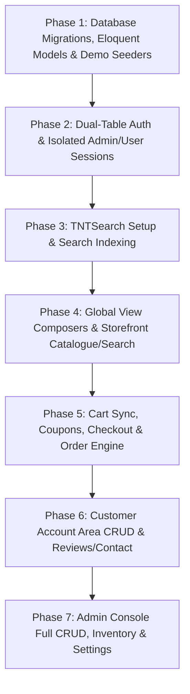

# 07 — Step-by-Step Backend Development Blueprint (AI Execution Guide)

> **AI Agent Context Header**
> - **Project**: The Everbloom (Laravel 12 Botanical Skincare E-Commerce)
> - **How AI Should Execute This Guide**: Follow Phases 1 through 7 strictly in sequential order. Complete and verify each phase using the provided Artisan/PHPUnit verification commands before starting the next phase.
> - **Core Constraints**:
>   1. **Separate Admin & Customer Auth/Sessions**: `admins` table (`admin` guard, `everbloom_admin_session` cookie) vs `users` table (`web` guard, `everbloom_user_session` cookie).
>   2. **Search Engine**: Laravel Scout + **TNTSearch** (`teamtnt/laravel-scout-tntsearch-driver`).
>   3. **Third-Party Cloud Storage + `image_source` Column + WebP Conversion**: Every image column (`image`, `images`, `avatar`) has a companion source column (`image_source` or `avatar_source`, e.g., `'s3'`, `'r2'`, `'spaces'`, `'cloudinary'`, or `'local'`). All uploaded images are automatically converted to `.webp` via `ImageStorageService` before uploading to third-party storage.
>   4. **UI Preservation**: Do not break the existing Storefront (Tailwind + Alpine.js) or Admin (`/admin` Bootstrap 5.3.3 Larkon) markup.

---

## Execution Roadmap Overview



---

## Phase 1: Database Migrations, Eloquent Models & Demo Data Seeder

### 1.1 Objective
Create all database tables, Eloquent models with `config/demo/*`-compatible accessors/serialization, and seed the database from `config/demo/*.php` so zero existing data is lost.

### 1.2 Step-by-Step Tasks
1. **Update & Create Migrations in `database/migrations/`**:
   - `0001_01_01_000000_create_users_table.php`: Replace `name` with `first_name`, `last_name`, add `phone`, `avatar`, `avatar_source` (`default('local')`), `status` (`default('Active')`), `provider_name`, `provider_id`.
   - `0001_01_01_000003_create_admins_table.php`: Create `admins` (`id`, `name`, `email` unique, `password`, `avatar`, `avatar_source` default `'local'`, `role` default `'super_admin'`, `is_active` default `true`, `last_login_at`, `remember_token`, `timestamps`) and `admin_password_reset_tokens`.
   - `0001_01_01_000004_create_categories_table.php`: Create `categories` (`id`, `slug` unique, `name`, `short_name`, `tagline`, `description`, `image`, `image_source` default `'local'`, `sort_order`, `is_active`, `timestamps`).
   - `0001_01_01_000005_create_products_and_variants_tables.php`: Create `products` (including `images` JSON and `image_source` default `'local'`), `product_images` (`id`, `product_id`, `image`, `image_source`, `is_primary`, `sort_order`), and `product_variants` tables as specified in [`06-database-and-domain-architecture.md`](./06-database-and-domain-architecture.md#34-products--product_images-tables-create_products_table).
   - `0001_01_01_000006_create_addresses_table.php`: Create `addresses` table linked to `users`.
   - `0001_01_01_000007_create_coupons_table.php`: Create `coupons` table (`code`, `type`, `value`, `label`, `min_order_amount`, `usage_limit`, `used_count`, `is_active`, `expires_at`).
   - `0001_01_01_000008_create_orders_items_invoices_tables.php`: Create `orders`, `order_items` (including `image` and `image_source`), and `invoices` tables.
   - `0001_01_01_000009_create_reviews_settings_inquiries_tables.php`: Create `reviews`, `settings`, `contact_inquiries`, and `newsletter_subscribers` tables.

2. **Create `ImageStorageService` (`app/Services/ImageStorageService.php`) & Update `<x-storefront.image />`**:
   - Install `intervention/image-laravel` and `league/flysystem-aws-s3-v3`.
   - Implement `ImageStorageService::uploadAsWebp()`, `resolveUrl($path, $source)`, and `delete($path, $source)` as specified in [`06-database-and-domain-architecture.md`](./06-database-and-domain-architecture.md#53-centralized-webp-upload--url-resolver-service-appservicesimagestorageservicephp).
   - Update `resources/views/components/storefront/image.blade.php` and `resources/js/app.js` so both `'local'` demo images and third-party cloud `.webp` URLs resolve seamlessly without prefixing `/images/` to `https://` URLs.

2. **Create Eloquent Models in `app/Models/`**:
   - `Admin.php`: Extends `Illuminate\Foundation\Auth\User as Authenticatable`, uses `Notifiable`.
   - `User.php`: Add `first_name`, `last_name`, `phone`, `avatar`, `status` to `$fillable`. Add accessors:
     - `getNameAttribute()`: returns `trim("{$this->first_name} {$this->last_name}")`.
     - `getMemberSinceAttribute()`: returns `$this->created_at?->format('F Y') ?? 'March 2024'`.
     - `getJoinDateAttribute()`: returns `$this->created_at?->format('F d, Y')`.
     - Relationships: `orders()`, `addresses()`, `defaultAddress()`, `reviews()`.
   - `Category.php`: Relationships `products()`. Add `item_count` accessor (`$this->products_count ?? $this->products()->count()`) and include `'item_count'` in `$appends` so Blade views reading `$cat['item_count']` work seamlessly.
   - `Product.php`:
     - Casts: `'sizes' => 'array'`, `'images' => 'array'`, `'key_ingredients' => 'array'`, `'benefits' => 'array'`, `'skin_types' => 'array'`, `'is_featured' => 'boolean'`, `'best_seller' => 'boolean'`, `'is_active' => 'boolean'`, `'price' => 'float'`, `'compare_at_price' => 'float'`, `'rating' => 'float'`.
     - Relationships: `categoryRelation()` (`belongsTo(Category::class, 'category_id')`), `productVariants()` (`hasMany(ProductVariant::class)`), `reviews()` (`hasMany(Review::class)`).
     - Append compatibility attributes in `$appends = ['category', 'category_slug', 'variants']`:
       - `getCategoryAttribute()`: `$this->categoryRelation?->name ?? 'Skincare'`
       - `getCategorySlugAttribute()`: `$this->categoryRelation?->slug ?? 'face-care'`
       - `getVariantsAttribute()`: maps `$this->productVariants` to `[['size' => ..., 'price' => (float)..., 'compare_at_price' => ..., 'stock_status' => ...]]`.
   - `ProductVariant.php`, `Address.php`, `Coupon.php`, `Order.php`, `OrderItem.php`, `Invoice.php`, `Review.php`, `Setting.php`, `ContactInquiry.php`, `NewsletterSubscriber.php`.
   - On `Order.php`: Override `toArray()` or add accessors so `$order['id']` returns `$this->order_number` when accessed in legacy views, or support lookup by both `id` and `order_number` (`EVB-9204`), plus `date` (`placed_at->format('F j, Y')`), `iso_date` (`placed_at->format('Y-m-d')`), and `shipping` (`(float) $this->shipping_cost`).

3. **Build `DatabaseSeeder.php`**:
   - Seed default Admin in `admins` table:
     - Email: `admin@the-everbloom.com`, Password: `password`, Name: `Clara Vance (Apothecary Director)`, Role: `super_admin`.
   - Seed demo Customers in `users` table:
     - Primary demo user: `eleanor.vance@example.com`, Password: `password`, `first_name`: `Eleanor`, `last_name`: `Vance`, `phone`: `+1 (503) 555-0192`, plus the 3 additional customers from `AdminCustomerController` (`Sophia Laurent`, `Emma Chen`, `Lucas Wright`).
   - Seed all 6 categories from `config('demo.categories')`.
   - Seed all 16 products and their `variants` from `config('demo.products')`.
   - Seed saved addresses and the 4 orders (`EVB-9204`, `EVB-9145`, `EVB-8921`, `EVB-7402`) + `order_items` + `invoices` (`INV-2026-1001`..`1004`) from `config('demo.account')`.
   - Seed the 4 coupons (`WELCOME10`, `BLOOM10`, `FREESHIP`, `BOTANICAL20`) and site settings from `config('demo.site')`.
   - Seed reviews and testimonials from `config('demo.reviews')` and `config('demo.testimonials')`.

### 1.3 Phase 1 Verification
```bash
php artisan migrate:fresh --seed
php artisan tinker --execute="echo App\Models\Product::count() . ' products, ' . App\Models\Admin::count() . ' admins, ' . App\Models\User::count() . ' users';"
```
Expected output: `16 products, 1 admins, 4 users`.

---

## Phase 2: Dual-Table Authentication & Isolated Admin/User Sessions

### 2.1 Objective
Implement completely separate authentication and session isolation for **Admin (`admins` table, `/admin*`)** and **Customer (`users` table, `/account*`)**.

### 2.2 Step-by-Step Tasks
1. **Configure `config/auth.php`**:
   - Add the `admin` guard (`driver: session`, `provider: admins`) and `admins` provider (`model: App\Models\Admin::class`) as documented in [`06-database-and-domain-architecture.md`](./06-database-and-domain-architecture.md#22-auth-guards--providers-configauthphp).

2. **Create Session Isolation Middleware (`app/Http/Middleware/IsolateAdminSession.php`)**:
   - Inspect `$request->is('admin') || $request->is('admin/*')`.
   - When in `/admin*`, set `config(['session.cookie' => env('ADMIN_SESSION_COOKIE', 'everbloom_admin_session'), 'session.path' => '/admin'])`.
   - Otherwise, set `config(['session.cookie' => env('SESSION_COOKIE', 'everbloom_user_session'), 'session.path' => '/'])`.
   - Register `IsolateAdminSession` in `bootstrap/app.php` using `$middleware->web(prepend: [\App\Http\Middleware\IsolateAdminSession::class])` so it **always executes before `StartSession`**.

3. **Create Admin & Customer Auth Middleware Redirects (`bootstrap/app.php`)**:
   - Configure `$middleware->redirectGuestsTo(fn (Request $request) => $request->is('admin*') ? route('admin.login') : route('login'));`
   - Configure `$middleware->redirectUsersTo(fn (Request $request) => $request->is('admin*') ? route('admin.dashboard') : route('account'));`

4. **Implement `AdminAuthController` (`app/Http/Controllers/Admin/AdminAuthController.php`)**:
   - `showLogin()`: If `Auth::guard('admin')->check()`, redirect to `route('admin.dashboard')`; otherwise return `view('admin.auth.login')`.
   - `login(Request $request)`: Validate `email` and `password`. Attempt `Auth::guard('admin')->attempt(['email' => ..., 'password' => ..., 'is_active' => true], $request->boolean('remember'))`. On success, `$request->session()->regenerate()`, update `last_login_at`, and redirect to `route('admin.dashboard')`. On failure, `back()->withErrors(['email' => 'Invalid admin credentials.'])->onlyInput('email')`.
   - `logout(Request $request)`: Call `Auth::guard('admin')->logout()`, `$request->session()->invalidate()`, `$request->session()->regenerateToken()`, and redirect to `route('admin.login')`. Because `IsolateAdminSession` scopes the session cookie to `everbloom_admin_session` (`/admin`), this **never invalidates the customer session** on `/`.
   - Update `resources/views/admin/auth/login.blade.php` to display validation errors (`@error('email')`) and default/pre-fill or hint the demo admin login in local environment.
   - Protect `Route::prefix('admin')->name('admin.')->middleware('auth:admin')->group(...)` in `routes/admin.php`.

5. **Implement Customer Auth in `AccountController` (or `AuthController`) & `routes/web.php`**:
   - Guest routes (`middleware('guest:web')`):
     - `GET /account/login` (`login`), `POST /account/login` (`login.submit`)
     - `GET /account/register` (`register`), `POST /account/register` (`register.submit`)
     - `GET /account/forgot-password` (`password.request`), `POST /account/forgot-password` (`password.email`)
   - Authenticated customer routes (`middleware('auth:web')`):
     - `GET /account` (`account`), `GET /account/orders` (`account.orders`), `GET /account/orders/{id}` (`account.order.details`), `GET /account/addresses` (`account.addresses`), `GET /account/profile` (`account.profile`), `POST /account/logout` (`logout`).
   - Update `frontend/account/login.blade.php` and `frontend/account/register.blade.php` so form submission posts to the real Laravel routes (`method="POST" action="{{ route('login.submit') }}"` with `@csrf`) after client-side validation passes, removing the `"Demo only. No one was signed in."` blocker.

### 2.3 Phase 2 Verification
- Write feature test `tests/Feature/DualAuthSessionIsolationTest.php` verifying:
  1. Admin can sign in at `/admin/login` using `admins` table credentials.
  2. Customer can sign in at `/account/login` using `users` table credentials.
  3. Unauthenticated requests to `/admin` redirect to `/admin/login`; unauthenticated requests to `/account` redirect to `/account/login`.
  4. Customer logged into `web` guard cannot access `/admin` (`auth:admin`).
  5. Logging out of `/admin/logout` does not log out the customer session.

---

## Phase 3: TNTSearch Setup & Full-Text Search Indexing

### 3.1 Objective
Install and configure `laravel/scout` and `teamtnt/laravel-scout-tntsearch-driver`, index all products in `storage/search/products_index.index`, and create the search service/controller.

### 3.2 Step-by-Step Tasks
1. **Install Packages**:
   ```bash
   composer require laravel/scout teamtnt/laravel-scout-tntsearch-driver
   php artisan vendor:publish --provider="Laravel\Scout\ScoutServiceProvider"
   ```
2. **Create Index Storage Directory**:
   - Create `storage/search/.gitignore` (ignoring `*.index` and keeping `!.gitignore`).
3. **Configure `config/scout.php` & `.env`**:
   - Set `SCOUT_DRIVER=tntsearch` in `.env` and `.env.example`.
   - Add `'tntsearch'` settings in `config/scout.php` (`storage => storage_path('search')`, `fuzziness => true`, `asYouType => true`).
4. **Add `Searchable` to `App\Models\Product`**:
   - Implement `toSearchableArray()`, `searchableAs()`, and `shouldBeSearchable()` as specified in [`06-database-and-domain-architecture.md`](./06-database-and-domain-architecture.md#42-appmodelsproduct-searchable-implementation).
   - Call `Artisan::call('scout:import', ['model' => Product::class])` at the end of `DatabaseSeeder::run()` (wrapped in a `try/catch` for safety).
5. **Create `SearchController` (`app/Http/Controllers/SearchController.php`)**:
   - Route: `GET /search` (`name('search')`).
   - Accepts `?q=...`. If `empty(trim($q))`, returns `response()->json(['results' => []])`.
   - Performs `Product::search($q)->keys()`, queries `Product::with(['categoryRelation', 'productVariants'])->where('is_active', true)->whereIn('id', $ids)->get()`, preserves TNTSearch relevance order, and returns JSON array matching the frontend product schema.
6. **Connect Storefront Search Modal (`resources/js/app.js` & `components/storefront/search-modal.blade.php`)**:
   - Update `Alpine.data('searchModal')` in `resources/js/app.js`:
     - Add `loading: false` and `remoteResults: null`.
     - Watch `query` (with `200ms` debounce) and fetch `/search?q=${encodeURIComponent(this.query)}` via `axios.get` or `fetch`, falling back to local `#everbloom-search-data` if offline.

### 3.3 Phase 3 Verification
```bash
php artisan scout:import "App\Models\Product"
php artisan tinker --execute="print_r(App\Models\Product::search('rosehip serum')->keys()->all());"
```

---

## Phase 4: Global View Composers & Storefront Catalogue (`HomeController` & `ShopController`)

### 4.1 Objective
Replace all static `config('demo.*')` reads on Storefront public pages (`/`, `/shop`, `/shop/category/{slug}`, `/shop/product/{slug}`, `/faq`, `/contact`, `/shipping-and-returns`) with database queries and cached site settings.

### 4.2 Step-by-Step Tasks
1. **Create `SiteDataService` / View Composer in `AppServiceProvider`**:
   - Load `Setting::where('key', 'site')->first()?->value ?? config('demo.site')` (cached via `Cache::rememberForever('site_settings', ...)`).
   - Dynamically merge or override `config(['demo.site' => $siteSettings])` at boot or share `$site` across views so every component reading `config('demo.site.*')` automatically receives live database settings!
   - Share active products JSON (`#everbloom-products-data`) and active coupons JSON (`#everbloom-discounts-data`) with `components.storefront.cart-drawer` and `components.storefront.search-modal` from cached Eloquent queries (`Cache::remember('storefront_catalog_json', 3600, ...)`).

2. **Create `HomeController` (`GET /`)**:
   - Query `$featuredProducts = Product::with(['categoryRelation', 'productVariants'])->where('is_active', true)->where('is_featured', true)->take(4)->get()`.
   - Query `$bestsellerProducts = Product::with(['categoryRelation', 'productVariants'])->where('is_active', true)->where('best_seller', true)->whereNotIn('id', $featuredProducts->pluck('id'))->take(4)->get()`.
   - Query `$categories = Category::where('is_active', true)->withCount(['products as item_count' => fn($q) => $q->where('is_active', true)])->orderBy('sort_order')->get()`.
   - Query `$testimonials = Review::where('status', 'Approved')->where('is_featured_testimonial', true)->latest()->take(3)->get()`.
   - Pass data to `view('frontend.home')` and update `frontend/home.blade.php` to use the controller variables instead of calling `config('demo.products')` inline.

3. **Create `ShopController` (`GET /shop`, `GET /shop/category/{slug}`, `GET /shop/product/{slug}`)**:
   - `index(Request $request)`:
     - Supports query parameters:
       - `search`: Uses TNTSearch `Product::search($request->search)->keys()`
       - `category`: Filters by category slug
       - `goal` (array/string): Filters by `skin_types` / benefits
       - `in_stock`: Filters `where('stock_status', 'in_stock')`
       - `on_sale`: Filters `whereNotNull('compare_at_price')->whereColumn('compare_at_price', '>', 'price')`
       - `sort`: `'featured'` (default), `'price-asc'`, `'price-desc'`, `'rating'`, `'newest'`, `'best_selling'`
     - Wire up the sort buttons and filter checkboxes in `frontend/shop/index.blade.php` and `frontend/shop/category.blade.php` so selecting a sort option or filter submits or updates the query string cleanly.
   - `category(string $slug, Request $request)`:
     - `Category::where('slug', $slug)->where('is_active', true)->firstOrFail()`.
     - Queries products in that category with sorting.
   - `product(string $slug)`:
     - `Product::with(['categoryRelation', 'productVariants', 'reviews' => fn($q) => $q->where('status', 'Approved')->latest()])->where('slug', $slug)->where('is_active', true)->firstOrFail()`.
     - Computes 4 related products from the same category (with fallback) and passes approved reviews + rating breakdown to `frontend.shop.product`.

### 4.3 Phase 4 Verification
- Visit `/`, `/shop`, `/shop?sort=price-asc`, `/shop?search=bakuchiol`, `/shop/category/serums`, and `/shop/product/botanical-radiance-serum` and verify 200 OK responses with database records.

---

## Phase 5: Cart Synchronization, Coupons, Checkout & Order Placement

### 5.1 Objective
Transform `/checkout` from a front-end simulation into a real transactional order placement workflow while keeping the Alpine.js cart and summary UX smooth.

### 5.2 Step-by-Step Tasks
1. **Coupon Validation Endpoint (`POST /checkout/validate-coupon`)**:
   - Validates promo codes against the `coupons` database table (`is_active = true`, not expired, under `usage_limit`, meets `min_order_amount`) and returns `{ valid: true, code, type, value, label }`.
   - Also inject active coupons into `#everbloom-discounts-data` so `$store.cart.applyDiscount()` works seamlessly.

2. **Checkout Controller (`app/Http/Controllers/CheckoutController.php`)**:
   - `index()`:
     - Renders `frontend.checkout.index`.
     - If customer is logged in (`Auth::guard('web')->check()`), pre-fills `form` with user's `email`, `phone`, `first_name`, `last_name`, and default saved address!
   - `store(Request $request)` (`POST /checkout`):
     - Validates payload:
       - `email`, `phone`, `firstName`, `lastName`, `country`, `address`, `apartment`, `city`, `state`, `zip`
       - `shippingMethod` (`standard` | `express`)
       - `paymentMethod` (`card_demo` | `digital_wallet_demo`)
       - `discountCode` (`nullable|string`)
       - `items` (`required|array|min:1`), `items.*.productId`, `items.*.variantId`, `items.*.qty` (`integer|min:1|max:10`)
     - Inside `DB::transaction()`:
       - Re-calculates all item prices and line totals strictly from the database (`Product` / `ProductVariant`) — never trusting client-submitted prices.
       - Verifies stock availability and decrements `stock_count` on `ProductVariant` and `Product` (updating `stock_status` to `'low_stock'` if `<= min_threshold` or `'out_of_stock'` if `0`).
       - Validates and applies `Coupon` (if provided) and increments `used_count`.
       - Computes `shipping_cost` based on site shipping settings (`standard` vs `express` and `free_threshold`).
       - Generates unique order number (`EVB-` + 4-digit sequence, e.g. `EVB-9205`).
       - Creates `Order` record (linked to `Auth::guard('web')->id()` if signed in), `OrderItem` records, and `Invoice` record (`INV-2026-XXXX`).
       - Returns JSON `{ success: true, order_number: $order->order_number, redirect_url: ... }`.
   - Update `submitDemoOrder()` in `resources/views/frontend/checkout/index.blade.php` to `POST` the form + `$store.cart.items` to `route('checkout.store')`, clear `$store.cart.clear()`, and display the confirmed Order Number (`#EVB-XXXX`) with a link to view the order!

### 5.3 Phase 5 Verification
- Run automated test submitting `POST /checkout` with 2 cart items and promo code `WELCOME10`.
- Verify `orders`, `order_items`, and `invoices` rows are created, product `stock_count` is decremented, and coupon `used_count` is incremented.

---

## Phase 6: Customer Account Portal CRUD, Reviews & Contact Form

### 6.1 Objective
Connect all authenticated Customer Account pages (`/account/*`) and customer-facing forms (`/contact`, newsletter, product review submission) to real database persistence.

### 6.2 Step-by-Step Tasks
1. **`AccountController` Dynamic Queries & Actions (`app/Http/Controllers/AccountController.php`)**:
   - `index()`: Queries `$user = Auth::guard('web')->user()`, `$recentOrders = $user->orders()->with('items')->latest('placed_at')->take(3)->get()`, `$defaultAddress = $user->addresses()->where('is_default', true)->first() ?? $user->addresses()->first()`.
   - `orders(Request $request)`: Queries `$user->orders()->with('items')->latest('placed_at')->get()`.
   - `showOrder(string $orderNumber)`: Queries `$user->orders()->with('items')->where('order_number', $orderNumber)->firstOrFail()`.
   - **Saved Addresses CRUD**:
     - `POST /account/addresses` (`AccountController@storeAddress`)
     - `PUT /account/addresses/{address}` (`AccountController@updateAddress`)
     - `PATCH /account/addresses/{address}/default` (`AccountController@setDefaultAddress`)
     - `DELETE /account/addresses/{address}` (`AccountController@destroyAddress`)
     - Update `frontend/account/addresses.blade.php` Alpine methods (`submit()`, `setAsDefault()`, `confirmRemove()`) to call these endpoints via `fetch`/`axios` (or form submission) and persist changes to the `addresses` table.
   - **Profile & Password Updates**:
     - `PUT /account/profile` (`AccountController@updateProfile`): Updates `first_name`, `last_name`, `email`, `phone` on `Auth::guard('web')->user()`.
     - `PUT /account/password` (`AccountController@updatePassword`): Validates `current_password` with `current_password:web` rule and updates `password`.
     - `DELETE /account` (`AccountController@destroyAccount`): Deletes customer account, logs out of `web` guard, and redirects to `/`.

2. **Storefront Contact, Newsletter & Review Submissions**:
   - `POST /contact` (`ContactController@store`): Validates `name`, `email`, `message` and saves to `contact_inquiries`.
   - `POST /newsletter` (`NewsletterController@store`): Validates `email` and saves to `newsletter_subscribers`.
   - `POST /shop/product/{slug}/reviews` (`ReviewController@store`): Allows customers to submit a product review (saved with `status = 'Pending'` for admin moderation).

### 6.3 Phase 6 Verification
- Test customer login, creating/editing/setting default address, updating profile/password, viewing order history, and submitting a contact inquiry.

---

## Phase 7: Admin Console (`/admin`) Full CRUD, Inventory & Settings

### 7.1 Objective
Connect all 10 controllers in `app/Http/Controllers/Admin/` to Eloquent models so the back-office manages the live store and automatically updates the Storefront and TNTSearch index.

### 7.2 Step-by-Step Tasks
1. **`AdminDashboardController@index`**:
   - Compute real KPIs from DB:
     - `$totalRevenue = Order::where('status', '!=', 'Cancelled')->sum('total')`
     - `$totalOrders = Order::count()`
     - `$totalProducts = Product::count()`
     - `$totalCustomers = User::count()`
     - `$recentOrders = Order::with('items')->latest('placed_at')->take(5)->get()`
     - `$topProducts = Product::with('categoryRelation')->orderByDesc('review_count')->take(5)->get()`

2. **`AdminProductController` (`index`, `create`, `store`, `edit`, `update`, `destroy`)**:
   - `index(Request $request)`:
     - If `$request->filled('search')`, filter by TNTSearch `Product::search($request->search)->keys()`.
     - If `$request->filled('category')`, filter by category slug.
     - Paginate results (`paginate(12)->withQueryString()`).
   - `store(Request $request)` & `update(Request $request, $id)`:
     - Validate fields (`name`, `category_slug`, `slug`, `badge`, `stock_status`, `sizes`, `is_featured`, `short_description`, `description`, `ingredients`, `how_to_use`, `price`, `compare_at_price`, `sku`, `stock_count`, `images.*`).
     - **WebP Conversion & Third-Party Storage Upload**:
       - Pass each uploaded image file through `ImageStorageService::uploadAsWebp($file, 'products', $request->slug ?: $request->name)`.
       - Store the returned `.webp` path in `images` / `product_images.image` and the storage disk identifier (e.g., `'s3'`, `'r2'`, `'spaces'`) in `image_source` / `product_images.image_source`.
     - Sync `product_variants` based on selected `sizes`.
     - Clear storefront catalog cache (`Cache::forget('storefront_catalog_json')`).
     - Trigger Scout index update (`$product->searchable()`).
   - `destroy($id)`: Delete third-party cloud images via `ImageStorageService::delete($path, $product->image_source)`, delete product, remove from TNTSearch index, and clear catalog cache.

3. **`AdminCategoryController` (`index`, `create`, `store`, `edit`, `update`, `destroy`)**:
   - Query `Category::withCount('products')->orderBy('sort_order')->get()`.
   - When an image is uploaded on category create/update, convert to `.webp` and push to third-party storage via `ImageStorageService::uploadAsWebp($file, 'categories', $request->slug)`, saving both `image` (`.webp` path) and `image_source` (third-party disk name). Clear cache.

4. **`AdminOrderController` & `AdminInvoiceController`**:
   - `AdminOrderController@index`: Filter `Order::with('items')->latest('placed_at')` by `status`, compute live status counts (`$allCount`, `$processingCount`, `$shippedCount`, `$deliveredCount`).
   - `AdminOrderController@show($id)`: Find by `order_number` (`EVB-9204`) or `id`.
   - `AdminOrderController@updateStatus(Request $request, $id)`: Update `status`, `current_step`, and optional `tracking_number` on the order.
   - `AdminInvoiceController@index` & `show($id)`: Query `Invoice::with('order.items')->latest('issued_at')->get()`.

5. **`AdminInventoryController`**:
   - `index()`: Query `Product::with('categoryRelation', 'productVariants')->get()` and map to inventory table format.
   - Add `POST /admin/inventory/{product}/adjust` (`updateStock`) so admins can update `stock_count`, `min_threshold`, and `batch_lot` directly.

6. **`AdminCustomerController`**:
   - `index()`: Query `User::withCount('orders')->withSum('orders as total_spent', 'total')->latest()->get()`.
   - `show($id)`: Query `User::with(['orders.items', 'addresses'])->findOrFail($id)`.

7. **`AdminCouponController`**:
   - `index()`: Query `Coupon::latest()->get()`.
   - `store(Request $request)`: Validate and create `Coupon` (`code`, `type`, `value`, `label`, `usage_limit`, `expires_at`), and clear coupon cache.
   - Add `destroy($id)` / status toggle route to deactivate coupons.

8. **`AdminReviewController`**:
   - `index()`: Query `Review::with('product')->latest()->get()`.
   - `toggleStatus($id)`: Toggle review `status` between `'Approved'` and `'Pending'`, and recalculate the parent product's cached `rating` and `review_count`!

9. **`AdminSettingController`**:
   - `index()`: Load `Setting::where('key', 'site')->first()?->value ?? config('demo.site')`.
   - `update(Request $request)`: Update brand identity (`name`, `tagline`, `currency`), announcement bar (`enabled`, `message`, `link`, `link_text`), shipping thresholds/rates (`free_shipping_threshold`, `standard_rate`, `express_rate`, `returns_window_days`), and contact details (`email`, `phone`, `hours`, `address`) in `settings` table and flush `Cache::forget('site_settings')`.

### 7.3 Phase 7 Verification
```bash
php artisan test
```
- Verify full end-to-end flow:
  1. Admin updates announcement bar message and creates a new product in `/admin/products/create`.
  2. Storefront homepage immediately shows the new announcement bar and the new product appears in TNTSearch results (`/search?q=...`) and `/shop`.
  3. Customer adds the product to bag, applies a coupon created in `/admin/coupons`, and places an order at `/checkout`.
  4. Order appears in both Customer's `/account/orders` and Admin's `/admin/orders` & `/admin/invoices`.

