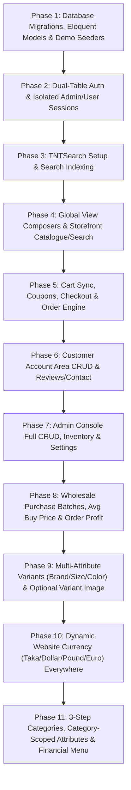

# 07 — Step-by-Step Backend Development Blueprint (AI Execution Guide)

> **AI Agent Context Header**
> - **Project**: The Everbloom (Laravel 12 Botanical Skincare E-Commerce)
> - **How AI Should Execute This Guide**: Follow Phases 1 through 7 strictly in sequential order. Complete and verify each phase using the provided Artisan/PHPUnit verification commands before starting the next phase.
> - **Core Constraints**:
>   1. **Separate Admin & Customer Auth/Sessions**: `admins` table (`admin` guard, `everbloom_admin_session` cookie) vs `users` table (`web` guard, `everbloom_user_session` cookie).
>   2. **Search Engine**: Laravel Scout + **TNTSearch** (`teamtnt/laravel-scout-tntsearch-driver`).
>   3. **Third-Party Cloud Storage + `image_source` Column + WebP Conversion**: Every image column (`image`, `images`, `avatar`) has a companion source column (`image_source` or `avatar_source`, e.g., `'s3'`, `'r2'`, `'spaces'`, `'cloudinary'`, or `'local'`). All uploaded images are automatically converted to `.webp` via `ImageStorageService` before uploading to third-party storage.
>   4. **Bangladesh Location Hierarchy (`Country = Bangladesh` -> `District` -> `Thana` -> `Area`)**: Country is always **Bangladesh**. All Bangladesh Districts, Thanas, and Areas are seeded into `districts`, `thanas`, and `areas` tables via `BangladeshLocationSeeder`. Storefront Checkout and Customer Addresses use cascading `District -> Thana -> Area` selects (filtering `is_active = true`), and Admins can **rename** and **enable/disable (`is_active`)** any District, Thana, or Area in `/admin/locations`.
>   5. **Wholesale Purchase Batches, Available-Stock Weighted Average Cost & Order Profit**: Admin buys products wholesale by **Vendor Name** (`vendors`) and **Batch** (`purchase_batches`, `purchase_batch_items`). When a new batch is added for an existing product, `avg_buy_price` is recalculated using **only currently available stock (`stock_count`) + the new batch quantity**. When an order is placed/received, `order_items` and `orders` snapshot the product's `avg_buy_price` and display exact per-product and total order **Profit** in `/admin`.
>   6. **Multi-Attribute Product Variants (`Brand`, `Size`, `Color`, etc.) + Optional Variant Image**: Variants support any combination of dynamic attributes (`Brand`, `Size`, `Color`, `Scent`, etc.) via `attributes`, `attribute_values`, `product_variants`, and `product_variant_values`. Each variant has its own price, SKU, stock, and an **optional variant image** (`image` + `image_source`, converted to `.webp` on third-party storage).
>   7. **Dynamic Website Currency (`Taka ৳ / BDT`, `Dollar $ / USD`, `Pound £ / GBP`, `Euro € / EUR`, etc.)**: Currency is configured dynamically in `/admin/settings` and shared globally via `AppServiceProvider` (`$currencySymbol`, `$currencyCode`) across every Storefront, Alpine.js, and Admin view.
>   8. **3-Step Category Hierarchy, Category-Scoped Attributes & Dedicated Financial Menu (`/admin/financial`)**:
>      - Categories support a **maximum 3-step hierarchy** (`level` 1 Main -> `level` 2 Sub -> `level` 3 Child via `parent_id`).
>      - Attributes are linked to Categories (`category_attribute` pivot); selecting a Category on `/admin/products/create` dynamically displays only that Category's attributes in the Variant Builder.
>      - `/admin` displays common operational store statistics, while a dedicated **Financial** menu (`/admin/financial`) displays all financial, COGS, profit, and inventory valuation analytics with Date Range, Category, Vendor, and Status filters using Larkon UI components from `docs/admin-dashboard/`.
>   9. **UI Preservation**: Do not break the existing Storefront (Tailwind + Alpine.js) or Admin (`/admin` Bootstrap 5.3.3 Larkon) markup.

---

## Execution Roadmap Overview



---

## Phase 1: Database Migrations, Eloquent Models & Demo Data Seeder

### 1.1 Objective
Create all database tables, Eloquent models with `config/demo/*`-compatible accessors/serialization, and seed the database from `config/demo/*.php` so zero existing data is lost.

### 1.2 Step-by-Step Tasks
1. **Update & Create Migrations in `database/migrations/`**:
   - `0001_01_01_000000_create_users_table.php`: Replace `name` with `first_name`, `last_name`, add `phone`, `avatar`, `avatar_source` (`default('local')`), `status` (`default('Active')`), `provider_name`, `provider_id`.
   - `0001_01_01_000003_create_admins_table.php`: Create `admins` (`id`, `name`, `email` unique, `password`, `avatar`, `avatar_source` default `'local'`, `role` default `'super_admin'`, `is_active` default `true`, `last_login_at`, `remember_token`, `timestamps`) and `admin_password_reset_tokens`.
   - `0001_01_01_000004_create_categories_table.php`: Create `categories` (`id`, `slug` unique, `name`, `short_name`, `tagline`, `description`, `image`, `image_source` default `'local'`, `sort_order`, `is_active`, `timestamps`).
   - `0001_01_01_000005_create_products_and_variants_tables.php`: Create `products` (including `images` JSON and `image_source` default `'local'`), `product_images` (`id`, `product_id`, `image`, `image_source`, `is_primary`, `sort_order`), and `product_variants` tables as specified in [`06-database-and-domain-architecture.md`](./06-database-and-domain-architecture.md#34-products--product_images-tables-create_products_table).
   - `0001_01_01_000006_create_bangladesh_locations_and_addresses_tables.php`: Create `districts`, `thanas`, `areas`, and `addresses` tables (with `country` defaulting to `'Bangladesh'` and `district_id`, `thana_id`, `area_id`, `district_name`, `thana_name`, `area_name`).
   - `0001_01_01_000007_create_coupons_table.php`: Create `coupons` table (`code`, `type`, `value`, `label`, `min_order_amount`, `usage_limit`, `used_count`, `is_active`, `expires_at`).
   - `0001_01_01_000008_create_orders_items_invoices_tables.php`: Create `orders`, `order_items` (including `image` and `image_source`), and `invoices` tables.
   - `0001_01_01_000009_create_reviews_settings_inquiries_tables.php`: Create `reviews`, `settings`, `contact_inquiries`, and `newsletter_subscribers` tables.

2. **Create `ImageStorageService` (`app/Services/ImageStorageService.php`) & Update `<x-storefront.image />`**:
   - Install `intervention/image-laravel` and `league/flysystem-aws-s3-v3`.
   - Implement `ImageStorageService::uploadAsWebp()`, `resolveUrl($path, $source)`, and `delete($path, $source)` as specified in [`06-database-and-domain-architecture.md`](./06-database-and-domain-architecture.md#53-centralized-webp-upload--url-resolver-service-appservicesimagestorageservicephp).
   - Update `resources/views/components/storefront/image.blade.php` and `resources/js/app.js` so both `'local'` demo images and third-party cloud `.webp` URLs resolve seamlessly without prefixing `/images/` to `https://` URLs.

2. **Create Eloquent Models in `app/Models/`**:
   - `Admin.php`: Extends `Illuminate\Foundation\Auth\User as Authenticatable`, uses `Notifiable`.
   - `User.php`: Add `first_name`, `last_name`, `phone`, `avatar`, `status` to `$fillable`. Add accessors:
     - `getNameAttribute()`: returns `trim("{$this->first_name} {$this->last_name}")`.
     - `getMemberSinceAttribute()`: returns `$this->created_at?->format('F Y') ?? 'March 2024'`.
     - `getJoinDateAttribute()`: returns `$this->created_at?->format('F d, Y')`.
     - Relationships: `orders()`, `addresses()`, `defaultAddress()`, `reviews()`.
   - `Category.php`: Relationships `products()`. Add `item_count` accessor (`$this->products_count ?? $this->products()->count()`) and include `'item_count'` in `$appends` so Blade views reading `$cat['item_count']` work seamlessly.
   - `Product.php`:
     - Casts: `'sizes' => 'array'`, `'images' => 'array'`, `'key_ingredients' => 'array'`, `'benefits' => 'array'`, `'skin_types' => 'array'`, `'is_featured' => 'boolean'`, `'best_seller' => 'boolean'`, `'is_active' => 'boolean'`, `'price' => 'float'`, `'compare_at_price' => 'float'`, `'rating' => 'float'`.
     - Relationships: `categoryRelation()` (`belongsTo(Category::class, 'category_id')`), `productVariants()` (`hasMany(ProductVariant::class)`), `reviews()` (`hasMany(Review::class)`).
     - Append compatibility attributes in `$appends = ['category', 'category_slug', 'variants']`:
       - `getCategoryAttribute()`: `$this->categoryRelation?->name ?? 'Skincare'`
       - `getCategorySlugAttribute()`: `$this->categoryRelation?->slug ?? 'face-care'`
       - `getVariantsAttribute()`: maps `$this->productVariants` to `[['size' => ..., 'price' => (float)..., 'compare_at_price' => ..., 'stock_status' => ...]]`.
   - `ProductVariant.php`, `ProductImage.php`, `District.php`, `Thana.php`, `Area.php`, `Address.php`, `Coupon.php`, `Order.php`, `OrderItem.php`, `Invoice.php`, `Review.php`, `Setting.php`, `ContactInquiry.php`, `NewsletterSubscriber.php`.
   - On `District.php`, `Thana.php`, `Area.php`: Add `scopeActive($query)` (`$query->where('is_active', true)->orderBy('sort_order')->orderBy('name')`) and relationships (`District::hasMany(Thana::class)`, `Thana::belongsTo(District::class)`, `Thana::hasMany(Area::class)`, `Area::belongsTo(Thana::class)`).
   - On `Order.php`: Override `toArray()` or add accessors so `$order['id']` returns `$this->order_number` when accessed in legacy views, or support lookup by both `id` and `order_number` (`EVB-9204`), plus `date` (`placed_at->format('F j, Y')`), `iso_date` (`placed_at->format('Y-m-d')`), and `shipping` (`(float) $this->shipping_cost`).

4. **Build `BangladeshLocationSeeder.php` & `DatabaseSeeder.php`**:
   - **`BangladeshLocationSeeder`**: Seeds all 64 Districts of Bangladesh (`Dhaka`, `Chattogram`, `Sylhet`, `Gazipur`, `Narayanganj`, `Rajshahi`, `Khulna`, `Barishal`, `Rangpur`, `Mymensingh`, `Cumilla`, etc.), their Thanas/Upazilas (e.g., `Dhanmondi`, `Gulshan`, `Banani`, `Uttara`, `Mirpur`, `Mohammadpur`, `Motijheel`, `Tejgaon`, `Badda`, `Ramna`, `Savar`, `Panchlaish`, `Kotwali`, `Double Mooring`, etc.), and detailed Areas (`Gulshan 1`, `Gulshan 2`, `Banani DOHS`, `Dhanmondi Road 27`, `Uttara Sector 1`–`14`, `Mirpur DOHS`, etc.) with `is_active = true`.
   - **`DatabaseSeeder`**:
     - Calls `$this->call(BangladeshLocationSeeder::class);`.
     - Seeds default Admin in `admins` table (`admin@the-everbloom.com`, password `password`).
     - Seeds demo Customers in `users` table (`eleanor.vance@example.com`, password `password`, plus `Sophia Laurent`, `Emma Chen`, `Lucas Wright`).
     - Seeds all 6 categories from `config('demo.categories')`.
     - Seeds all 16 products and their `variants` from `config('demo.products')`.
     - Seeds saved addresses (mapped to Bangladesh `Dhaka -> Gulshan -> Gulshan 2` and `Dhaka -> Dhanmondi -> Dhanmondi 27`) and the 4 orders (`EVB-9204`, `EVB-9145`, `EVB-8921`, `EVB-7402`) + `order_items` + `invoices` (`INV-2026-1001`..`1004`).
     - Seeds the 4 coupons (`WELCOME10`, `BLOOM10`, `FREESHIP`, `BOTANICAL20`) and site settings from `config('demo.site')`.
     - Seeds reviews and testimonials from `config('demo.reviews')` and `config('demo.testimonials')`.

### 1.3 Phase 1 Verification
```bash
php artisan migrate:fresh --seed
php artisan tinker --execute="echo App\Models\Product::count() . ' products, ' . App\Models\Admin::count() . ' admins, ' . App\Models\User::count() . ' users';"
```
Expected output: `16 products, 1 admins, 4 users`.

---

## Phase 2: Dual-Table Authentication & Isolated Admin/User Sessions

### 2.1 Objective
Implement completely separate authentication and session isolation for **Admin (`admins` table, `/admin*`)** and **Customer (`users` table, `/account*`)**.

### 2.2 Step-by-Step Tasks
1. **Configure `config/auth.php`**:
   - Add the `admin` guard (`driver: session`, `provider: admins`) and `admins` provider (`model: App\Models\Admin::class`) as documented in [`06-database-and-domain-architecture.md`](./06-database-and-domain-architecture.md#22-auth-guards--providers-configauthphp).

2. **Create Session Isolation Middleware (`app/Http/Middleware/IsolateAdminSession.php`)**:
   - Inspect `$request->is('admin') || $request->is('admin/*')`.
   - When in `/admin*`, set `config(['session.cookie' => env('ADMIN_SESSION_COOKIE', 'everbloom_admin_session'), 'session.path' => '/admin'])`.
   - Otherwise, set `config(['session.cookie' => env('SESSION_COOKIE', 'everbloom_user_session'), 'session.path' => '/'])`.
   - Register `IsolateAdminSession` in `bootstrap/app.php` using `$middleware->web(prepend: [\App\Http\Middleware\IsolateAdminSession::class])` so it **always executes before `StartSession`**.

3. **Create Admin & Customer Auth Middleware Redirects (`bootstrap/app.php`)**:
   - Configure `$middleware->redirectGuestsTo(fn (Request $request) => $request->is('admin*') ? route('admin.login') : route('login'));`
   - Configure `$middleware->redirectUsersTo(fn (Request $request) => $request->is('admin*') ? route('admin.dashboard') : route('account'));`

4. **Implement `AdminAuthController` (`app/Http/Controllers/Admin/AdminAuthController.php`)**:
   - `showLogin()`: If `Auth::guard('admin')->check()`, redirect to `route('admin.dashboard')`; otherwise return `view('admin.auth.login')`.
   - `login(Request $request)`: Validate `email` and `password`. Attempt `Auth::guard('admin')->attempt(['email' => ..., 'password' => ..., 'is_active' => true], $request->boolean('remember'))`. On success, `$request->session()->regenerate()`, update `last_login_at`, and redirect to `route('admin.dashboard')`. On failure, `back()->withErrors(['email' => 'Invalid admin credentials.'])->onlyInput('email')`.
   - `logout(Request $request)`: Call `Auth::guard('admin')->logout()`, `$request->session()->invalidate()`, `$request->session()->regenerateToken()`, and redirect to `route('admin.login')`. Because `IsolateAdminSession` scopes the session cookie to `everbloom_admin_session` (`/admin`), this **never invalidates the customer session** on `/`.
   - Update `resources/views/admin/auth/login.blade.php` to display validation errors (`@error('email')`) and default/pre-fill or hint the demo admin login in local environment.
   - Protect `Route::prefix('admin')->name('admin.')->middleware('auth:admin')->group(...)` in `routes/admin.php`.

5. **Implement Customer Auth in `AccountController` (or `AuthController`) & `routes/web.php`**:
   - Guest routes (`middleware('guest:web')`):
     - `GET /account/login` (`login`), `POST /account/login` (`login.submit`)
     - `GET /account/register` (`register`), `POST /account/register` (`register.submit`)
     - `GET /account/forgot-password` (`password.request`), `POST /account/forgot-password` (`password.email`)
   - Authenticated customer routes (`middleware('auth:web')`):
     - `GET /account` (`account`), `GET /account/orders` (`account.orders`), `GET /account/orders/{id}` (`account.order.details`), `GET /account/addresses` (`account.addresses`), `GET /account/profile` (`account.profile`), `POST /account/logout` (`logout`).
   - Update `frontend/account/login.blade.php` and `frontend/account/register.blade.php` so form submission posts to the real Laravel routes (`method="POST" action="{{ route('login.submit') }}"` with `@csrf`) after client-side validation passes, removing the `"Demo only. No one was signed in."` blocker.

### 2.3 Phase 2 Verification
- Write feature test `tests/Feature/DualAuthSessionIsolationTest.php` verifying:
  1. Admin can sign in at `/admin/login` using `admins` table credentials.
  2. Customer can sign in at `/account/login` using `users` table credentials.
  3. Unauthenticated requests to `/admin` redirect to `/admin/login`; unauthenticated requests to `/account` redirect to `/account/login`.
  4. Customer logged into `web` guard cannot access `/admin` (`auth:admin`).
  5. Logging out of `/admin/logout` does not log out the customer session.

---

## Phase 3: TNTSearch Setup & Full-Text Search Indexing

### 3.1 Objective
Install and configure `laravel/scout` and `teamtnt/laravel-scout-tntsearch-driver`, index all products in `storage/search/products_index.index`, and create the search service/controller.

### 3.2 Step-by-Step Tasks
1. **Install Packages**:
   ```bash
   composer require laravel/scout teamtnt/laravel-scout-tntsearch-driver
   php artisan vendor:publish --provider="Laravel\Scout\ScoutServiceProvider"
   ```
2. **Create Index Storage Directory**:
   - Create `storage/search/.gitignore` (ignoring `*.index` and keeping `!.gitignore`).
3. **Configure `config/scout.php` & `.env`**:
   - Set `SCOUT_DRIVER=tntsearch` in `.env` and `.env.example`.
   - Add `'tntsearch'` settings in `config/scout.php` (`storage => storage_path('search')`, `fuzziness => true`, `asYouType => true`).
4. **Add `Searchable` to `App\Models\Product`**:
   - Implement `toSearchableArray()`, `searchableAs()`, and `shouldBeSearchable()` as specified in [`06-database-and-domain-architecture.md`](./06-database-and-domain-architecture.md#42-appmodelsproduct-searchable-implementation).
   - Call `Artisan::call('scout:import', ['model' => Product::class])` at the end of `DatabaseSeeder::run()` (wrapped in a `try/catch` for safety).
5. **Create `SearchController` (`app/Http/Controllers/SearchController.php`)**:
   - Route: `GET /search` (`name('search')`).
   - Accepts `?q=...`. If `empty(trim($q))`, returns `response()->json(['results' => []])`.
   - Performs `Product::search($q)->keys()`, queries `Product::with(['categoryRelation', 'productVariants'])->where('is_active', true)->whereIn('id', $ids)->get()`, preserves TNTSearch relevance order, and returns JSON array matching the frontend product schema.
6. **Connect Storefront Search Modal (`resources/js/app.js` & `components/storefront/search-modal.blade.php`)**:
   - Update `Alpine.data('searchModal')` in `resources/js/app.js`:
     - Add `loading: false` and `remoteResults: null`.
     - Watch `query` (with `200ms` debounce) and fetch `/search?q=${encodeURIComponent(this.query)}` via `axios.get` or `fetch`, falling back to local `#everbloom-search-data` if offline.

### 3.3 Phase 3 Verification
```bash
php artisan scout:import "App\Models\Product"
php artisan tinker --execute="print_r(App\Models\Product::search('rosehip serum')->keys()->all());"
```

---

## Phase 4: Global View Composers & Storefront Catalogue (`HomeController` & `ShopController`)

### 4.1 Objective
Replace all static `config('demo.*')` reads on Storefront public pages (`/`, `/shop`, `/shop/category/{slug}`, `/shop/product/{slug}`, `/faq`, `/contact`, `/shipping-and-returns`) with database queries and cached site settings.

### 4.2 Step-by-Step Tasks
1. **Create `SiteDataService` / View Composer in `AppServiceProvider`**:
   - Load `Setting::where('key', 'site')->first()?->value ?? config('demo.site')` (cached via `Cache::rememberForever('site_settings', ...)`).
   - Dynamically merge or override `config(['demo.site' => $siteSettings])` at boot or share `$site` across views so every component reading `config('demo.site.*')` automatically receives live database settings!
   - Share active products JSON (`#everbloom-products-data`) and active coupons JSON (`#everbloom-discounts-data`) with `components.storefront.cart-drawer` and `components.storefront.search-modal` from cached Eloquent queries (`Cache::remember('storefront_catalog_json', 3600, ...)`).

2. **Create `HomeController` (`GET /`)**:
   - Query `$featuredProducts = Product::with(['categoryRelation', 'productVariants'])->where('is_active', true)->where('is_featured', true)->take(4)->get()`.
   - Query `$bestsellerProducts = Product::with(['categoryRelation', 'productVariants'])->where('is_active', true)->where('best_seller', true)->whereNotIn('id', $featuredProducts->pluck('id'))->take(4)->get()`.
   - Query `$categories = Category::where('is_active', true)->withCount(['products as item_count' => fn($q) => $q->where('is_active', true)])->orderBy('sort_order')->get()`.
   - Query `$testimonials = Review::where('status', 'Approved')->where('is_featured_testimonial', true)->latest()->take(3)->get()`.
   - Pass data to `view('frontend.home')` and update `frontend/home.blade.php` to use the controller variables instead of calling `config('demo.products')` inline.

3. **Create `ShopController` (`GET /shop`, `GET /shop/category/{slug}`, `GET /shop/product/{slug}`)**:
   - `index(Request $request)`:
     - Supports query parameters:
       - `search`: Uses TNTSearch `Product::search($request->search)->keys()`
       - `category`: Filters by category slug
       - `goal` (array/string): Filters by `skin_types` / benefits
       - `in_stock`: Filters `where('stock_status', 'in_stock')`
       - `on_sale`: Filters `whereNotNull('compare_at_price')->whereColumn('compare_at_price', '>', 'price')`
       - `sort`: `'featured'` (default), `'price-asc'`, `'price-desc'`, `'rating'`, `'newest'`, `'best_selling'`
     - Wire up the sort buttons and filter checkboxes in `frontend/shop/index.blade.php` and `frontend/shop/category.blade.php` so selecting a sort option or filter submits or updates the query string cleanly.
   - `category(string $slug, Request $request)`:
     - `Category::where('slug', $slug)->where('is_active', true)->firstOrFail()`.
     - Queries products in that category with sorting.
   - `product(string $slug)`:
     - `Product::with(['categoryRelation', 'productVariants', 'reviews' => fn($q) => $q->where('status', 'Approved')->latest()])->where('slug', $slug)->where('is_active', true)->firstOrFail()`.
     - Computes 4 related products from the same category (with fallback) and passes approved reviews + rating breakdown to `frontend.shop.product`.

### 4.3 Phase 4 Verification
- Visit `/`, `/shop`, `/shop?sort=price-asc`, `/shop?search=bakuchiol`, `/shop/category/serums`, and `/shop/product/botanical-radiance-serum` and verify 200 OK responses with database records.

---

## Phase 5: Cart Synchronization, Coupons, Checkout & Order Placement

### 5.1 Objective
Transform `/checkout` from a front-end simulation into a real transactional order placement workflow while keeping the Alpine.js cart and summary UX smooth.

### 5.2 Step-by-Step Tasks
1. **Bangladesh Cascading Location Endpoints (`app/Http/Controllers/LocationController.php`)**:
   - `GET /locations/districts`: Returns active districts `District::active()->get(['id', 'name', 'bn_name', 'delivery_charge'])`.
   - `GET /locations/districts/{district}/thanas`: Returns active thanas `Thana::active()->where('district_id', $district->id)->get(['id', 'name', 'bn_name'])`.
   - `GET /locations/thanas/{thana}/areas`: Returns active areas `Area::active()->where('thana_id', $thana->id)->get(['id', 'name', 'bn_name', 'postal_code'])`.

2. **Coupon Validation Endpoint (`POST /checkout/validate-coupon`)**:
   - Validates promo codes against the `coupons` database table (`is_active = true`, not expired, under `usage_limit`, meets `min_order_amount`) and returns `{ valid: true, code, type, value, label }`.
   - Also inject active coupons into `#everbloom-discounts-data` so `$store.cart.applyDiscount()` works seamlessly.

3. **Checkout Controller & Cascading Bangladesh Form (`app/Http/Controllers/CheckoutController.php` & `frontend/checkout/index.blade.php`)**:
   - `index()`:
     - Passes `$districts = District::active()->get()` to `frontend.checkout.index`.
     - In `frontend/checkout/index.blade.php`, set Country to fixed **Bangladesh** (`country: 'Bangladesh'`) and replace generic City/State inputs with cascading **District -> Thana -> Area** `<select>` fields in `checkoutComponent()`.
     - If customer is logged in (`Auth::guard('web')->check()`), pre-fills `form` with user's `email`, `phone`, `first_name`, `last_name`, and default saved address (`district_id`, `thana_id`, `area_id`, `address_line1`, `address_line2`, `postal_code`).
   - `store(Request $request)` (`POST /checkout`):
     - Validates payload:
       - `email`, `phone`, `firstName`, `lastName`
       - `district_id` (`required|exists:districts,id,is_active,1`), `thana_id` (`required|exists:thanas,id,is_active,1`), `area_id` (`required|exists:areas,id,is_active,1`)
       - `address` (`required|string`), `apartment` (`nullable|string`), `zip` (`nullable|string`)
       - `shippingMethod` (`standard` | `express`)
       - `paymentMethod` (`card_demo` | `digital_wallet_demo`)
       - `discountCode` (`nullable|string`)
       - `items` (`required|array|min:1`), `items.*.productId`, `items.*.variantId`, `items.*.qty` (`integer|min:1|max:10`)
     - Inside `DB::transaction()`:
       - Re-calculates all item prices and line totals strictly from the database (`Product` / `ProductVariant`) — never trusting client-submitted prices.
       - Verifies stock availability and decrements `stock_count` on `ProductVariant` and `Product` (updating `stock_status` to `'low_stock'` if `<= min_threshold` or `'out_of_stock'` if `0`).
       - Validates and applies `Coupon` (if provided) and increments `used_count`.
       - Computes `shipping_cost` based on site shipping settings (`standard` vs `express` and `free_threshold`).
       - Generates unique order number (`EVB-` + 4-digit sequence, e.g. `EVB-9205`).
       - Creates `Order` record (linked to `Auth::guard('web')->id()` if signed in), `OrderItem` records, and `Invoice` record (`INV-2026-XXXX`).
       - Returns JSON `{ success: true, order_number: $order->order_number, redirect_url: ... }`.
   - Update `submitDemoOrder()` in `resources/views/frontend/checkout/index.blade.php` to `POST` the form + `$store.cart.items` to `route('checkout.store')`, clear `$store.cart.clear()`, and display the confirmed Order Number (`#EVB-XXXX`) with a link to view the order!

### 5.3 Phase 5 Verification
- Run automated test submitting `POST /checkout` with 2 cart items and promo code `WELCOME10`.
- Verify `orders`, `order_items`, and `invoices` rows are created, product `stock_count` is decremented, and coupon `used_count` is incremented.

---

## Phase 6: Customer Account Portal CRUD, Reviews & Contact Form

### 6.1 Objective
Connect all authenticated Customer Account pages (`/account/*`) and customer-facing forms (`/contact`, newsletter, product review submission) to real database persistence.

### 6.2 Step-by-Step Tasks
1. **`AccountController` Dynamic Queries & Actions (`app/Http/Controllers/AccountController.php`)**:
   - `index()`: Queries `$user = Auth::guard('web')->user()`, `$recentOrders = $user->orders()->with('items')->latest('placed_at')->take(3)->get()`, `$defaultAddress = $user->addresses()->where('is_default', true)->first() ?? $user->addresses()->first()`.
   - `orders(Request $request)`: Queries `$user->orders()->with('items')->latest('placed_at')->get()`.
   - `showOrder(string $orderNumber)`: Queries `$user->orders()->with('items')->where('order_number', $orderNumber)->firstOrFail()`.
   - **Saved Addresses CRUD**:
     - `POST /account/addresses` (`AccountController@storeAddress`)
     - `PUT /account/addresses/{address}` (`AccountController@updateAddress`)
     - `PATCH /account/addresses/{address}/default` (`AccountController@setDefaultAddress`)
     - `DELETE /account/addresses/{address}` (`AccountController@destroyAddress`)
     - Update `frontend/account/addresses.blade.php` Alpine methods (`submit()`, `setAsDefault()`, `confirmRemove()`) to call these endpoints via `fetch`/`axios` (or form submission) and persist changes to the `addresses` table.
   - **Profile & Password Updates**:
     - `PUT /account/profile` (`AccountController@updateProfile`): Updates `first_name`, `last_name`, `email`, `phone` on `Auth::guard('web')->user()`.
     - `PUT /account/password` (`AccountController@updatePassword`): Validates `current_password` with `current_password:web` rule and updates `password`.
     - `DELETE /account` (`AccountController@destroyAccount`): Deletes customer account, logs out of `web` guard, and redirects to `/`.

2. **Storefront Contact, Newsletter & Review Submissions**:
   - `POST /contact` (`ContactController@store`): Validates `name`, `email`, `message` and saves to `contact_inquiries`.
   - `POST /newsletter` (`NewsletterController@store`): Validates `email` and saves to `newsletter_subscribers`.
   - `POST /shop/product/{slug}/reviews` (`ReviewController@store`): Allows customers to submit a product review (saved with `status = 'Pending'` for admin moderation).

### 6.3 Phase 6 Verification
- Test customer login, creating/editing/setting default address, updating profile/password, viewing order history, and submitting a contact inquiry.

---

## Phase 7: Admin Console (`/admin`) Full CRUD, Inventory & Settings

### 7.1 Objective
Connect all 10 controllers in `app/Http/Controllers/Admin/` to Eloquent models so the back-office manages the live store and automatically updates the Storefront and TNTSearch index.

### 7.2 Step-by-Step Tasks
1. **`AdminDashboardController@index`**:
   - Compute real KPIs from DB:
     - `$totalRevenue = Order::where('status', '!=', 'Cancelled')->sum('total')`
     - `$totalOrders = Order::count()`
     - `$totalProducts = Product::count()`
     - `$totalCustomers = User::count()`
     - `$recentOrders = Order::with('items')->latest('placed_at')->take(5)->get()`
     - `$topProducts = Product::with('categoryRelation')->orderByDesc('review_count')->take(5)->get()`

2. **`AdminProductController` (`index`, `create`, `store`, `edit`, `update`, `destroy`)**:
   - `index(Request $request)`:
     - If `$request->filled('search')`, filter by TNTSearch `Product::search($request->search)->keys()`.
     - If `$request->filled('category')`, filter by category slug.
     - Paginate results (`paginate(12)->withQueryString()`).
   - `store(Request $request)` & `update(Request $request, $id)`:
     - Validate fields (`name`, `category_slug`, `slug`, `badge`, `stock_status`, `sizes`, `is_featured`, `short_description`, `description`, `ingredients`, `how_to_use`, `price`, `compare_at_price`, `sku`, `stock_count`, `images.*`).
     - **WebP Conversion & Third-Party Storage Upload**:
       - Pass each uploaded image file through `ImageStorageService::uploadAsWebp($file, 'products', $request->slug ?: $request->name)`.
       - Store the returned `.webp` path in `images` / `product_images.image` and the storage disk identifier (e.g., `'s3'`, `'r2'`, `'spaces'`) in `image_source` / `product_images.image_source`.
     - Sync `product_variants` based on selected `sizes`.
     - Clear storefront catalog cache (`Cache::forget('storefront_catalog_json')`).
     - Trigger Scout index update (`$product->searchable()`).
   - `destroy($id)`: Delete third-party cloud images via `ImageStorageService::delete($path, $product->image_source)`, delete product, remove from TNTSearch index, and clear catalog cache.

3. **`AdminCategoryController` (`index`, `create`, `store`, `edit`, `update`, `destroy`)**:
   - Query `Category::withCount('products')->orderBy('sort_order')->get()`.
   - When an image is uploaded on category create/update, convert to `.webp` and push to third-party storage via `ImageStorageService::uploadAsWebp($file, 'categories', $request->slug)`, saving both `image` (`.webp` path) and `image_source` (third-party disk name). Clear cache.

4. **`AdminOrderController` & `AdminInvoiceController`**:
   - `AdminOrderController@index`: Filter `Order::with('items')->latest('placed_at')` by `status`, compute live status counts (`$allCount`, `$processingCount`, `$shippedCount`, `$deliveredCount`).
   - `AdminOrderController@show($id)`: Find by `order_number` (`EVB-9204`) or `id`.
   - `AdminOrderController@updateStatus(Request $request, $id)`: Update `status`, `current_step`, and optional `tracking_number` on the order.
   - `AdminInvoiceController@index` & `show($id)`: Query `Invoice::with('order.items')->latest('issued_at')->get()`.

5. **`AdminInventoryController`**:
   - `index()`: Query `Product::with('categoryRelation', 'productVariants')->get()` and map to inventory table format.
   - Add `POST /admin/inventory/{product}/adjust` (`updateStock`) so admins can update `stock_count`, `min_threshold`, and `batch_lot` directly.

6. **`AdminCustomerController`**:
   - `index()`: Query `User::withCount('orders')->withSum('orders as total_spent', 'total')->latest()->get()`.
   - `show($id)`: Query `User::with(['orders.items', 'addresses'])->findOrFail($id)`.

7. **`AdminCouponController`**:
   - `index()`: Query `Coupon::latest()->get()`.
   - `store(Request $request)`: Validate and create `Coupon` (`code`, `type`, `value`, `label`, `usage_limit`, `expires_at`), and clear coupon cache.
   - Add `destroy($id)` / status toggle route to deactivate coupons.

8. **`AdminReviewController`**:
   - `index()`: Query `Review::with('product')->latest()->get()`.
   - `toggleStatus($id)`: Toggle review `status` between `'Approved'` and `'Pending'`, and recalculate the parent product's cached `rating` and `review_count`!

9. **`AdminSettingController`**:
   - `index()`: Load `Setting::where('key', 'site')->first()?->value ?? config('demo.site')`.
   - `update(Request $request)`: Update brand identity (`name`, `tagline`, `currency`), announcement bar (`enabled`, `message`, `link`, `link_text`), shipping thresholds/rates (`free_shipping_threshold`, `standard_rate`, `express_rate`, `returns_window_days`), and contact details (`email`, `phone`, `hours`, `address`) in `settings` table and flush `Cache::forget('site_settings')`.

10. **`AdminLocationController` (`/admin/locations` — Bangladesh District, Thana & Area Management)**:
   - Add routes in `routes/admin.php` and a **"Locations (BD)"** link in `resources/views/components/admin/sidebar.blade.php`:
     - `GET /admin/locations` (`admin.locations.index`): Tabbed/filterable management screen for **Districts (64)**, **Thanas**, and **Areas**.
     - `POST /admin/locations/districts`, `PUT /admin/locations/districts/{district}`, `POST /admin/locations/districts/{district}/toggle`: Create, **rename** (`name`, `bn_name`, `delivery_charge`), or **enable/disable (`is_active`)** a District.
     - `POST /admin/locations/thanas`, `PUT /admin/locations/thanas/{thana}`, `POST /admin/locations/thanas/{thana}/toggle`: Create, **rename** (`name`, `bn_name`), or **enable/disable (`is_active`)** a Thana under a District.
     - `POST /admin/locations/areas`, `PUT /admin/locations/areas/{area}`, `POST /admin/locations/areas/{area}/toggle`: Create, **rename** (`name`, `bn_name`, `postal_code`), or **enable/disable (`is_active`)** an Area under a Thana.
   - Whenever an Admin renames or disables a District, Thana, or Area, Storefront Checkout (`/checkout`) and Customer Addresses (`/account/addresses`) immediately reflect the updated name or hide disabled locations.

### 7.3 Phase 7 Verification
```bash
php artisan test
```

---

## Phase 8: Wholesale Purchase Batches, Available-Stock Weighted Average Price & Order Profit Tracking

### 8.1 Objective
Implement the **Admin Wholesale Buy / Purchase Batch Module (`/admin/purchases`)** with **Vendor Name** tracking, **Available-Stock-Only Weighted Average Buy Price** calculation, and **Per-Product & Per-Order Profit Display** when orders are received.

### 8.2 Step-by-Step Tasks

1. **Create Wholesale & Profit Migration (`database/migrations/0001_01_01_000010_create_wholesale_purchases_and_profit_columns.php`)**:
   - Create `vendors` table (`id`, `name`, `company_name`, `phone`, `email`, `address`, `is_active`, `timestamps`).
   - Create `purchase_batches` table (`id`, `batch_code` unique, `vendor_id` FK, `vendor_name`, `reference_no`, `purchased_at`, `total_qty`, `total_cost`, `notes`, `created_by`, `timestamps`).
   - Create `purchase_batch_items` table (`id`, `purchase_batch_id` FK, `vendor_id` FK, `product_id` FK, `product_variant_id` nullable FK, `batch_lot`, `purchased_qty`, `remaining_qty`, `unit_buy_price`, `line_total_cost`, `timestamps`).
   - Add `avg_buy_price` (`decimal(10,2)`, `default(0)`) and `last_buy_price` (`decimal(10,2)`, `default(0)`) to `products` and `product_variants`.
   - Add `unit_buy_price` (`decimal(10,2)`, `default(0)`), `line_cost_total` (`decimal(10,2)`, `default(0)`), `unit_profit` (`decimal(10,2)`, `default(0)`), and `line_profit` (`decimal(10,2)`, `default(0)`) to `order_items`.
   - Add `total_cost` (`decimal(10,2)`, `default(0)`) and `total_profit` (`decimal(10,2)`, `default(0)`) to `orders`.

2. **Create Models & `PurchaseBatchService` (`app/Models/Vendor.php`, `PurchaseBatch.php`, `PurchaseBatchItem.php`, `app/Services/PurchaseBatchService.php`)**:
   - Implement `PurchaseBatchService::calculateWeightedAveragePrice($availableStock, $currentAvgBuyPrice, $newBatchQty, $newBatchUnitBuyPrice)`:
     - Uses **only currently available stock (`$product->stock_count`)**:
       $$\text{New Avg Buy Price} = \frac{(\text{Available Stock} \times \text{Current Avg Price}) + (\text{New Batch Qty} \times \text{New Batch Unit Buy Price})}{\text{Available Stock} + \text{New Batch Qty}}$$
   - Implement `PurchaseBatchService::createBatch(array $data)`:
     - Finds or creates `Vendor` by `vendor_name` / `vendor_id`.
     - Generates unique `batch_code` (e.g., `BATCH-2026-0001`).
     - For each item in the batch:
       - Locks the `Product` row (`lockForUpdate()`).
       - Reads current available stock (`$availableQty = max(0, (int) $product->stock_count)`) and current average buy price (`$currentAvg = (float) $product->avg_buy_price`).
       - Computes `$newAvgBuyPrice = PurchaseBatchService::calculateWeightedAveragePrice($availableQty, $currentAvg, $purchasedQty, $unitBuyPrice)`.
       - Creates `PurchaseBatchItem` with `purchased_qty = $purchasedQty` and `remaining_qty = $purchasedQty`.
       - Updates `Product`:
         - `avg_buy_price = $newAvgBuyPrice`
         - `last_buy_price = $unitBuyPrice`
         - `stock_count = $availableQty + $purchasedQty`
         - `batch_lot = $batchLot`
         - `last_restocked_at = $purchasedAt`
         - `stock_status = 'in_stock'`

3. **Update `DatabaseSeeder.php` with Initial Wholesale Batches & Order Profit Data**:
   - Seed demo Vendors (e.g., `Pacific Botanical Labs`, `Alpine Herbal Extracts`, `Oregon Cold-Press Collective`).
   - Seed initial `PurchaseBatch` and `PurchaseBatchItem` records for all 16 products (setting initial `avg_buy_price` at ~40% of retail price, e.g., `$25.60` for a `$64.00` serum) and populate `unit_buy_price`, `line_cost_total`, `unit_profit`, `line_profit`, `total_cost`, and `total_profit` on the seeded demo orders.

4. **Update `CheckoutController@store` for Live Order Profit & Batch Deduction**:
   - When a customer places an order at `/checkout`:
     - Snapshot `$unitBuyPrice = (float) ($variant?->avg_buy_price ?: $product->avg_buy_price)` on each `OrderItem`.
     - Compute `$lineCostTotal = round($unitBuyPrice * $qty, 2)`, `$unitProfit = round($unitPrice - $unitBuyPrice, 2)`, and `$lineProfit = round($lineTotal - $lineCostTotal, 2)`.
     - Deduct `$qty` from `PurchaseBatchItem::where('product_id', $product->id)->where('remaining_qty', '>', 0)` in FIFO order (`PurchaseBatchService::deductFromAvailableBatches($product->id, $qty)`).
     - On `Order`, save `total_cost = round($sumLineCosts, 2)` and `total_profit = round(($subtotal - $discountAmount) - $sumLineCosts, 2)`.

5. **Create `AdminPurchaseController` & Views (`/admin/purchases`)**:
   - Routes in `routes/admin.php`:
     - `GET /admin/purchases` (`admin.purchases.index`): Lists all Wholesale Purchase Batches and a Product Wholesale Cost & Profit table showing `Product`, `Vendor Name`, `Batch Code / Lot`, `Available Stock`, `Last Buy Price`, `Weighted Avg Buy Price (Available Stock)`, `Retail Selling Price`, and `Unit Profit ($ & %)`.
     - `GET /admin/purchases/create` (`admin.purchases.create`): Form to select/enter **Vendor Name**, **Reference / Invoice No**, **Purchase Date**, and one or more **Product Batch Rows** (`Product`, `Batch Lot`, `Buy Qty`, `Unit Buy Price`), with a live calculator previewing the new Weighted Average Buy Price and Expected Unit Profit.
     - `POST /admin/purchases` (`admin.purchases.store`): Validates and executes `PurchaseBatchService::createBatch()`.
   - Add **"Wholesale Purchases"** navigation item under Inventory/Products in `resources/views/components/admin/sidebar.blade.php`.

6. **Update Admin Order & Inventory Views to Show Profit (`/admin/orders`, `/admin/orders/{id}`, `/admin/inventory`, `/admin`)**:
   - `resources/views/admin/orders/index.blade.php`: Add `Total Profit` KPI card at the top, and add **Wholesale Cost** and **Profit (`+$XX.XX`)** columns to the Orders table.
   - `resources/views/admin/orders/show.blade.php`: In the Order Items table, display **`Avg Buy Price`**, **`Sell Price`**, **`Qty`**, **`Line Total`**, and **`Profit` (`+$XX.XX`)** for each product, plus **`Total Wholesale Cost`** and **`Net Order Profit`** in the Order Summary card.
   - `resources/views/admin/inventory/index.blade.php`: Display **`Avg Buy Price`**, **`Selling Price`**, and **`Unit Profit`** alongside `Stock` and `Batch Lot`.

### 8.3 Phase 8 Verification
```bash
php artisan test --filter=WholesalePurchaseAndOrderProfitTest
```
- Verify:
  1. Product with `20` available units at `$25.00` avg buy price + new wholesale batch of `30` units from Vendor `"Pacific Botanicals"` at `$35.00` updates `stock_count` to `50` and `avg_buy_price` to **`$31.00`** (`(20*25 + 30*35) / 50 = 31.00`), ignoring any previously sold units.
  2. Placing a new order for `2` units at `$64.00` selling price records `unit_buy_price = $31.00`, `unit_profit = $33.00`, `line_profit = $66.00`, and `total_profit = $66.00` (adjusted for any coupon discount).
  3. `/admin/purchases`, `/admin/orders`, and `/admin/orders/{id}` render the Vendor Name, Batch Code, Weighted Average Buy Price, and Order Profit accurately.

---

## Phase 9: Multi-Attribute Product Variants (`Brand`, `Size`, `Color`, etc.) & Optional Variant Image Builder

### 9.1 Objective
Upgrade the Product Variant system from simple bottle-size checkboxes to a full **Multi-Attribute Variant System** (`Brand`, `Size`, `Color`, `Scent`, `Vessel`, etc.) where **each variant has its own attributes, SKU, retail price, compare-at price, stock count, and an optional variant-specific image** (converted to `.webp` and stored in third-party cloud storage with its own `image_source`).

### 9.2 Step-by-Step Tasks

1. **Create Attributes & Variant Image Migration (`database/migrations/0001_01_01_000011_create_attributes_and_variant_images_tables.php`)**:
   - Create `attributes` table (`id`, `name`, `slug` unique, `display_type` default `'button'`, `sort_order`, `is_active`, `timestamps`).
   - Create `attribute_values` table (`id`, `attribute_id` FK, `value`, `slug`, `color_code` nullable, `sort_order`, `is_active`, `timestamps`).
   - Add multi-attribute & optional image columns to `product_variants`:
     - `title` (`string(180)`, nullable — composite label e.g. `'50ml / Amber Glass / The Everbloom'`)
     - `attributes_json` (`json`, nullable — e.g. `{"Brand": "The Everbloom", "Size": "50ml / 1.7 fl oz", "Color": "Amber Glass"}`)
     - `image` (`string`, nullable — optional `.webp` image path for this variant)
     - `image_source` (`string(40)`, default `'local'` — third-party storage disk identifier e.g. `'s3'`, `'r2'`, `'spaces'`, `'cloudinary'`, `'local'`)
     - `is_active` (`boolean`, default `true`)
   - Create `product_variant_values` pivot table (`id`, `product_variant_id` FK, `attribute_id` FK, `attribute_value_id` FK).

2. **Create Eloquent Models & Seed Default Attributes (`Attribute.php`, `AttributeValue.php`, `ProductVariant.php`, `DatabaseSeeder.php`)**:
   - `App\Models\Attribute`: `hasMany(AttributeValue::class)`.
   - `App\Models\AttributeValue`: `belongsTo(Attribute::class)`.
   - Update `App\Models\ProductVariant`:
     - Add `title`, `attributes_json`, `image`, `image_source`, `is_active` to `$fillable` and `'attributes_json' => 'array'`, `'is_active' => 'boolean'` to `casts()`.
     - Add `resolvedImage(): ?string` method using `ImageStorageService::resolveUrl($this->image, $this->image_source)` when `$this->image` is non-empty, or returning `null` if no variant image was uploaded.
     - Update `Product::getVariantsAttribute()` so each variant serialized to the Storefront & Admin includes:
       - `id`, `title` (`$v->title ?: $v->size`), `size` (`$v->title ?: $v->size`), `attributes` (`$v->attributes_json ?? []`), `sku`, `price`, `compare_at_price`, `stock_count`, `stock_status`, `image` (`$v->resolvedImage()`), `raw_image` (`$v->image`), and `image_source` (`$v->image_source`).
   - Seed default Attributes in `DatabaseSeeder`:
     - **Brand**: `The Everbloom`, `Apothecary Reserve`, `Botanical Lab`
     - **Size**: `15ml / 0.5 fl oz`, `30ml / 1.0 fl oz`, `50ml / 1.7 fl oz`, `100ml / 3.4 fl oz`, `200ml / 6.8 fl oz`
     - **Color / Vessel**: `Amber Glass`, `Frosted Ivory`, `Botanical Green`, `Rose Tint`
     - **Skin Type / Formula**: `All Skin Types`, `Dry & Sensitive`, `Combination / Oily`

3. **Create `AdminAttributeController` & Views (`/admin/attributes`)**:
   - Routes in `routes/admin.php`:
     - `GET /admin/attributes` (`admin.attributes.index`): Lists all Attributes (`Brand`, `Size`, `Color`, etc.) and their values, with forms to create new Attributes, add Attribute Values, rename, or toggle `is_active`.
     - `POST /admin/attributes` (`admin.attributes.store`)
     - `PUT /admin/attributes/{attribute}` (`admin.attributes.update`)
     - `POST /admin/attributes/{attribute}/values` (`admin.attributes.values.store`)
     - `DELETE /admin/attributes/values/{value}` (`admin.attributes.values.destroy`)
   - Add **"Attributes"** link under Products in `resources/views/components/admin/sidebar.blade.php`.

4. **Upgrade Admin Product Create/Edit Form (`resources/views/admin/products/create.blade.php` & `AdminProductController`)**:
   - Replace the static "Available Bottle Sizes" checkboxes with a **Dynamic Product Variants Card**:
     - Allows adding multiple Variant rows (`variants[index]`).
     - In each Variant row, the Admin can specify:
       1. **Variant Attributes** (select values for `Brand`, `Size`, `Color`, or custom attribute key-value pairs; auto-builds the composite variant `title` such as `50ml / Amber Glass`, or allows custom title override).
       2. **Variant SKU** (`variants[i][sku]`).
       3. **Variant Price (`variants[i][price]`)** & **Compare-at Price (`variants[i][compare_at_price]`)**.
       4. **Variant Stock (`variants[i][stock_count]`)** & **Stock Status (`variants[i][stock_status]`)**.
       5. **Optional Variant Image (`variant_images[i]`)**: File upload input (`accept="image/*"`) + preview thumbnail of existing variant image + checkbox to remove/keep existing variant image.
   - In `AdminProductController@store` and `AdminProductController@update`:
     - Iterate through submitted `variants` array.
     - If `$request->hasFile("variant_images.$idx")`, convert the uploaded variant image to `.webp` via `ImageStorageService::uploadAsWebp($file, 'products/variants', $product->slug . '-v' . ($idx + 1))` and save `image` + `image_source` on that `ProductVariant` record.
     - Sync `product_variant_values` if attribute value IDs are selected.
     - Automatically sync `$product->sizes` to the list of variant `title`s so legacy views reading `$product['sizes']` remain 100% compatible.

5. **Update Storefront Product Page, Cart & Checkout for Variant Attributes & Optional Variant Image**:
   - **`resources/views/frontend/shop/product.blade.php`**:
     - Display variant attribute badges/pills (`Brand`, `Size`, `Color`) on the Product Detail page.
     - When a customer selects a variant that has a custom `variant.image`, automatically display that variant's image in the main product image stage!
   - **`resources/js/app.js` (`createDerivedCartItem`)**:
     - Update the `image` getter on `createDerivedCartItem` to return `this.variant.image` when the selected variant has an optional image, falling back to `this.product.images[0]` when `this.variant.image` is null.
   - **`app/Http/Controllers/CheckoutController.php`**:
     - When creating `OrderItem` rows in `CheckoutController@store`, use `$variant?->image ?: ($product->images[0] ?? null)` and `$variant?->image ? ($variant->image_source ?: 'local') : ($product->image_source ?: 'local')` so the order confirmation, customer order history, and admin order detail display the exact variant image!

### 9.3 Phase 9 Verification
```bash
php artisan test --filter=MultiAttributeProductVariantTest
```
- Verify:
  1. Admin can create attributes (`Brand`, `Size`, `Color`) and values in `/admin/attributes`.
  2. Admin can create/update a product in `/admin/products` with multiple variants combining `Brand`, `Size`, and `Color`, uploading an optional image for one variant and leaving another variant without an image.
  3. The uploaded variant image is converted to `.webp` with its `image_source` recorded, while the variant without an image falls back to the main product image.
  4. Selecting the variant on `/shop/product/{slug}` and placing an order at `/checkout` preserves the variant's composite title, attributes, price, and optional variant image.

---

## Phase 10: Dynamic Website Currency (`Taka ৳`, `Dollar $`, `Pound £`, `Euro €`) Across Storefront & Admin

### 10.1 Objective
Eliminate all hardcoded `$` and `USD` strings across both the **Storefront** and the **`/admin` Console** so that changing the currency in `/admin/settings` (e.g., to **Bangladeshi Taka `BDT` / `৳`**, **US Dollar `USD` / `$`**, **British Pound `GBP` / `£`**, **Euro `EUR` / `€`**, etc.) dynamically updates every price display, cart drawer, checkout total, invoice, and admin report.

### 10.2 Step-by-Step Tasks

1. **Share `$currencySymbol` & `$currencyCode` Globally in `AppServiceProvider::boot()`**:
   - In `app/Providers/AppServiceProvider.php`:
     ```php
     $currencySymbol = config('demo.site.currency.symbol', '$');
     $currencyCode   = config('demo.site.currency.code', 'USD');
     View::share('currencySymbol', $currencySymbol);
     View::share('currencyCode', $currencyCode);
     ```

2. **Upgrade Admin Settings Currency Selector (`resources/views/admin/settings/index.blade.php` & `AdminSettingController`)**:
   - Add a **Currency Preset Selector** dropdown in `admin/settings/index.blade.php` (`Bangladeshi Taka — BDT (৳)`, `US Dollar — USD ($)`, `British Pound — GBP (£)`, `Euro — EUR (€)`, `Indian Rupee — INR (₹)`, `Canadian Dollar — CAD (CA$)`, `Australian Dollar — AUD (A$)`) that auto-populates `currency_code` and `currency_symbol` when changed, while still allowing custom edits.
   - Replace hardcoded `($ USD)` and `<span class="input-group-text">$</span>` in `admin/settings/index.blade.php` with `({{ $currencySymbol }} {{ $currencyCode }})` and `<span class="input-group-text">{{ $currencySymbol }}</span>`.

3. **Replace Hardcoded `$` in Storefront Views & Alpine.js Templates**:
   - `resources/views/frontend/shop/product.blade.php`:
     - Use `'priceCurrency' => $currencyCode` in Schema.org JSON-LD.
     - Replace `'$'` and `$` in Alpine price bindings (`x-text="'{{ $currencySymbol }}' + ..."`) and Blade server-rendered prices (`{{ $currencySymbol }}{{ number_format(...) }}`).
   - `resources/views/frontend/cart/index.blade.php`:
     - Replace all `'$' + ...` and `${{ ... }}` with `'{{ $currencySymbol }}' + ...` and `{{ $currencySymbol }}{{ ... }}`.
   - `resources/views/frontend/checkout/index.blade.php`:
     - Replace all `'$' + ...` and `${{ ... }}` with `'{{ $currencySymbol }}' + ...` and `{{ $currencySymbol }}{{ ... }}` (including `getShippingRatePrice()`).
   - `resources/views/frontend/pages/wishlist.blade.php`:
     - Replace `'$' + parseFloat(item.price || 0).toFixed(2)` with `'{{ $currencySymbol }}' + parseFloat(item.price || 0).toFixed(2)`.
   - `resources/views/frontend/account/index.blade.php`, `orders.blade.php`, `order-details.blade.php`:
     - Replace `${{ number_format(...) }}` with `{{ $currencySymbol }}{{ number_format(...) }}`.

4. **Replace Hardcoded `$` & `USD` in All Admin Views & Controllers**:
   - `app/Http/Controllers/Admin/AdminCouponController.php`: Use `config('demo.site.currency.symbol', '$')` when formatting fixed-amount discounts.
   - Replace hardcoded `$` and `USD` with `{{ $currencySymbol }}` and `{{ $currencyCode }}` in:
     - `resources/views/admin/dashboard/index.blade.php`
     - `resources/views/admin/products/index.blade.php` & `create.blade.php`
     - `resources/views/admin/orders/index.blade.php` & `show.blade.php`
     - `resources/views/admin/inventory/index.blade.php`
     - `resources/views/admin/purchases/index.blade.php` & `create.blade.php`
     - `resources/views/admin/invoices/index.blade.php` & `show.blade.php`
     - `resources/views/admin/customers/index.blade.php` & `show.blade.php`
     - `resources/views/admin/coupons/create.blade.php`

### 10.3 Phase 10 Verification
```bash
php artisan test --filter=DynamicCurrencyTest
```
- Verify:
  1. Admin updates currency in `/admin/settings` to `BDT` and `৳` (Bangladeshi Taka) or `GBP` and `£` (British Pound).
  2. Storefront homepage, `/shop`, `/shop/product/{slug}`, `/cart`, `/checkout`, `/wishlist`, and `/account/orders` render `৳` (or `£`) and `BDT` (or `GBP`).
  3. Admin Dashboard, Products, Inventory, Wholesale Purchases, Orders, Invoices, Customers, and Coupons render `৳` (or `£`) and `BDT` (or `GBP`) everywhere.

---

## Phase 11: 3-Step Category Hierarchy, Category-Scoped Attributes & Dedicated Financial Menu (`/admin/financial`)

### 11.1 Objective
1. Upgrade Categories to a **3-Step Hierarchy (`Main Category -> Subcategory -> Child Category`, max 3 levels)**.
2. Link **Attributes to Categories (`category_attribute`)** so selecting a Category on `/admin/products/create` dynamically displays only that Category's attributes in the Variant Builder.
3. Keep `/admin` (`AdminDashboardController`) focused on **common operational statistics**, and add a dedicated **Financial** menu (`/admin/financial` — `AdminFinancialController`) with multi-dimensional filters (**Date Period / Custom Range, Category, Vendor, Order Status**) using Larkon UI components from `docs/admin-dashboard/`.

### 11.2 Step-by-Step Tasks

1. **Create Migration (`database/migrations/0001_01_01_000012_add_category_hierarchy_and_category_attributes.php`)**:
   - Add `parent_id` (`nullable()->constrained('categories')->nullOnDelete()`) and `level` (`unsignedTinyInteger`, `default(1)`) to `categories`.
   - Create `category_attribute` pivot table (`id`, `category_id` FK -> `categories`, `attribute_id` FK -> `attributes`, `timestamps`, unique `['category_id', 'attribute_id']`).

2. **Update `Category` & `Attribute` Models (`app/Models/Category.php`, `app/Models/Attribute.php`)**:
   - On `Category`:
     - Add `parent_id`, `level` to `$fillable`.
     - Relationships:
       - `parent(): BelongsTo` (`belongsTo(Category::class, 'parent_id')`)
       - `children(): HasMany` (`hasMany(Category::class, 'parent_id')->orderBy('sort_order')`)
       - `attributes(): BelongsToMany` (`belongsToMany(Attribute::class, 'category_attribute')->withTimestamps()`)
     - Helper `getHierarchyPathAttribute()`: Returns `"Main > Sub > Child"` breadcrumb label.
     - Helper `effectiveAttributeIds(): array`: Collects attribute IDs assigned to `$this`, `$this->parent`, and `$this->parent?->parent`. If that set is empty, falls back to global attributes (attributes with no specific category restriction) or all active attributes.
     - Helper `descendantAndSelfIds(): array`: Returns `[$this->id]` plus all child and grandchild category IDs so filtering by a Level 1 or Level 2 category includes products in its child categories.
   - On `Attribute`:
     - Relationship `categories(): BelongsToMany` (`belongsToMany(Category::class, 'category_attribute')->withTimestamps()`).

3. **Upgrade `AdminCategoryController` & Views for 3-Step Category Hierarchy (`/admin/categories`)**:
   - In `AdminCategoryController@create` and `edit`:
     - Pass `$parentCategories = Category::where('level', '<', 3)->orderBy('level')->orderBy('sort_order')->get()` and `$attributes = Attribute::where('is_active', true)->orderBy('sort_order')->get()`.
   - In `AdminCategoryController@store` and `update`:
     - Validate `'parent_id' => ['nullable', 'integer', 'exists:categories,id']` and `'attribute_ids' => ['nullable', 'array']`, `'attribute_ids.*' => ['integer', 'exists:attributes,id']`.
     - Enforce **3-Step Maximum Depth**: If `parent_id` is provided, load `$parent = Category::findOrFail($validated['parent_id'])`; if `$parent->level >= 3` (or `$parent->id === $category->id`), return a validation error (`Maximum category depth is 3 steps (Main -> Subcategory -> Child Category).`).
     - Set `$level = $parent ? ($parent->level + 1) : 1`.
     - Sync `$category->attributes()->sync($request->input('attribute_ids', []))`.
   - In `resources/views/admin/categories/create.blade.php` and `index.blade.php`:
     - Add **Parent Category (Step 1 or Step 2)** selector and **Assigned Variant Attributes** checkboxes to `create.blade.php`.
     - Display the 3-step hierarchy badge (`Step 1: Main`, `Step 2: Subcategory`, `Step 3: Child`) and full path (`Parent > Child`) in `categories/index.blade.php`.

4. **Upgrade `AdminAttributeController` (`/admin/attributes`) & `admin/products/create.blade.php` for Category-Driven Attributes**:
   - In `resources/views/admin/attributes/index.blade.php` and `AdminAttributeController@store` / `update`:
     - Allow assigning Categories (`category_ids[]`) when creating or updating an Attribute in `/admin/attributes`.
   - In `resources/views/admin/products/create.blade.php`:
     - Add a **3-Step Cascading Category Selector** (Step 1: Main Category -> Step 2: Subcategory -> Step 3: Child Category, or hierarchical category select where each option includes `data-attribute-ids='@json($cat->effectiveAttributeIds())'`).
     - In the Variant Builder, wrap each attribute `<select>` in `.variant-attr-col[data-attribute-id="{{ $attr->id }}"]`.
     - Add JavaScript `filterAttributesByCategory()` triggered on page load and whenever the Category selection changes:
       - Reads `data-attribute-ids` from the selected Category option.
       - Shows and enables only `.variant-attr-col` elements whose `data-attribute-id` is in the selected category's `effectiveAttributeIds()` (hiding and disabling unselected category attributes so only relevant attributes appear and submit!).

5. **Refine `/admin` Operational Dashboard & Create Dedicated `/admin/financial` Menu (`AdminFinancialController`)**:
   - **Operational Dashboard (`/admin` — `AdminDashboardController@index` & `admin/dashboard/index.blade.php`)**:
     - Display common operational store stats: `Total Orders`, `Processing / Pending Orders`, `Registered Customers`, `Active SKUs`, `Low Stock Alerts`, `Recent Orders`, and `Top Formulations`.
   - **Dedicated Financial Menu (`/admin/financial` — `AdminFinancialController@index` & `admin/financial/index.blade.php`)**:
     - Route: `GET /admin/financial` (`name('admin.financial.index')`) in `routes/admin.php`.
     - Sidebar link: Add **"Financial"** (`solar:chart-square-bold-duotone` icon) in `resources/views/components/admin/sidebar.blade.php`.
     - Filter bar supporting:
       - `period` (`all`, `today`, `7d`, `this_month`, `last_month`, `this_year`, `custom`) + `date_from` & `date_to`
       - `category_id` (includes 3-step child categories via `descendantAndSelfIds()`)
       - `vendor_id` (filters by wholesale supplier)
       - `status` (`all_valid`, `Delivered`, `Shipped`, `Processing`, `Placed`)
     - Financial KPIs & Ledgers (using Larkon card/chart/table patterns from `docs/admin-dashboard/`):
       - **Net Booked Revenue**, **Discounts Given**, **Total Wholesale COGS**, **Net Realized Profit & Profit Margin %**, **Wholesale Purchase Outflow**, **Available Inventory Cost Valuation (`stock_count * avg_buy_price`)**, **Projected Retail Stock Value (`stock_count * price`)**, and **Unrealized Stock Profit**.
       - **ApexCharts Revenue vs. Wholesale Cost vs. Net Profit Chart**.
       - **Product Profitability Breakdown Table** & **Filtered Order Profit Ledger**.

### 11.3 Phase 11 Verification
```bash
php artisan test --filter=CategoryHierarchyAndFinancialMenuTest
```
- Verify:
  1. Admin can create a 3-step category chain (`Level 1 Main` -> `Level 2 Subcategory` -> `Level 3 Child Category`), and attempting to create a 4th level under a Level 3 category is rejected by validation.
  2. Assigning specific attributes (e.g., `SPF Rating` to `Sunscreens`, `Bottle Size` to `Serums`) causes `/admin/products/create` to dynamically show/filter those attributes when the corresponding category is selected.
  3. `/admin` displays common operational stats, while `/admin/financial` displays full financial metrics (Revenue, COGS, Net Profit, Margin %, Batch Outflow, Inventory Valuation) and filters accurately by Date Range, Category (including child categories), Vendor, and Order Status.

