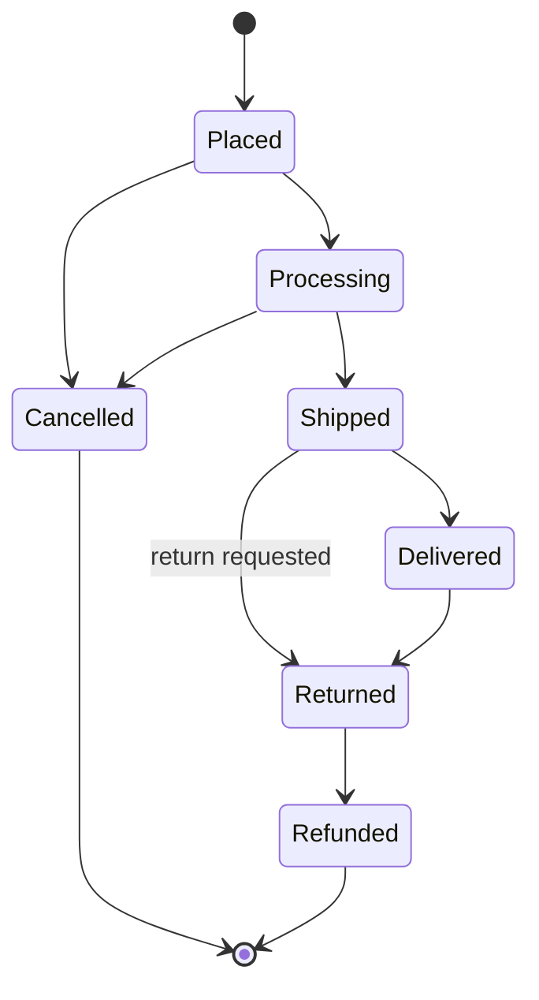

# Business Logic

Each workflow states what **exists** (`[VERIFIED EXISTING]`, with file) and what is **required**.

## 1. Product Workflow
1. Admin creates product → `AdminProductController@store` (`app/Http/Controllers/Admin/AdminProductController.php`). Slug = `Str::slug(slug|name)`, random 4-char suffix on collision; SKU auto `EB-SKU-####` if empty; images converted to WebP and stored via `ImageStorageService::uploadAsWebp` on the cloud disk; `is_active` is **always set true** on create (no draft state in form).
2. Variants synced by `syncProductVariants`; product `stock_count` becomes the **sum of variant stock**; `sizes` JSON is rebuilt from variant titles.
3. Cache `storefront_catalog_json` flushed; Scout index updated (`searchable()`).
4. Storefront shows only `is_active = true` (`ShopController`, `HomeController`, `SearchController`).
5. Customer views product → picks variant → Add to Bag (Alpine `Alpine.store('cart')`).

`[REQUIRED]` ~~Product status (draft/published) toggle, `is_active` input, `brand`, `subtitle`, `min_threshold`, `best_seller`, skin_types/benefits/key_ingredients inputs, `compare_at_price > price` validation (compare-at is the 'was' price and must exceed the selling price; allow NULL)[^compare-at], variant `price <= 0` guard.~~ **IMPLEMENTED (Phase 3)** via `StoreProductRequest`, `UpdateProductRequest`, `AdminProductController`, and `admin/products/create.blade.php`.

[^compare-at]: See IMPLEMENTATION_ROADMAP.md P3-2 (`gt:price`).

## 2. Shopping Cart Workflow
The cart lives **only in the browser** (`localStorage.everbloom_cart`), storing `{productId, variantId, qty}` (`resources/js/app.js`). Prices are derived at render from `window.__everbloomProducts` / `#everbloom-products-data` JSON, which is produced by `Product::toStorefrontArray()` (cached 1 h).

| Step | Current behaviour |
|---|---|
| Add | `cart.add()`; qty clamped 1–10; variant matched by size/title/id; unknown products ignored |
| Update/Remove | `updateQty`, `remove` |
| Validate status/price/stock | Client-side only against the cached catalog; **stock is not checked in the cart** |
| Subtotal | `Σ price × qty` (variant price) |
| Coupon | `applyDiscount()` looks up the code in `#everbloom-discounts-data` (active, non-expired coupons, cached 1 h). Does **not** call `POST /checkout/validate-coupon`; ignores `min_order_amount` and `usage_limit` |
| Shipping | `subtotal >= free_threshold` or shipping coupon → 0, else `standard_cost` (always Standard; checkout page adds Express) |
| Tax | none (always 0) |

`[REQUIRED]` Server-side cart recalculation endpoint (e.g. `POST /cart/quote`) returning authoritative lines, flash-sale prices, stock errors, coupon result and shipping. The server must always recompute; client numbers are display-only.

### Order of calculations (REQUIRED standard — implement in one service)
1. Line unit price = flash-sale price (if active & stock & limit allow) else variant price else product price.
2. Subtotal = Σ(line unit price × qty).
3. Coupon discount on eligible lines (see §6 for flash-sale interaction), capped by `max_discount` and subtotal.
4. Discounted subtotal = subtotal − discount.
5. Shipping from method/zone; free-shipping threshold evaluated on discounted subtotal `[UNRESOLVED DECISION D-12]` (D-12 = threshold before/after discount; D-09 = flat vs. district pricing — separate decisions); shipping coupon zeroes shipping.
6. Tax on (discounted subtotal [+ shipping]) `[UNRESOLVED D-10]`.
7. Total = 4 + 5 + 6, never below 0; round each step to 2 dp.

## 3. Checkout Workflow
`POST /checkout` → `CheckoutController@store` `[VERIFIED EXISTING]` (JSON API):
1. Validate: phone required, email optional, names, `district_id/thana_id/area_id` must exist **and be active and consistent**, `shippingMethod ∈ {standard, express}`, `paymentMethod ∈ {cod_demo, bkash_demo, nagad_demo, card_demo}`, `items.*.qty` 1–10, `items.*.productId` exists.
2. `DB::transaction`: for each line `Product::lockForUpdate()` → pick variant by size/title/id (falls back to **first variant** silently) → unit price from DB (client price ignored ✔) → decrement variant and product stock with `max(0, …)` → FIFO deduct `purchase_batch_items` → compute cost/profit snapshot.
3. Coupon: `Coupon::lockForUpdate()`; valid via `isValidForSubtotal`; percentage/fixed/shipping; `used_count++`.
4. Shipping: config rates `demo.site.shipping.*` (or `settings.site` override). **District `delivery_charge` is not used.** See **D-09** (shipping pricing model) and **D-12** (free-shipping threshold basis).
5. Order number = `EVB-` + (max id + 9205); creates `Order` (status `Placed`, payment_status **`Paid`**, tracking `Pending assignment`), `OrderItem`s, `Invoice` (status `Paid`). Cache flushed.
6. Response JSON `{success, order_number, redirect_url}`.

Known defects `[NEEDS IMPROVEMENT]`:
- The storefront page never calls this endpoint (`submitDemoOrder()` only sets `orderPlaced = true` and shows "Demo only. No order was placed.").
- Stock check: throws only if `stock_count < qty AND stock_status === 'out_of_stock'`; otherwise stock is clamped to 0 → **overselling is possible**. Must be `if ($available < $qty) throw`. The variant row is not locked (`lockForUpdate` applies to product only).
- Guest checkout is allowed per **D-02 (provisional)**; see OPEN_DECISIONS.md for sign-off status.
- Every order is `payment_status = Paid` regardless of method (COD should be `Pending`).
- Coupon usage is not per-customer; order-number/invoice-number generation uses `max(id)` (race → unique violation).
- No email/notification is sent.
- Saved-address checkbox `saveAddress` is ignored by the backend.

`[REQUIRED]` Extract `CheckoutService`/`OrderPlacementService`; replace demo payment values; add email confirmation (`Mail`/`Notification` queued); wire the page.

## 4. Order Lifecycle
Existing statuses (validated in `AdminOrderController@updateStatus`): `Placed, Processing, Shipped, Delivered, Cancelled`. Any value may be set from any value (no state machine).

`[REQUIRED]` Allowed transitions (above) enforced server-side; `Delivered`/`Cancelled` terminal for edits; `Cancelled` only before `Shipped` `[UNRESOLVED D-06]`; history row on each change; customer email on Shipped/Delivered.

Stock restoration on cancel `[VERIFIED EXISTING]` (`AdminOrderController` lines 76-106): adds qty back to product + variant and increments the **latest** `purchase_batch_items.remaining_qty` for the product (not the original batch FIFO rows; approximation) — runs only on transition into `Cancelled`; re-activating a cancelled order does **not** re-deduct stock `[NEEDS IMPROVEMENT]`. Also: restoring coupon `used_count` is not done.

Returns/refunds/partial refunds: **NOT IMPLEMENTED** (`[REQUIRED]` `order_returns`/`refunds` tables; restock only if item resellable `[UNRESOLVED D-07]`).

## 5. Payment Workflow
Existing: four **demo** method codes, no gateway, no verification, no transaction table. `payment_method` stores a label like `Cash on Delivery (Demo)`.
Required design:
- COD: order `payment_status=Pending`; marked `Paid` by admin on delivery/collection.
- Online: create order `Pending` → redirect to provider → provider webhook/IPN (signature verified, idempotent by `provider_txn_id`) → set `Paid` or `Failed`; failed payments release reserved stock after timeout (job).
- Duplicate prevention: unique `payment_transactions.provider_txn_id`; idempotency key per order.
- Refund: admin initiates against the provider API, stores `refunds` row, updates `payment_status` (`Refunded`/`Partially Refunded`).
Providers are **not chosen** (`[UNRESOLVED D-01]`; UI hints at bKash, Nagad, card, but nothing is integrated).

## 6. Coupon & Discount Workflow
Existing `Coupon::isValidForSubtotal`: active, not expired, `used_count < usage_limit`, `subtotal >= min_order_amount`. Types `percentage|fixed|shipping`.
Required: `starts_at`, `max_discount`, `per_customer_limit` (via `coupon_redemptions`), product/category scope, coupon code uniqueness case-insensitively (uppercase storage **claimed** — see D-27; verify against `AdminCouponController@store` before treating as ✔), usage increment inside the order transaction (✔ today), decrement on cancel.
Stacking: one coupon per order (current). Flash-sale interaction is **undecided** (`D-03`). Recommended default: coupons apply to non-flash-sale lines only (flash price is already discounted), flash lines excluded from percentage coupons; document in UI.

## 7. Inventory Workflow
- Purchase: `PurchaseBatchService::createBatch` (transaction, `lockForUpdate`) adds stock, updates weighted avg buy price over **available stock only**, creates batch rows (`remaining_qty = qty`).
- Sale: stock decremented in checkout; FIFO `deductFromAvailableBatches` lowers `remaining_qty` (if batches hold fewer units than sold, remainder silently ignored).
- Cancel: restores stock (see §4).
- Manual adjust: `AdminInventoryController@updateStock` overwrites `stock_count` (no delta, no reason, no history, variants untouched).
- Reservation: **not implemented** (stock reduced at order creation; online payments need a hold window `[UNRESOLVED D-05]`).
- Overselling prevention: partial (product row lock only). Required: lock variant rows, `UPDATE … SET stock_count = stock_count - ? WHERE stock_count >= ?` and check affected rows.

## 8. Flash Sale Workflow (all REQUIRED — see FLASH_SALE_MANAGEMENT.md)
Admin creates sale → selects products & sale price/stock/limits → schedules → scheduler (`schedule:run`, every minute) activates when `now ∈ [starts_at, ends_at)` and expires after → storefront shows discounted price & countdown → checkout re-validates price/stock/limit under lock → increments `sold_qty`, stores actual paid price in `order_items.price` plus `flash_sale_id`/`flash_sale_product_id` → expiry stops pricing immediately even before the job runs (price resolution checks timestamps, not just `status`). Cancel/refund returns `sold_qty` (and regular stock) `[UNRESOLVED D-04]`.

> **Resolution rule (authoritative):** `PriceResolver` treats `now ∈ [starts_at, ends_at)` AND `status != 'disabled'` as active regardless of whether the scheduler has synced `status`. The `status` column is a denormalised cache for admin UI only.

Current state: homepage "flash sale" is simply 4 products where `compare_at_price > price` plus an optional `settings.flash_sale` window (`enabled`, `starts_at`, `ends_at`) feeding a countdown. No pricing change occurs.

## 9. Customer Account Workflow `[VERIFIED EXISTING]` (`AccountController`)
- Register: mobile or email; first/last name, password min 8 + confirmed, terms; auto-login. Client-side password complexity (letter+number) is not enforced server-side.
- Login: by email (requires `status=Active`) or phone (digit-normalised comparison, loads all users) ; session regenerated; "remember me".
- Logout: `POST /account/logout` exists, but UI links point to `GET /account/login` (does **not** log out).
- Password reset: **stub** (no token/email).
- Profile/password/address CRUD/delete account: implemented via JSON. Account deletion hard-deletes the user (orders keep snapshot, `user_id` nulled).
- Wishlist: localStorage only. Order history: implemented.

