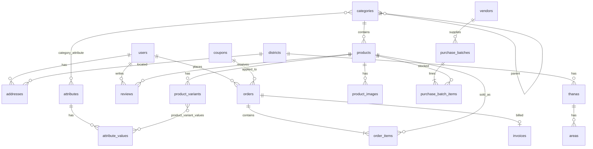

# Database Schema

Source of truth: `database/migrations/*` (16 consolidated files, inspected). **40 tables exist** (count includes framework tables `cache`, `cache_locks`, `jobs`, `job_batches`, `failed_jobs`; domain tables are listed in §1.1–§1.7). Production target is MySQL; local/test uses SQLite. Labels: `[VERIFIED EXISTING]` = read from a migration; `[PROPOSED]` = does not exist yet.

> Note: JSON columns and `->change()` calls (`users.email`, `addresses.*`) require `doctrine`-free Laravel 12 schema changes; they work on MySQL and SQLite.

## 1. Existing Tables `[VERIFIED EXISTING]`

### 1.1 Auth & framework
| Table | Columns (type, null, default) | Keys / Indexes |
|---|---|---|
| `users` | id; first_name varchar100; last_name varchar100; email varchar191 **nullable**; phone varchar40 null; avatar varchar255 null; avatar_source varchar40 default `local`; status varchar30 default `Active`; provider_name varchar40 null; provider_id varchar191 null; email_verified_at ts null; password; remember_token; timestamps | PK id; **unique(email)**; `users_phone_idx(phone)`; `users_status_idx(status)`. `phone_normalized` deferred (D-26). |
| `password_reset_tokens` | email PK, token, created_at | PK email |
| `sessions` | id PK, user_id null idx, ip_address, user_agent, payload, last_activity idx | |
| `admins` | id; name120; email191 unique; password; avatar null; avatar_source default `local`; role varchar50 default `super_admin`; is_active bool default 1; last_login_at null; remember_token; timestamps | unique(email) |
| `admin_password_reset_tokens` | email PK, token, created_at | unused by code |
| `cache`, `cache_locks`, `jobs`, `job_batches`, `failed_jobs` | Laravel defaults | |

### 1.2 Catalog
| Table | Columns | Keys |
|---|---|---|
| `categories` | id; parent_id FK→categories null `nullOnDelete`; level tinyint default 1; slug120 **unique**; name120; short_name60 null; tagline255 null; description text null; image null; image_source default `local`; sort_order int 0; is_active bool 1; meta_title varchar255 null; meta_description text null; timestamps | max depth 3 enforced only in `AdminCategoryController` |
| `products` | id; category_id FK→categories **restrictOnDelete**; slug160 unique; sku60 unique; name180; brand varchar255 null; subtitle255 null; price dec(10,2); compare_at_price dec(10,2) null; avg_buy_price dec(10,2) 0; last_buy_price dec(10,2) 0; rating dec(3,2) 5.00; review_count uint 0; short_description, description, ingredients, how_to_use text null; key_ingredients, benefits, skin_types, sizes, images JSON null; image_source40 `local`; stock_count int 25; min_threshold int 10; stock_status30 `in_stock`; batch_lot60 null; last_restocked_at date null; is_featured bool 0; best_seller bool 0; badge60 null; is_active bool 1; meta_title varchar255 null; meta_description text null; timestamps | `products_active_category_idx(is_active, category_id)`; `products_brand_idx(brand)`; `products_stock_status_idx(stock_status)`; `products_featured_idx(is_featured)`; `products_best_seller_idx(best_seller)`. |
| `product_images` | id; product_id FK cascade; image; image_source default `s3`; is_primary; sort_order | Duplicates `products.images` JSON (see §4) |
| `product_variants` | id; product_id FK cascade; size80; title180 null; attributes_json JSON null; sku80 null **unique** (`product_variants_sku_unique`); price; compare_at_price null; avg_buy_price 0; last_buy_price 0; stock_count int 25; stock_status; image null; image_source `local`; sort_order; is_active bool 1 | `product_variants_product_active_idx(product_id, is_active)` |
| `attributes` | id; name100; slug120 unique; display_type30 `button`; sort_order; is_active | |
| `attribute_values` | id; attribute_id FK cascade; value120; slug140; color_code30 null; sort_order; is_active | `attribute_values_attr_slug_unique(attribute_id, slug)` |
| `product_variant_values` | id; product_variant_id FK cascade; attribute_id FK cascade; attribute_value_id FK cascade | no unique composite |
| `category_attribute` | id; category_id FK; attribute_id FK; **unique(category_id, attribute_id)** | |

### 1.3 Customers & locations
| Table | Columns | Notes |
|---|---|---|
| `districts` | id; name120; bn_name null; slug120 unique; delivery_charge dec(10,2) **null**; sort_order; is_active | 64 seeded |
| `thanas` | id; district_id FK cascade; name; bn_name; slug140 **index**; sort_order; is_active | |
| `areas` | id; district_id FK cascade; thana_id FK cascade; name150; bn_name; postal_code20 null; sort_order; is_active | |
| `addresses` | id; user_id FK cascade; is_default; first_name; last_name; country60 `Bangladesh`; district_id/thana_id/area_id FK null `nullOnDelete`; district_name/thana_name/area_name varchar null; address_line1 **text**; phone40 **NOT NULL**; timestamps | **Code still references `$addr->label`, `address_line2`** (CheckoutController) – those attributes do not exist (silently null). |

### 1.4 Sales & Engagement
| Table | Columns | Notes |
|---|---|---|
| `coupons` | id; code60 **unique**; type30 (`percentage`,`fixed`,`shipping`); value dec(10,2) 0; max_discount dec(10,2) null; label; min_order_amount dec 0; usage_limit int null; per_customer_limit uint null; used_count int 0; is_active; starts_at ts null; expires_at ts null | |
| `coupon_redemptions` | id; coupon_id FK cascade; order_id FK cascade; user_id FK null `nullOnDelete`; email191 null; discount_amount dec(10,2) 0; timestamps | `coupon_redemptions_coupon_user_idx(coupon_id, user_id)`; `coupon_redemptions_coupon_email_idx(coupon_id, email)` |
| `coupon_product` | id; coupon_id FK cascade; product_id FK cascade; timestamps | `unique(coupon_id, product_id)` |
| `coupon_category` | id; coupon_id FK cascade; category_id FK cascade; timestamps | `unique(coupon_id, category_id)` |
| `orders` | id; order_number40 unique; user_id FK null nullOnDelete; coupon_id FK null nullOnDelete; customer_email191 **NOT NULL**; customer_phone40 null; status30 default `Placed`; current_step30 `Placed`; subtotal dec; discount_amount 0; discount_code60 null; shipping_cost 0; tax_amount 0; total dec; total_cost 0; total_profit 0; items_count uint 1; delivery_method (NOT NULL); payment_method (NOT NULL); payment_status30 default `Pending`; placed_via30 default `web`; tracking_number80 default `Pending assignment`; shipping_address JSON; notes text null; placed_at ts; timestamps | `orders_user_placed_idx(user_id, placed_at)`; `orders_status_idx(status)`; `orders_payment_status_idx(payment_status)`; `orders_placed_at_idx(placed_at)` |
| `order_items` | id; order_id FK cascade; product_id FK null nullOnDelete; product_variant_id FK null; name; slug160; variant80 null; image null; image_source; qty uint 1; price dec; original_price dec(10,2) null; unit_buy_price 0; line_total dec; line_cost_total 0; unit_profit 0; line_profit 0 | `order_items_product_idx(product_id)`. `price` + `original_price` snapshots ✔ |
| `order_status_histories` | id; order_id FK cascade; from_status30 null; to_status30; admin_id FK→admins null `nullOnDelete`; note text null; created_at ts null | `order_status_histories_order_created_idx(order_id, created_at)` |
| `invoices` | id; order_id FK cascade; invoice_no50 unique; customer_name160; customer_email191; amount dec; status30 `Paid`; payment_method; issued_at | |
| `reviews` | id; product_id FK cascade; user_id FK null; author120; author_email191 null; location120 null; variant80 null; rating utinyint; headline255; body text; verified bool 1; is_featured_testimonial bool 0; status30 default **`Approved`** — ⚠️ DEFECT: any non-controller insert (seeder/factory) bypasses moderation. Controller sets `Pending`. Fix: change default to `Pending` (see OPEN_DECISIONS.md D-17); timestamps | `reviews_product_status_idx(product_id, status)` |
| `wishlists` | id; user_id FK cascade; product_id FK cascade; timestamps | `unique(user_id, product_id)` |

### 1.5 Inventory costing
| Table | Columns |
|---|---|
| `vendors` | id; name150; company_name; phone; email; address; is_active |
| `purchase_batches` | id; batch_code60 unique; vendor_id FK cascade; vendor_name; reference_no; purchased_at date; total_qty; total_cost dec(12,2); notes; created_by FK→admins null `nullOnDelete` |
| `purchase_batch_items` | id; purchase_batch_id FK cascade; vendor_id FK cascade; product_id FK cascade; product_variant_id FK null; batch_lot; purchased_qty; remaining_qty; unit_buy_price; line_total_cost; idx `purchase_batch_items_product_rem_idx(product_id, remaining_qty)` |
| `stock_movements` | id; product_id FK cascade; product_variant_id FK null `nullOnDelete`; delta int; reason50; reference_type100 null; reference_id ubigint null; note text null; admin_id FK→admins null `nullOnDelete`; created_at ts null; idx `stock_movements_product_created_idx(product_id, created_at)` |
| `order_item_batches` | id; order_item_id FK cascade; purchase_batch_item_id FK cascade; qty uint; timestamps |

### 1.6 Content
| Table | Columns |
|---|---|
| `settings` | id; group60 `general`; key100 **unique**; value JSON; timestamps. Known keys in code: `site`, `flash_sale` (seeder/HomeController), `brands` (HomeController, never written by admin). |
| `contact_inquiries` | id; name120; email191; message text; status30 `unread` |
| `newsletter_subscribers` | id; email191 unique; is_active |

## 2. Entity Relationship Diagram (existing)

## 3. Missing Required Tables `[PROPOSED]`

| Table | Why | Key columns |
|---|---|---|
| `flash_sales` | Flash Sale module (see `admin-dashboard/FLASH_SALE_MANAGEMENT.md`) | id; title; slug unique; description; banner_image, image_source; starts_at, ends_at (indexed); status enum(draft,scheduled,active,expired,disabled); show_on_homepage bool; created_by; timestamps |
| `flash_sale_products` | Per-product sale price & caps | id; flash_sale_id FK cascade; product_id FK cascade; product_variant_id FK null; sale_price dec(10,2); sale_stock uint; sold_qty uint default 0; max_qty_per_customer uint null; is_active; **unique(flash_sale_id, product_id, product_variant_id)** |
| `brands` | Dedicated Brand CRUD | id; name; slug unique; logo, image_source; description; is_active; sort_order; + `products.brand_id` FK null (keep `products.brand` until migrated) |
| `payment_transactions` | Real payments | id; order_id FK; provider; provider_txn_id unique; amount; currency; status; payload JSON; verified_at |
| `refunds` / `order_returns` | Returns & refunds | order_id, order_item_id, qty, amount, reason, status |
| `order_status_histories` | Order history/audit | order_id, from_status, to_status, admin_id, note, created_at |
| `order_notes` (or reuse `orders.notes`) | Internal notes | |
| `stock_movements` | Stock history | product_id, variant_id, delta, reason(enum), reference_type/id, admin_id, created_at |
| `coupon_redemptions` | Per-customer usage & history | coupon_id, order_id, user_id null, email, discount_amount |
| `coupon_product` / `coupon_category` | Restrictions | pivot tables |
| `wishlists` | Server-side wishlist | user_id, product_id, unique(user_id, product_id) |
| `pages`, `banners`, `homepage_sections` | CMS | |
| `seo_meta` (polymorphic) or columns `meta_title`, `meta_description`, `og_image`, `canonical_url` on products/categories | SEO | |
| `shipping_methods`, `shipping_zones` (optional) | Replace hard-coded `standard`/`express` | |
| `roles`, `permissions`, `admin_activity_logs` | RBAC (or `admins.permissions` JSON if kept simple) | |

## 4. Duplicate / Unnecessary Structures `[RECOMMENDED IMPROVEMENT]`
1. `products.images` JSON **and** `product_images` table store the same data; storefront reads JSON, admin writes both. Pick one (prefer `product_images`).
2. `products.sizes` JSON duplicates `product_variants.size/title`; kept in sync manually in `AdminProductController::syncProductVariants`.
3. Stock is stored on both `products.stock_count` and `product_variants.stock_count`; checkout decrements both, admin inventory edits only the product. They can drift. Define variant as source of truth when variants exist.
4. `products.stock_status` is derived data (computed in several controllers with differing rules: `>threshold`, `>0`). Centralise in a model accessor.
5. `orders.status` + `orders.current_step` duplicate; `current_step` is not updated on cancel.
6. `orders.customer_email` is NOT NULL but checkout allows empty email (`''` stored) – works only because `''` is not NULL.
7. `admin_password_reset_tokens` unused.

## 5. Recommended Indexes `[RECOMMENDED IMPROVEMENT]`
- `products`: index(is_active, category_id), index(brand), index(stock_status), index(is_featured), index(best_seller).
- `orders`: index(user_id, placed_at), index(status), index(payment_status), index(placed_at).
- `order_items`: index(product_id).
- `users`: index(phone), index(status). Consider normalised `phone_normalized` unique-nullable column (current phone matching loads all users). [BLOCKED: see OPEN_DECISIONS.md D-26]
- `reviews`: index(product_id, status).
- `product_variants`: unique(sku) where not null; index(product_id, is_active).
- `purchase_batch_items`: index(product_id, remaining_qty).
- `attribute_values`: unique(attribute_id, slug).

## 6. Foreign-Key & Integrity Rules
- `products.category_id` currently **cascades on delete**: deleting a category deletes all its products (and via `order_items.product_id nullOnDelete`, orders keep snapshots). Change to `restrictOnDelete`, or block deletion in `AdminCategoryController::destroy` when products/children exist.
- `purchase_batches.created_by` should be FK→`admins.id` `nullOnDelete`.
- Orders must never hard-delete; no delete route exists (good).
- Money = `decimal(10,2)`; use integer minor units or `bcmath` helpers in new code; models cast to `float` (rounding risk).
- Flash-sale rules at DB level: `sale_price < products.price` (validate in app; MySQL CHECK cannot cross tables), `sold_qty <= sale_stock` via CHECK, atomic `UPDATE ... WHERE sold_qty + ? <= sale_stock`.

## 7. Migration Ordering Note
Default `database/seeders/DatabaseSeeder.php` seeds admin `admin@the-everbloom.com` / `password` — must be replaced for production (see SECURITY_AUDIT S-02). `FlashSaleSeeder` is **not** called from `DatabaseSeeder`.

