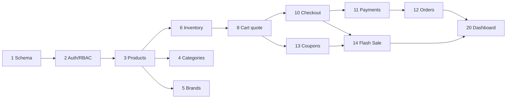

# Implementation Roadmap

Status values: `DONE` (verified), `PARTIAL`, `TODO`. Checklists: `[x]` done, `[ ]` open. Task IDs are stable references (`P<phase>-<n>`). Tests named here are specified in `TESTING_GUIDE.md`. Decisions blocking a task are `D-xx` from `OPEN_DECISIONS.md`.

Dependency order was adjusted from the suggested list: **security/AJAX prerequisites and checkout wiring come before payment**, and **Flash Sale comes after Inventory + Checkout + Coupons** because it hooks into price resolution and order items.

## Phase 0 — Prerequisites (do first)
- [x] **P0-1** Add `<meta name="csrf-token">` to `layouts/app.blade.php` & `layouts/checkout.blade.php`. *Files:* those two. *Accept:* profile/address AJAX returns 200 in browser.
- [x] **P0-2** Admin flash/validation alert partial in `layouts/admin.blade.php`. *Accept:* `session('success')` and `$errors` visible after any admin action.
- [x] **P0-3** Restrict `Route::resource` for products/categories with `->except('show')` (`routes/admin.php`). *Accept:* `GET /admin/products/1` → 404, not 500.
- [x] **P0-4** Replace `config('demo.products')` in `layouts/checkout.blade.php` with `$storefrontProductsJson` (via view composer: add `layouts.checkout` to the composer list in `AppServiceProvider`).

## Phase 1 — Database & schema preparation
| ID | Description | Status | Depends | Create | Update | DB | Acceptance |
|---|---|---|---|---|---|---|---|
| P1-1 | Indexes from DATABASE_SCHEMA §5 | DONE | – | consolidated into original `0001_01_01_000000..000011` migrations | – | indexes | `EXPLAIN` uses indexes on shop/orders queries |
| P1-2 | Fix category→products FK to restrict | DONE | – | consolidated into `0001_01_01_000005` (`products.category_id` `restrictOnDelete`) & `0001_01_01_000010` (`purchase_batches.created_by` FK) | `AdminCategoryController@destroy` (block if products/children) | FK change | Deleting category with products → validation error |
| P1-3 | Core new tables: `flash_sales`, `flash_sale_products`, `brands`, `payment_transactions`, `order_status_histories`, `stock_movements`, `order_item_batches`, `coupon_redemptions`, `wishlists` | PARTIAL | – | `0001_01_01_000012`..`000015` + models (`order_status_histories`, `stock_movements`, `order_item_batches`, `coupon_redemptions`, `wishlists`) | – | `brands` deferred (D-19); `flash_sales`/`flash_sale_products` deferred (D-03/D-04/D-08); `payment_transactions` deferred (D-01) | `migrate` passes on MySQL & SQLite |
| P1-4 | Coupon columns: `starts_at`, `max_discount`, `per_customer_limit`, pivot tables | DONE | P1-3 | `coupons` columns in `0001_01_01_000007`; `0001_01_01_000014_create_coupon_redemptions_and_scope_tables` | `Coupon` | `coupon_product`, `coupon_category`, `coupon_redemptions` | |
| P1-5 | `orders` adds `payment_status` default `Pending`, `placed_via`; `order_items` adds `original_price` (`flash_sale_id`/`flash_sale_product_id` deferred) | PARTIAL | P1-3 | consolidated into `0001_01_01_000008_create_orders_items_invoices_tables` | `Order`, `OrderItem` fillable | `flash_sale_*` columns deferred (D-03/D-04/D-08) | `orders.payment_status` defaults to `Pending`; `order_items.original_price` nullable |
| P1-6 | `users.phone_normalized` + index | TODO | D-26 | migration + backfill | `AccountController` | | phone login uses indexed lookup. *Blocked: D-26 (duplicate-phone handling) must be resolved before the unique index is added.* |
| P1-7 | Production seeder split (`ProductionSeeder` for admin only) | DONE | – | `ProductionSeeder` | `DatabaseSeeder` guard | | no demo data/credentials in production |

## Phase 2 — Authentication & authorization
- [x] **P2-1** Login throttling (`RateLimiter::for('login')`) for admin & customer. *Test:* `Phase2AuthAndSecurityTest`.
- [ ] **P2-2** Real password reset (customer broker `users` implemented with `password.reset`, `password.update`, `reset-password.blade.php`; admin broker `admins` + production mail delivery pending D-13). *Depends:* mail config (D-13).
- [x] **P2-3** POST logout forms (storefront account layout/overview).
- [ ] **P2-4** Admin RBAC: `config/admin_permissions.php`, `Gate::define`, `EnsureAdminPermission` (*Blocked:* D-14). Per-request `is_active` check implemented via `EnsureAccountIsActive`.
- [ ] **P2-5** Admin Users module (list/create/edit/deactivate/reset password; cannot delete last super_admin). *Blocked:* D-14.
- [x] **P2-6** `admin_activity_logs` + `LogAdminActivity` middleware on admin write routes.
- [x] **P2-7** Server password policy (`Password::defaults()`).
- [x] **P2-8** Remember-me default off on admin login (production `SESSION_SECURE_COOKIE` / `SESSION_ENCRYPT` env checklist remains for Phase 21).
- [ ] **P2-9** Social login (Socialite google/apple) — *Blocked:* D-15.
- [x] **P2-10** Review `IsolateAdminSession` middleware; confirmed cookie-name + path isolation (`everbloom_admin_session` at `/admin` vs `everbloom_user_session` at `/`), documented in `LARAVEL_ARCHITECTURE.md`.

## Phase 3 — Product management (`DONE` core)
- [x] **P3-1** Add form inputs: `brand` (free text, D-19 pending), `subtitle`, `min_threshold`, `best_seller`, `is_active`, `badge` free text, `skin_types`, `benefits`, `key_ingredients`, `stock_count` for non-variant product. *Files:* `admin/products/create.blade.php`, `AdminProductController@store/update`, `StoreProductRequest`, `UpdateProductRequest`.
- [x] **P3-2** Validation: `compare_at_price gt:price`, variant `price min:0.01`, variant SKU unique, image mimes/dimensions/max size (matches BUSINESS_LOGIC.md §1).
- [x] **P3-3** Product gallery management (delete individual images; append on upload instead of wiping all). Syncs `product_images` and `products.images`.
- [x] **P3-4** Pagination/search/sort/status filter in listing; bulk activate/deactivate/delete (`admin.products.bulk`).
- [ ] **P3-5** Soft deletes for products — *Blocked:* D-18. Order-referenced product deletion is blocked in `AdminProductController@destroy` & `bulkAction`; unreferenced deletes run in `DB::transaction`.
- [x] **P3-6** SEO fields (`meta_title`, `meta_description` on `products` & `categories`).
*Acceptance:* creating/editing every column in DATABASE_SCHEMA `products` from the UI; `Phase3ProductAndCategoryTest` passes.

## Phase 4 — Categories (`DONE`)
- [x] **P4-1** `is_active` & `sort_order` inputs; **P4-2** block delete when products/children exist; **P4-3** storefront category nav from DB (replace `config('demo.navigation')` and `config('demo.categories')` in header/footer/shop sidebar); **P4-4** image rendering on category page; **P4-5** SEO fields (`meta_title`, `meta_description`).

## Phase 5 — Brands (`DONE`)
- [x] **P5-1** `brands` table + `Brand` model + `AdminBrandController` (resource except show) + views `admin/brands/index|create` + sidebar entry.
- [x] **P5-2** migrate distinct `products.brand` strings → brands, add `products.brand_id`.
- [x] **P5-3** `/shop?brand=slug` & dedicated brand pages (`/brand/{slug}`).
- [x] **P5-4** homepage brands section reads `Brand::active()` (retire `settings.brands`).

## Phase 6 — Inventory (`DONE` core; P6-6 deferred)
- [x] **P6-1** `StockService` (atomic decrement/increment with locks) and use it in checkout, cancel, admin adjust.
- [x] **P6-2** `stock_movements` log on every change (+ history table in inventory page).
- [x] **P6-3** Variant-level adjust UI (`admin.inventory.adjustVariant`).
- [x] **P6-4** Low-stock alerts list/widget on inventory page.
- [x] **P6-5** Fix cancel restore to use original FIFO rows (`order_item_batches`).
- [ ] **P6-6** Reservation for online payments (*Blocked:* D-05).
*Test:* `Phase6InventoryTest`.

## Phase 7 — Customer management (`DONE`)
- [x] **P7-1** Search/filter/paginate (`AdminCustomerController@index`), **P7-2** status toggle (`Active/Inactive`) w/ per-request enforcement (`EnsureAccountIsActive`), **P7-3** remove fabricated labels (`VIP Botanical Member`, `Preferred Ritual`, `580 pts`), **P7-4** address & order stats real, **P7-5** export CSV (`admin.customers.export`).

## Phase 8 — Shopping cart (server authority) (`DONE`)
- [x] **P8-1** `POST /cart/quote` (`CartController@quote`) returning lines/prices/stock/coupon/shipping using `PriceResolver`.
- [x] **P8-2** Alpine cart store calls quote on open/change (keep localStorage lines).
- [x] **P8-3** Show stock limits & errors; qty max from stock.
## Phase 9 — Wishlist (`DONE`)
- [x] **P9-1** `wishlists` table, `WishlistController` (`GET/POST/DELETE /account/wishlist`), merge `localStorage` on login, guests keep local. Keep UI.

## Phase 10 — Checkout (`DONE` core; P10-3 & P10-7 pending decisions)
- [x] **P10-1** Wire checkout form to `POST /checkout` & `POST /checkout/validate-coupon` in `frontend/checkout/index.blade.php`.
- [x] **P10-2** Extract `PlaceOrderService` & `CheckoutRequest`; fix stock (`S-04`), strict variant (`S-05`), `payment_status = Pending`.
- [ ] **P10-3** District delivery charge/zones in `ShippingCalculator` (*Blocked:* D-09, D-12).
- [x] **P10-4** Save address option (`saveAddress` persisted for authenticated users).
- [x] **P10-5** Order-confirmation page (`checkout.confirmation`) + queued `OrderConfirmationMail` (external SMTP pending D-13).
- [x] **P10-6** Atomic order/invoice numbers (ULID suffix).
- [ ] **P10-7** Guest policy — provisional D-02 (awaiting owner sign-off; guest tracking pending D-28).

## Phase 11 — Payments (blocked by D-01)
- [ ] **P11-1** `PaymentGateway` interface + COD gateway (Pending → Paid by admin). **P11-2** Chosen provider(s): initiate, return URL, webhook route (excluded from CSRF **only** this one, signature-verified, idempotent). **P11-3** `payment_transactions`, failure/timeout handling job. **P11-4** Admin Payment Settings UI (enable methods, credentials via encrypted settings or env). **P11-5** Refund API integration.

## Phase 12 — Order management (`DONE` core; P12-4 deferred)
- [x] **P12-1** Transition map + history + `OrderStatusService`.
- [x] **P12-2** Pagination, date/search/payment filters.
- [x] **P12-3** Internal notes (`orders.notes`) UI.
- [ ] **P12-4** Return/refund workflow (*Blocked:* D-07).
- [x] **P12-5** Remove hard-coded labels (`Portland`, `Everbloom Client #428`, `Captured`, hard-coded `Paid` badge).
- [x] **P12-6** Real invoice number (`invoices.invoice_no`) on invoice page.
- [x] **P12-7** Customer emails on status change (`OrderStatusChangedMail`).
- [x] **P12-8** Remove `total_cost` / `total_profit` from `Order::toViewArray()` used on customer-facing pages; keep them only in `Order::toAdminArray()`.

## Phase 13 — Coupons (`DONE`)
- [x] **P13-1** Edit/update/toggle (`AdminCouponController@edit/update/toggle`).
- [x] **P13-2** `max_discount`, `starts_at`, `percentage <= 100`, `per_customer_limit` via `coupon_redemptions`, case-insensitive code uniqueness.
- [x] **P13-3** Product/category scope (`coupon_product`, `coupon_category`).
- [x] **P13-4** Usage history screen (`admin.coupons.history`).
- [x] **P13-5** Restore usage on cancel (`OrderStatusService`).
- [x] **P13-6** Cart/checkout use server quote (`CouponService`).

## Phase 14 — Flash Sale (see `admin-dashboard/FLASH_SALE_MANAGEMENT.md`)
- [ ] **P14-1** Models/migrations. **P14-2** `FlashSaleService` + `PriceResolver` integration (resolves price at cart quote & checkout). `PriceResolver` must ignore stale `status` when timestamps place the sale in-window (see BUSINESS_LOGIC §8). **P14-3** Scheduler command `flashsales:sync`. **P14-4** Admin list/create/edit/products/show/analytics views & routes. **P14-5** Storefront homepage section + product-card/product-page price & countdown & remaining stock; `/flash-sales` page for upcoming/active. **P14-6** Checkout lock/limit/`sold_qty`/order-item tracking. **P14-7** Cancel/refund adjustments (D-04). **P14-8** Analytics. **P14-9** Retire `settings.flash_sale` + "compare_at_price" heuristic in `HomeController`.
*Blocked decisions:* D-03, D-04, D-08.

## Phase 15 — Reviews
- [ ] **P15-1** Wire storefront form. **P15-2** Status `Rejected`, reject/delete/bulk actions, search/filter/paginate. Include migration to change `reviews.status` default to `Pending`. **P15-3** Verified-buyer detection, one per user/product. **P15-4** Admin reply (optional) & featured testimonial toggle. **P15-5** Show real rating breakdown (remove `config('demo.site.rating_breakdown')`, remove fallback to `config('demo.reviews')`).

## Phase 16 — CMS
- [ ] **P16-1** `pages` table + `AdminPageController` (about/privacy/terms/shipping/faq as DB pages; rich text sanitised with an allow-list, e.g. `strip_tags` + `Purifier`-like logic — avoid raw `{!! !!}` without sanitising). **P16-2** `banners` + `homepage_sections` (hero, promo, trust badges). **P16-3** Contact inquiries inbox (`contact_inquiries` list, mark read, reply by email) and Newsletter subscribers (export, unsubscribe). **P16-4** Wire the storefront forms (Phase 0 follow-up). **P16-5** FAQ CRUD. *Rewrite default copy to match store region (BD, BDT) — D-11.*

## Phase 17 — SEO
- [ ] **P17-1** Meta fields on products/categories/pages + admin inputs; layouts `@yield('meta_description')`, `og_image`, canonical already supported — feed from DB. **P17-2** `GET /sitemap.xml` (cached) and `robots.txt` dynamic or static in `public/`. **P17-3** Product JSON-LD brand/price/availability/reviews from real data (`ShopController`/view). **P17-4** Slug-redirect table when slugs change. **P17-5** Admin SEO overview page.

## Phase 18 — Store settings
- [ ] **P18-1** Logo & favicon upload (admin layout still uses template assets). **P18-2** Social links editor, store email/phone separation, timezone, tax settings fields. **P18-3** Server-side currency decimals/position inputs (`demo.site.currency.decimals` currently only editable via config). **P18-4** Replace USD/US defaults in settings Blade with BDT/BD defaults. **P18-5** Set `config('app.timezone')` from setting (D-10).
- [ ] **P18-6** Update test fixtures that assert USD strings when D-10/D-11 change defaults. *Accept:* `php artisan test` green after currency switch. *Ref:* TESTING_GUIDE §1.

## Phase 19 — Shipping
- [ ] **P19-1** Shipping methods table (name, ETA, cost, free threshold, active) replacing hard-coded `standard`/`express`. **P19-2** Zone pricing (district charge, per-weight optional) used by `ShippingCalculator` (D-09). **P19-3** Courier assignment & tracking number/URL, status events (Steadfast/Pathao appear only as demo strings: D-16). **P19-4** Admin Shipping Settings page grouping methods + locations. **P19-5** Customer order timeline from real `order_status_histories`.

## Phase 20 — Dashboard & analytics
- [ ] **P20-1** Replace in-memory `->get()` with aggregates. **P20-2** Date-range filter, real sales/revenue chart endpoint (JSON) for `dash-performance-chart`; real returning-customer rate; real customer distribution map (district-based). **P20-3** Pending/Processing/Completed counts separately; low-stock list; revenue = paid orders only. **P20-4** Flash Sale analytics cards. **P20-5** Real notifications (new orders, low stock, pending reviews) replacing static dropdown.

## Phase 21 — Security improvements
- [ ] Items S-01 … S-21 from `SECURITY_AUDIT.md`; add CSP/headers middleware; `composer audit`/`npm audit` in CI; remove `/styleguide`; production checklist.
- [ ] Ensure P12-8 (cost/profit leakage) and P22-6 (`Schema::hasTable`) are closed before launch.

## Phase 22 — Final testing & optimisation
- [ ] Full suite on MySQL; concurrency tests; Lighthouse/perf (slim catalog JSON, pagination, caching); backups/queue/scheduler runbook; accessibility regression of storefront; release checklist.
- [ ] **P22-6** Remove per-request `Schema::hasTable` calls in `AppServiceProvider::boot()` (guard with `app()->runningInConsole()` or delete after migrations stabilise). *Accept:* no `Schema::hasTable` queries on storefront requests. *Ref:* LARAVEL_ARCHITECTURE §11.

## Coverage check
Every unfinished module in PROJECT_OVERVIEW §4 maps to a phase: Products P3, Brands P5, Orders P12, Customers P7, Coupons P13, Flash Sale P14, Reviews P15, CMS P16, SEO P17, Settings P18, Payments P11, Shipping P19, Admin users P2, Dashboard P20, Wishlist P9, Checkout P10, Forms (contact/newsletter) P16-4/P0.

