# Flash Sale Management — The Everbloom

> **Module Status**: `PARTIALLY IMPLEMENTED` (Storefront countdown + seeder exist; **dedicated DB tables, Admin UI, backend CRUD, scheduler, and server-side checkout pricing are NOT IMPLEMENTED**).
> **Existing References**: [`database/seeders/FlashSaleSeeder.php`](file:///e:/laragon/www/the-everbloom/database/seeders/FlashSaleSeeder.php), [`app/Http/Controllers/HomeController.php`](file:///e:/laragon/www/the-everbloom/app/Http/Controllers/HomeController.php), [`resources/views/frontend/home.blade.php`](file:///e:/laragon/www/the-everbloom/resources/views/frontend/home.blade.php)

---

## 1. Module Overview
Flash Sale Management is a dedicated promotional campaign module that lets administrators schedule time-boxed discount events on selected products (or variants) with explicit campaign stock caps (`sale_stock`), per-customer purchase limits (`max_qty_per_customer`), automatic minute-by-minute activation/expiration, and real-time analytics—without ever mutating a product's regular price (`products.price`).

---

## 2. Business Purpose
- Drive urgency and conversion on curated skincare/beauty drops with visible countdown timers and remaining flash-stock indicators.
- Protect gross margins by capping units sold at the flash price (`sale_stock`), preventing bulk hoarding (`max_qty_per_customer`), and preserving exact historical purchase prices on `order_items`.
- Eliminate manual midnight toggles via deterministic server-side timestamp checks and scheduled status synchronization.

---

## 3. Existing UI Structure `[VERIFIED EXISTING]` vs. `[REQUIRED IMPLEMENTATION]`

### 3.1 Existing Storefront UI (`resources/views/frontend/home.blade.php`)
- Homepage renders a Flash Sale countdown banner driven by `settings` (`group = 'storefront'`, `key = 'flash_sale'`) and displays 4 products selected by the heuristic `compare_at_price > price`.
- **Gap**: No dedicated `/flash-sales` landing page, no per-product flash stock bar, and no server-side flash-sale price resolution in cart/checkout.

### 3.2 Missing Admin Dashboard UI `[REQUIRED IMPLEMENTATION — New Admin UI Required]`
No admin Blade views or routes exist for Flash Sales yet. Design new Larkon Bootstrap 5.3.3 views matching `admin/coupons/*` and `admin/products/*`:
1. **`resources/views/admin/flash-sales/index.blade.php`** — Campaign listing table with status filter tabs (`All`, `Active`, `Scheduled`, `Draft`, `Expired`, `Disabled`), search by title, columns: Banner thumbnail, Title, Schedule (`starts_at` → `ends_at`), Status badge, Products count, Units Sold, Created At, and Actions (`View / Analytics`, `Products`, `Edit`, `Activate/Deactivate`, `Delete`).
2. **`resources/views/admin/flash-sales/create.blade.php`** (shared with `edit` via `$isEdit`) — Campaign details form: Title, Slug (auto-generated), Description, Banner Image upload (WebP preview), `starts_at` & `ends_at` datetime pickers, `status` (`draft`, `scheduled`, `disabled`), and `show_on_homepage` switch.
3. **`resources/views/admin/flash-sales/products.blade.php`** — Product & Variant assignment screen: searchable product picker, table of assigned items showing Regular Price (read-only), Flash Sale Price input, auto-calculated Discount %, Available Warehouse Stock (read-only), `sale_stock` cap input, `max_qty_per_customer` input, `is_active` toggle, and Remove action.
4. **`resources/views/admin/flash-sales/show.blade.php`** — Campaign overview & Flash Sale Analytics (units sold, flash revenue, sell-through %, remaining stock, and participating order items).

---

## 4. Existing Implementation Status

| Component | Status | Notes |
|---|---|---|
| `FlashSaleSeeder` & `settings.flash_sale` | `VERIFIED EXISTING` | Stores `enabled`, `starts_at`, `ends_at` in `settings` table |
| Homepage Countdown & 4-item Showcase | `PARTIALLY IMPLEMENTED` | Uses `compare_at_price > price` heuristic in `HomeController` |
| `flash_sales` & `flash_sale_products` Tables | `NOT IMPLEMENTED` | Requires migrations (`P14-1`) |
| Admin Flash Sale CRUD & Product Assignment UI | `NOT IMPLEMENTED` | Requires new controller, routes, and Blade views (`P14-4`) |
| Automatic Scheduler (`flashsales:sync`) | `NOT IMPLEMENTED` | Requires console command & `routes/console.php` schedule (`P14-3`) |
| Server-Side `PriceResolver` & Checkout Locking | `NOT IMPLEMENTED` | Requires integration into `PriceResolver` and `PlaceOrderService` (`P14-2`, `P14-6`) |

---

## 5. Required Functionality

### 5.1 Flash Sale Listing
Display for each campaign:
- Flash Sale title & slug
- Description (truncated excerpt)
- Banner image thumbnail
- Start date and time (`starts_at`)
- End date and time (`ends_at`)
- Status badge (`Draft`, `Scheduled`, `Active`, `Expired`, `Disabled`)
- Number of assigned products (`products_count`)
- Total units sold (`SUM(sold_qty)`)
- Creation date (`created_at`)
- Actions: **View / Analytics**, **Manage Products**, **Edit**, **Activate / Deactivate**, **Delete**

### 5.2 Flash Sale Creation & Editing
Admin can:
- Create and edit a Flash Sale campaign
- Upload/replace a banner image (converted to WebP via `ImageStorageService`)
- Set sale title, optional slug, and description
- Set `starts_at` and `ends_at` (`ends_at > starts_at`)
- Configure initial status (`draft` or `scheduled` / `disabled`)
- Toggle `show_on_homepage` (`boolean`)

### 5.3 Flash Sale Product Management
Admin can:
- Select multiple existing active products (and optionally specific variants)
- View each item's current Regular Price and available warehouse `stock_count`
- Configure individual `sale_price` (`< regular_price` and `> 0`)
- View live-calculated Discount Percentage: `round(((regular_price - sale_price) / regular_price) * 100, 1)`
- Configure `sale_stock` (`<= available product/variant stock_count`)
- Set `max_qty_per_customer` (nullable; `>= 1` when set)
- Enable or disable (`is_active`) individual products within the sale, or remove them

### 5.4 Flash Sale Status Lifecycle & Auto-Sync
Supported statuses:
- `draft` — Incomplete campaign; never visible on storefront and never auto-activated.
- `scheduled` — Ready for launch; `starts_at` is in the future.
- `active` — Currently live (`starts_at <= now < ends_at`).
- `expired` — Past `ends_at` (`now >= ends_at`).
- `disabled` — Manually paused/stopped by admin; never auto-activated and never returns flash pricing.

**Automatic Activation & Expiration (`php artisan flashsales:sync`)**:
- Runs every minute via `routes/console.php` (`Schedule::command('flashsales:sync')->everyMinute()->withoutOverlapping()`):
  1. `scheduled` → `active` where `starts_at <= now()` and `ends_at > now()`.
  2. `scheduled` or `active` → `expired` where `ends_at <= now()`.
- **Authoritative Resolution Rule** (per `BUSINESS_LOGIC.md §8`): `PriceResolver` treats `now ∈ [starts_at, ends_at)` AND `status != 'disabled'` AND `status != 'draft'` as active even if the scheduler has not yet synced `status`. Expired sales stop discounting immediately at `ends_at`.

### 5.5 Flash Sale Business Logic & End-to-End Workflow

```mermaid
flowchart LR
    A["Admin Creates Sale (Draft/Scheduled)"] --> B["Assigns Products, Sale Prices, Stock Caps & Per-Customer Limits"]
    B --> C["Scheduler Activates at starts_at (or PriceResolver checks window)"]
    C --> D["Storefront Displays Flash Price, Countdown & Remaining Stock"]
    D --> E["Customer Adds to Bag & Checks Out"]
    E --> F["Checkout Locks flash_sale_products + product/variant, Validates Limits & Stock"]
    F --> G["Increments sold_qty, Deducts Stock, Snapshots Price & flash_sale_id on order_items"]
    G --> H["Scheduler / Timestamp Expires Sale at ends_at -> Reverts to Regular Price"]
```

### 5.6 Critical Business Rules
1. `sale_price` **must** be strictly lower than regular `price` (`sale_price < regular_price`) and `> 0`.
2. `sale_stock` **must not** exceed current available warehouse stock (`sale_stock <= stock_count`).
3. Regular `products.price` (and `product_variants.price`) **must never** be overwritten by a Flash Sale.
4. Flash sale discounts **must** be calculated server-side (`PriceResolver`); client-submitted prices are always ignored.
5. Expired or disabled sales **must never** provide discounted prices.
6. Sale availability **must** respect `starts_at <= now < ends_at`.
7. Overselling prevented using `DB::transaction(..., 3)` and `lockForUpdate()` on `flash_sale_products` + `products` + `product_variants`, plus atomic conditional update (`WHERE sold_qty + ? <= sale_stock`).
8. `order_items` **must** preserve actual paid `price`, `original_price`, `flash_sale_id`, and `flash_sale_product_id`.
9. Cancellation / refund `sold_qty` restoration follows **D-04** (`OPEN_DECISIONS.md`).
10. Overlapping active/scheduled sales on the same product/variant follow **D-08** (`OPEN_DECISIONS.md`).
11. Coupon + Flash Sale stacking follows **D-03** (`OPEN_DECISIONS.md`).
12. Per-customer purchase limits (`max_qty_per_customer`) are enforced across all non-cancelled orders for the customer (by `user_id` or normalized `customer_phone`/`customer_email` for guests) during the same `flash_sale_id`.

---

## 6. Database Tables `[PROPOSED]`

### 6.1 `flash_sales`
| Column | Type | Notes |
|---|---|---|
| `id` | `bigIncrements` | PK |
| `title` | `varchar(180)` | Required |
| `slug` | `varchar(200)` | Unique |
| `description` | `text` nullable | Campaign copy |
| `banner_image` | `varchar(255)` nullable | Stored path |
| `image_source` | `varchar(40)` default `'local'` | `'local'` or `'s3'` |
| `starts_at` | `timestamp` | Indexed (`starts_at`, `ends_at`, `status`) |
| `ends_at` | `timestamp` | Must be `> starts_at` |
| `status` | `varchar(20)` default `'draft'` | `draft`, `scheduled`, `active`, `expired`, `disabled` |
| `show_on_homepage` | `boolean` default `true` | Controls homepage widget |
| `created_by` | `foreignId` nullable | FK → `admins.id` `nullOnDelete` |
| `timestamps` | `timestamps` | |

### 6.2 `flash_sale_products`
| Column | Type | Notes |
|---|---|---|
| `id` | `bigIncrements` | PK |
| `flash_sale_id` | `foreignId` | FK → `flash_sales.id` `cascadeOnDelete` |
| `product_id` | `foreignId` | FK → `products.id` `cascadeOnDelete` |
| `product_variant_id` | `foreignId` nullable | FK → `product_variants.id` `cascadeOnDelete` |
| `sale_price` | `decimal(10,2)` | `< regular_price` |
| `sale_stock` | `unsignedInteger` | Max units available in flash sale |
| `sold_qty` | `unsignedInteger` default `0` | Atomically incremented on checkout |
| `max_qty_per_customer` | `unsignedInteger` nullable | Per-customer cap |
| `is_active` | `boolean` default `true` | Item-level toggle |
| `timestamps` | `timestamps` | Unique `(flash_sale_id, product_id, product_variant_id)` |

### 6.3 `order_items` Additions
- `flash_sale_id` (`foreignId` nullable, `nullOnDelete`)
- `flash_sale_product_id` (`foreignId` nullable, `nullOnDelete`)
- `original_price` (`decimal(10,2)` nullable; backfilled to `price` for existing rows)

---

## 7. Model Relationships
- `FlashSale`:
  - `items()` → `hasMany(FlashSaleProduct::class)`
  - `products()` → `belongsToMany(Product::class, 'flash_sale_products')->withPivot([...])`
  - `creator()` → `belongsTo(Admin::class, 'created_by')`
  - `scopeLive($query)`: `whereNotIn('status', ['draft', 'disabled'])->where('starts_at', '<=', now())->where('ends_at', '>', now())`
- `FlashSaleProduct`:
  - `flashSale()` → `belongsTo(FlashSale::class)`
  - `product()` → `belongsTo(Product::class)`
  - `variant()` → `belongsTo(ProductVariant::class, 'product_variant_id')`
  - Accessor `remainingStock`: `max(0, $this->sale_stock - $this->sold_qty)`
- `Product`:
  - `flashSaleProducts()` → `hasMany(FlashSaleProduct::class)`
- `OrderItem`:
  - `flashSale()` → `belongsTo(FlashSale::class)`
  - `flashSaleProduct()` → `belongsTo(FlashSaleProduct::class)`

---

## 8. Controller Requirements
- **`AdminFlashSaleController`** (`app/Http/Controllers/Admin/AdminFlashSaleController.php`):
  - `index(Request $request)` — Paginated listing with status tabs, search, and aggregated `products_count` & `sold_qty`.
  - `create()` / `store(StoreFlashSaleRequest $request)` — Create campaign + WebP banner upload.
  - `show(FlashSale $flashSale)` — Analytics & order items breakdown.
  - `edit(FlashSale $flashSale)` / `update(UpdateFlashSaleRequest $request, FlashSale $flashSale)` — Update campaign details & banner.
  - `toggleStatus(FlashSale $flashSale)` — Toggle between `disabled` and `scheduled`/`active` (based on timestamps).
  - `products(FlashSale $flashSale)` — Show product assignment screen.
  - `syncProducts(SyncFlashSaleProductsRequest $request, FlashSale $flashSale)` — Add/update/toggle assigned products, validate `sale_price < regular_price`, `sale_stock <= stock_count`, and overlap rule (**D-08**).
  - `destroy(FlashSale $flashSale)` — Block deletion if any `order_items` reference it (suggest `disabled` instead); otherwise delete + remove banner image.

---

## 9. Route Requirements

| Method | URI | Route Name | Action |
|---|---|---|---|
| `GET` | `/admin/flash-sales` | `admin.flash-sales.index` | `AdminFlashSaleController@index` |
| `GET` | `/admin/flash-sales/create` | `admin.flash-sales.create` | `AdminFlashSaleController@create` |
| `POST` | `/admin/flash-sales` | `admin.flash-sales.store` | `AdminFlashSaleController@store` |
| `GET` | `/admin/flash-sales/{flashSale}` | `admin.flash-sales.show` | `AdminFlashSaleController@show` |
| `GET` | `/admin/flash-sales/{flashSale}/edit` | `admin.flash-sales.edit` | `AdminFlashSaleController@edit` |
| `PUT` | `/admin/flash-sales/{flashSale}` | `admin.flash-sales.update` | `AdminFlashSaleController@update` |
| `POST` | `/admin/flash-sales/{flashSale}/toggle` | `admin.flash-sales.toggle` | `AdminFlashSaleController@toggleStatus` |
| `GET` | `/admin/flash-sales/{flashSale}/products` | `admin.flash-sales.products` | `AdminFlashSaleController@products` |
| `POST` | `/admin/flash-sales/{flashSale}/products` | `admin.flash-sales.products.sync` | `AdminFlashSaleController@syncProducts` |
| `DELETE` | `/admin/flash-sales/{flashSale}` | `admin.flash-sales.destroy` | `AdminFlashSaleController@destroy` |
| `GET` | `/flash-sales` *(Storefront)* | `flash-sales.index` | `FlashSaleController@index` |

---

## 10. Validation Rules
- **Campaign (`StoreFlashSaleRequest` / `UpdateFlashSaleRequest`)**:
  - `title`: `required|string|max:180`
  - `slug`: `nullable|string|max:200|unique:flash_sales,slug,{id}`
  - `description`: `nullable|string|max:2000`
  - `banner_image`: `nullable|image|mimes:jpg,jpeg,png,webp|max:5120`
  - `starts_at`: `required|date`
  - `ends_at`: `required|date|after:starts_at`
  - `status`: `required|in:draft,scheduled,disabled` (cannot manually force `expired`; `active` is derived from `scheduled` + window)
  - `show_on_homepage`: `boolean`
- **Product Assignment (`SyncFlashSaleProductsRequest`)**:
  - `items`: `required|array|min:1`
  - `items.*.product_id`: `required|integer|exists:products,id`
  - `items.*.product_variant_id`: `nullable|integer|exists:product_variants,id`
  - `items.*.sale_price`: `required|numeric|min:0.01` + custom rule `< regular_price`
  - `items.*.sale_stock`: `required|integer|min:1` + custom rule `<= available_stock`
  - `items.*.max_qty_per_customer`: `nullable|integer|min:1`
  - `items.*.is_active`: `boolean`

---

## 11. Authorization Requirements
- Protected by `auth:admin` and Gate `manage-flash-sales` (allowed for `Super Admin` and `Manager`).

---

## 12. CRUD Operations
- Full campaign CRUD + item-level assignment/sync + status toggle.
- After any mutation, flush `storefront_catalog_json` and homepage flash sale caches.

---

## 13. Search and Filtering
- Filter campaigns by `status` (`all`, `active`, `scheduled`, `draft`, `expired`, `disabled`).
- Search campaigns by `title` or `slug`.

---

## 14. Sorting and Pagination
- Default sort: active/scheduled first, then `starts_at DESC`; paginated 15 per page.

---

## 15. Image and File Upload Requirements
- Banner image uploaded through `ImageStorageService::uploadAsWebp($file, 'flash-sales', $slug)`.
- Delete previous banner via `ImageStorageService::delete()` when replaced or when an unused draft campaign is deleted.

---

## 16. Frontend Integration
- **Homepage (`HomeController@index`)**: Query live `FlashSale` where `show_on_homepage = true`, passing campaign `ends_at` to the Alpine countdown timer and rendering only active `flash_sale_products` with `sold_qty < sale_stock`.
- **Product Cards & Product Detail (`ShopController`)**: Resolve active flash price via `PriceResolver`, show strikethrough `original_price`, discount badge, and remaining flash stock indicator.
- **Cart & Checkout (`PriceResolver` + `PlaceOrderService`)**: Recompute unit prices server-side; if flash stock is exhausted or per-customer limit is exceeded at checkout, fall back to regular price or return `422` with a clear line-item error.
- **Retire Legacy Heuristic (`P14-9`)**: Remove `settings.flash_sale` usage and `compare_at_price > price` fallback from `HomeController@index`.

---

## 17. Error Handling
- Concurrent checkout exhausting `sale_stock`: throw `FlashSaleLimitExceededException` (HTTP `422`) with exact product name and remaining flash units.
- Overlapping active/scheduled sale on the same product: return `422` validation error naming the conflicting campaign (per **D-08**).

---

## 18. Security Requirements
- Never trust client-submitted `sale_price` or `flash_sale_id` in `/cart/quote` or `/checkout`.
- Enforce `max_qty_per_customer` inside the checkout `DB::transaction` using row locks so parallel requests cannot bypass the limit.

---

## 19. Testing Scenarios
1. **Validation**: `sale_price >= regular_price` → 422; `sale_stock > product.stock_count` → 422; `ends_at <= starts_at` → 422.
2. **Timestamp Precedence**: Campaign in-window (`starts_at <= now < ends_at`) with `status = 'scheduled'` still resolves flash price in `PriceResolver`.
3. **Scheduler Sync**: `php artisan flashsales:sync` transitions `scheduled → active` and `active → expired` idempotently.
4. **Checkout & Concurrency**: 2 orders competing for `sale_stock = 1` → only 1 succeeds at flash price; `order_items` stores `flash_sale_id`, `flash_sale_product_id`, `price`, and `original_price` without altering `products.price`.
5. **Per-Customer Limit**: `max_qty_per_customer = 2`; ordering 2 succeeds, subsequent order for 1 more is blocked/priced regularly.

---

## 20. Remaining Implementation Checklist
- [ ] Resolve open decisions **D-03** (coupon + flash sale stacking), **D-04** (cancel/refund `sold_qty` restoration), and **D-08** (overlapping product sales) in `docs/OPEN_DECISIONS.md`.
- [ ] Create `flash_sales`, `flash_sale_products`, and `order_items` flash-sale columns migrations + Eloquent models (`P14-1`).
- [ ] Implement `FlashSaleService` and integrate with `PriceResolver` (`P14-2`).
- [ ] Create `flashsales:sync` Artisan command and register every-minute schedule in `routes/console.php` (`P14-3`).
- [ ] Build `AdminFlashSaleController`, Form Requests, routes, sidebar link, and 4 Larkon Blade views (`P14-4`).
- [ ] Update storefront homepage, `/flash-sales` page, product cards, cart quote, and `PlaceOrderService` (`P14-5`, `P14-6`, `P14-7`, `P14-9`).
- [ ] Write unit, feature, integration, and MySQL concurrency tests (`TESTING_GUIDE.md §2–4`).

